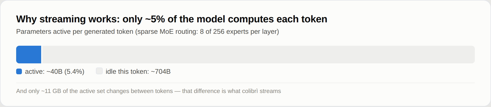
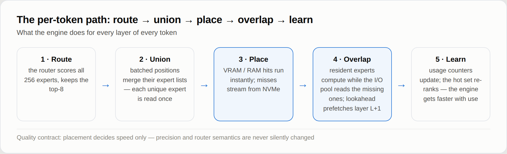
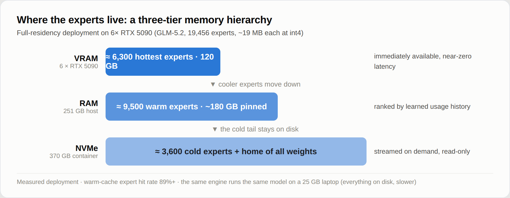
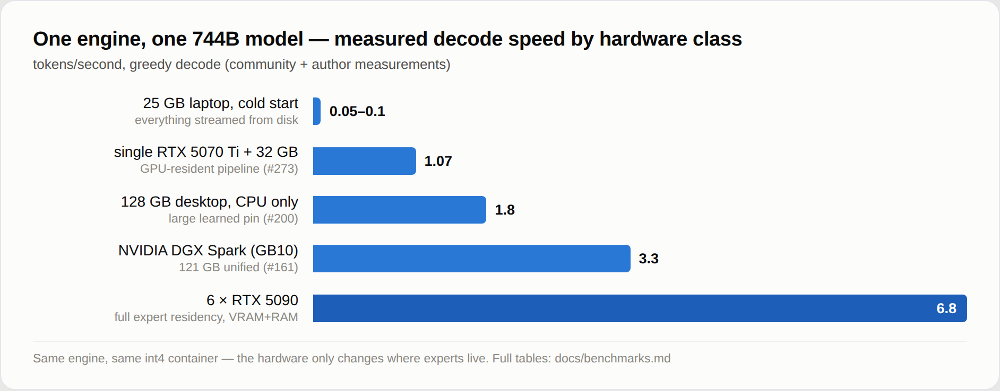

<p align="center">
  
</p>

<p align="center">
  <a href="https://justvugg.github.io/colibri"></a>
  <a href="https://github.com/Developer3000S/colibri-rus/releases"></a>
</p>

<p align="center">
  <a href="https://justvugg.github.io/colibri"><b>Веб-сайт</b></a> ·
  <a href="https://discord.gg/RXV83nSZdk"><b>Discord</b></a> ·
  <a href="README.md">English</a> · **Русский** · <a href="README.zh-CN.md">简体中文</a> · <a href="README.zh-TW.md">繁體中文</a> · <a href="README.it.md">Italiano</a> · <a href="README.ja.md">日本語</a> · <a href="README.id.md">Bahasa Indonesia</a> · <a href="README.pt-BR.md">Português (Brasil)</a>
</p>

**Крошечный движок, огромная модель.** colibri запускает очень большие открытые модели на
машине, которая у вас уже есть. Модель со смесью экспертов на сотни миллиардов
параметров использует для каждого токена лишь малую их часть, поэтому colibri держит
эту часть в оперативной памяти, а остальное — экспертов — читает с диска, когда модель
их запрашивает. Чистый C, один файл на семейство моделей, GPU не требуется.

Сегодня работают тринадцать движков. Десять — для языковых моделей: **GLM-5.2/5.3** (на них
также работает **Mistral-Large-4**), **GLM-5.3-Flash**, **Inkling**, **Kimi K3**,
**DeepSeek V4 Flash**, **DeepSeek V4.1 Flash**, **MiMo-V2.6 Flash** (и Pro),
**Qwen3.8-Flash-Next**, **Qwen3.6** (на нём также работают Qwen3-Coder, плотная
Qwen3.8-27B, **Flint**, **Muse Spark Open** и **LFM3-VL**) и **OLMoE**. Один
рисует картинки: **Qwen-Image-2.1**. Два принимают решения: **Laya** и
**GLiNER2.5-Decide**, а третья модель принятия решений, **Clef**, работает на движке Qwen3.6.
Языковые модели также запускаются из уже опубликованных файлов GGUF —
как есть ([GGUF](docs/ru/gguf.md)), на CPU, на любом GPU через Vulkan
и на картах NVIDIA через CUDA. [Какую выбрать для моей машины](#which-model-for-my-machine)

```
$ ./coli chat
  colibri v2.1.0 · GLM-5.2 · 744B MoE · int4 · streaming CPU
  ✓ ready in 32s · resident 9.9 GB
  › ciao!
  ◆ Ciao! Come posso aiutarti oggi?
```

<p align="center">
  <a href="https://www.buymeacoffee.com/justvugg"></a>
  <br>
  <sub>colibri бесплатен и имеет открытый исходный код. Если он занял место на вашей машине, кофе поможет оплатить следующий движок и следующее ускорение.</sub>
</p>

<a id="get-started"></a>
<a id="the-one-step-way"></a>

<a id="get-started-in-one-step"></a>
## Начните за один шаг

Вам нужен компьютер как минимум с **8 ГБ ОЗУ** (16 ГБ или более
лучше), **22 ГБ свободного места на диске** для самой маленькой модели и доступ в Интернет.
соединение. Видеокарта не является обязательной.

**Windows**

1. На этой странице нажмите **Код**, затем **Загрузить ZIP** и разархивируйте его.
2. Дважды щелкните **`START-HERE.bat`** в разархивированной папке. Если Python
   отсутствует, он предлагает установить его для вас.

**Linux** (Ubuntu и Debian; в других дистрибутивах такие же пакеты находятся под
свои имена)

```bash
sudo apt install git python3 build-essential
git clone https://github.com/Developer3000S/colibri-rus
cd colibri
./start-here.sh
```

**macOS** (с [Homebrew](https://brew.sh))

```bash
xcode-select --install
brew install libomp git python
git clone https://github.com/Developer3000S/colibri-rus
cd colibri
./start-here.sh
```

Вы отвечаете на один вопрос, какая модель, и Enter принимает рекомендацию. Тогда
установка:

1. **просматривает вашу машину**: оперативную память, свободный диск, процессор и графический процессор;
2. **рекомендует подходящую модель**: часть модели, которая всегда остается
   Оперативная память плюс минимальный кэш экспертов должны поместиться в вашей оперативной памяти, а загрузка
   на вашем диске;
3. **получает движок**: он собирает его для вашей машины, когда есть компилятор,
   в противном случае он загружает готовый вариант, который работает на CPU и в Linux.
   и Windows, а также на графическом процессоре Vulkan. Он строит
   для вашего графического процессора, когда это окупается: CUDA для карты NVIDIA в Linux, если установлен набор инструментов CUDA,
   иначе Vulkan. На дискретном графическом процессоре это всегда так; на встроенном графическом процессоре,
   который разделяет оперативную память CPU, только для моделей, измеряемых там быстрее
   (Qwen3.6, Qwen3-Coder и Qwen3.8-Flash-Next). Если пакет отсутствует
   печатает точную команду для ее установки и продолжает работу с процессором; запуститьПосле этого выполните повторную настройку, и он перестроится для графического процессора;
4. **загружает модель** с прогрессом и возобновлением: остановите ее, когда захотите,
   запустите его еще раз, и он продолжится с того места, где остановился;
5. **запускает colibri, открывает панель управления** в браузере и распечатывает
   адреса, которые могут использовать другие приложения:

```
Starting colibri
  Browser:             http://127.0.0.1:8000/
  OpenAI base URL:     http://127.0.0.1:8000/v1
  Anthropic base URL:  http://127.0.0.1:8000
  stop: press Ctrl+C here (or close this window)
```

**В следующий раз** снова запустите `START-HERE.bat` или `./start-here.sh`: запустится colibri
сразу, без загрузки и сборки. `c/coli status` показывает, что такое
установлен и работает ли он, `c/coli stop` останавливает его (`c\coli.cmd status` и
`c\coli.cmd stop` в Windows).

Варианты идут после `./start-here.sh` или `START-HERE.bat`:

| Вариант | Что он делает |
|---|---|
| `--list` | каждая модель против этой машины и почему одна не подходит |
| `--model ID` | установите эту модель (идентификаторы указаны в [таблицах ниже](#which-model-for-my-machine)) |
| `--yes` | вопросов нет: воспользуйтесь рекомендацией |
| `--dir DIR` | поместить модели на другой диск (по умолчанию `~/colibri-models`) |
| `--backend vulkan`, `cuda` или `cpu` | выбрать конструкцию движка самостоятельно; `--no-gpu` это `--backend cpu` |
| `--model-dir DIR` | используйте уже скачанную модель |
| `--reconfigure` | выбрать другую модель |

Подробное описание каждого шага: [docs/quickstart.md](docs/ru/quickstart.md#the-one-step-way).

<a id="if-something-goes-wrong"></a>
### Если что-то пойдет не так

| Что вы видите | Что делать |
|---|---|
| остановилось во время загрузки | запустите ту же команду еще раз: она возобновляется с уже имеющихся на диске байтов |
| `to use the GPU through ..., first run: <command>` | запустите эту команду, затем повторите настройку: она перестраивается для графического процессора и больше не загружается |
| `the ... build failed`, например `Unsupported gpu architecture`, когда установленный набор инструментов CUDA больше не поддерживает карту | установка сначала сверяет набор инструментов с картой и сама выбирает Vulkan, объясняя, почему; если сборка по-прежнему не удалась, он предлагает следующую (Vulkan, затем процессор). `./start-here.sh --backend vulkan` силы Vulkanа; `--no-gpu` остается на процессоре |
| `needs N GB free for the download` | `--dir` с папкой на диске большего размера |
| в WSL папка модели находится под `/mnt/c` | сохраните его на диске Linux (по умолчанию `~/colibri-models`): `/mnt/c` во много раз медленнее |
| вы обновили кассу (`git pull`) | запустите `./start-here.sh` еще раз: он пересобирает движок при изменении исходных кодов, а затем запускает его |
| что-нибудь еще | `c/coli logs -n 50` показывает журнал сервера, запущенного в фоновом режиме (сервер, запущенный на переднем плане, печатается на свой собственный терминал) и `c/coli logs --install` настройки; откройте [проблему](https://github.com/Developer3000S/colibri-rus/issues) с последними строками, напечатанными установкой |

<a id="let-your-ai-assistant-set-it-up"></a>
### Пусть ваш ИИ-помощник настроит это

Если вы используете помощника по программированию с искусственным интеллектом, он может сделать все это за вас. Спросите это:

> Настройте colibri на этом компьютере, следуя инструкциям docs/AI_SETUP.md от https://github.com/Developer3000S/colibri-rus.

[docs/AI_SETUP.md](docs/ru/AI_SETUP.md) показывает помощнику каждый шаг в виде
команда с машиночитаемым результатом и просит ее спросить вас перед этим
загружает модель или устанавливает системный пакет. Помощники, говорящие на модели
Вместо этого протокол контекста может использовать сервер MCP colibri: `coli mcp` предлагает инструменты
обнаружить оборудование, порекомендовать модель, установить, запустить, остановить и проверить его
([docs/MCP_SERVER.md](docs/ru/MCP_SERVER.md)).

<a id="or-by-hand"></a>
### Или вручную

Чтобы выбрать каждый шаг самостоятельно (готовый выпуск или сборка исходного кода, любая модель
из таблиц ниже, затем `coli chat`, `coli web` или `coli serve`), см.
[Установить вручную](#install-by-hand) или
[Краткое руководство](docs/ru/quickstart.md) для каждой платформы, пошаговое руководство.

<a id="what-colibri-is-and-why"></a>
## Что такое colibri и почему

Модель, состоящая из нескольких экспертов, огромна на диске и мала на токене. GLM-5.2 имеет
744B, на каждый токен используется около 40B, из них всего около 11 ГБ.
переход от одного токена к другому: перенаправленные эксперты.

<p align="center">
  
</p>Таким образом, модель не обязательно должна помещаться в быструю память; его необходимо **разместить**.
плотная часть (внимание, общие эксперты, вложения) остается в оперативной памяти. Маршрутизированный
эксперты остаются на диске и считываются, когда маршрутизатор запрашивает их, через
кэш, который узнает, какие эксперты используются в вашей работе. Графический процессор, если он есть, хранит
самые горячие эксперты и плотные слои. То, где находится гиря, меняется так быстро
приходит ответ, а не то, какие веса или какие решения маршрутизатора его создают.

Зачем: запускать модели такого размера на уже имеющемся оборудовании и наблюдать за ними.
работать (на приборной панели отображается каждый эксперт, когда он срабатывает), и поддерживать движок
достаточно мал, чтобы каждый мог его измерить и сделать быстрее. colibri также является
открытая исследовательская платформа: оптимизация занимает свое место благодаря воспроизводимому
сквозное измерение, а политика по умолчанию никогда не меняет модель молча
точность или семантика маршрутизатора. Менее быстрая память может стоить скорости; это не должно
тихо переопределить модель. [Как это работает](#how-it-works) содержит подробности.

<a id="which-model-for-my-machine"></a>
## Какая модель для моей машины

Программа установки рекомендует наиболее мощную модель, которая работает из оперативной памяти вашего компьютера.
машине, и перечисляет более крупные из них, которые передаются с диска прямо под ним.
`./start-here.sh --list` показывает их всех против вашей машины. Таблицы следуют
собственный каталог установки ([`c/setup_catalog.py`](c/setup_catalog.py)); тот
загрузки — это размеры списков Hugging Face для каждого репозитория.

- **RAM** - это две цифры: ниже первой модель не запускается, с
  во-вторых, он работает как измерено.
- **GPU** — это то, что установка может построить для этого движка ([GPUs](#gpus)).
  *Тоже интегрированный* означает, что он также использует встроенный графический процессор, в котором эти движки
  измерялись быстрее; остальные используют только дискретный графический процессор.
- **Измеренная** – это время, измеренное на указанной машине, скорость декодирования для
  модели чата. Буквы — это машины, перечисленные под таблицами. Пустой означает
  никто еще не измерял.

**Маленькие модели, работающие из оперативной памяти**

| Модель | `--model` | Скачать | ОЗУ | графический процессор | Измерено |
|---|---|---|---|---|---|
| **Qwen3.6-35B-A3B**: чат с мышлением и инструментами | `qwen36-35b` | 23 ГБ | 10/20 ГБ | CUDA, Vulkan (тоже интегрирован) | 6.0 tok/s на CPU, 9.9 с Vulkan на встроенном графическом процессоре (A); 30.0 с CUDA (C) |
| Qwen3-Coder-30B-A3B: вызовы кода и инструментов, никаких раздумий | `qwen3-coder-30b` | 19 ГБ | 8/18 ГБ | CUDA, Vulkan (тоже интегрирован) | 8.5-9.6 tok/s с каждым экспертом в ОЗУ, 5.1 с 32 на слой (A, CPU) |
| **Qwen-Image-2.1**: текст в картинку, некоммерческая лицензия | `qwen-image-2.1` | 33 ГБ | 12/18 ГБ | Vulkan | одна картинка 768х512 за 2 мин 40 с (8 Zen 4 ядра, CPU) |

**Большие модели, специалисты которых стримят с диска** (диск задает скорость:
быстрый диск NVMe помогает больше всего)

| Модель | `--model` | Скачать | ОЗУ | графический процессор | Измерено |
|---|---|---|---|---|---|
| DeepSeek V4 Flash REAP 150B: 132 из 256 экспертов | `deepseek-v4-flash-reap` | 85 ГБ | 16/32 ГБ | CUDA, Vulkan | |
| **DeepSeek V4 Flash** (284B): инструменты | `deepseek-v4-flash` | 167 ГБ | 16/32 ГБ | CUDA, Vulkan | 0,93 tok/s с 32 ГБ (Ryzen 7 5800X), 1,24 с 63 ГБ (Ryzen 9 5950X), только процессор; 1.5-1.6 с CUDA (RTX 5080, 32 ГБ, два NVMe) |
| **MiMo-V2.6 Flash** (309B): изображения и инструменты | `mimo-v2.6-flash` | 172 ГБ | 32/52 ГБ | Vulkan | 2,34-3,37 tok/s (А, CPU) || **Qwen3.8-Flash-Next** (125B + 51B n-gram): изображения и инструменты | `qwen38-flash-next` | 186 ГБ | 24/32 ГБ | CUDA, Vulkan (тоже интегрирован) | 1,91-2,56 tok/s с 32-96 экспертами на слой; 3.99 с дополнительными экспертами int4 (A, CPU) |
| **GLM-5.2** (744B): эталонная модель с головкой MTP | `glm-5.2` | 429 ГБ | 16/24 ГБ | CUDA, Vulkan | 0,05-0,1 tok/s холодная на ноуте 25 Гб; 1,83 на Ryzen AI Max+ 395 объемом 128 ГБ; 9,0–9,2 на 6x RTX 5090 |
| GLM-5.3 (744B): движок тот же, головки MTP нет | `glm-5.3` | 419 ГБ | 16/24 ГБ | CUDA, Vulkan | |
| **Inkling** (975B): эксперты int4, плотные веса bf16 | `inkling` | 514 ГБ | 120/128 ГБ в загруженном виде; 25 ГБ после [плотного преобразования](docs/ru/inkling.md) | CUDA, Vulkan | 0,25 tok/s (Ryzen 9 7900, 187 ГБ, RTX A6000) |
| MiMo-V2.6 Pro (1.02T): изображения и инструменты | `mimo-v2.6-pro` | 564 ГБ | 54/64 ГБ | Vulkan | 0,66-0,79 tok/s (А, CPU) |
| **Kimi K3** (2,8T): самый большой | `kimi-k3` | 1,56 ТБ | 32/64 ГБ | CUDA, Vulkan | около 9,4 с на токен, эксперты читают 6,3 ГБ/с |

<a id="other-supported-models"></a>

**Вручную: этап преобразования или подготовки после загрузки**

| Модель | Скачать, затем на диск | ОЗУ | графический процессор | Измерено |
|---|---|---|---|---|
| **OLMoE** (7B): небольшой, для изучения инструментов | 14 ГБ, 7 ГБ после конвертации в int8 | 8 ГБ | Vulkan | 22-23 tok/s (А, CPU) |
| Qwen3.8-27B (плотный): текст и изображения | 56 ГБ, 51 ГБ после конвертации | 20 ГБ в int4, 30 ГБ в int8 | Vulkan | 3.45 tok/s в int4, 2.1 в int8 (16-поточный сервер CPU) |
| **GLM-5.3-Flash** (321B): изображения и инструменты | 328 ГБ, преобразовано по сегментам в 195 ГБ | 25 ГБ | CUDA, Vulkan | около 20 с на теплый токен, 44 с холодный (6 ядер, 25 ГБ, обычный диск) |
| **DeepSeek V4.1 Flash** (552B): изображения и инструменты, не преобразование, а разовая подготовка | 510 ГБ | около 18 ГБ плюс экспертный кэш (максимальная 24,8 ГБ с 8 на слой) | Vulkan | 0,21-0,24 tok/s (16-поточный сервер с 68% экспертов) |

<a id="from-a-gguf"></a>

**Из GGUF: опубликованные файлы в том виде, в каком они есть**

`./coli import` берет первый файл GGUF (остальные его части рядом) и записывает модель
каталог рядом с ним; `--model` этот каталог, как и любой другой ([gguf.md](docs/ru/gguf.md)). Ничего не
снова преобразуется или квантовается: блоки выполняются в том виде, в котором они содержатся в файле, от IQ1_S до Q8_0, F16, BF16.
и MXFP4. Движки каждой модели чата, представленной выше, также читают GGUF.
([архитектура](docs/ru/gguf.md#supported-architectures)); эти четыре модели представляют собой GGUF:

| Модель | GGUF | графический процессор | Измерено |
|---|---|---|---|
| **Мистраль-Большой-4** (активен 1Т, 52Б): текст, изображения, обоснование и инструменты | неленивец, UD-IQ1_S 233 ГБ | CUDA, Vulkan | 1,34–1,36 tok/s с CUDA, 1,16–1,17 с Vulkan (D) |
| **Muse Spark Open** (816B, 42B активны): текст и инструменты в соответствии с лицензионным соглашением Meta | unsloth, от UD-IQ1_S 176 ГБ до UD-Q4_K_XL 505 ГБ | CUDA, Vulkan | 1,55-1,58tok/s с Vulkan, 1,34-1,40 с CUDA, 0,83-0,89 на CPU (D) |
| **Flint** (40Б, 2,5Б активно): текст и инструменты, Apache 2.0 | unsloth, от UD-IQ1_M 11,4 ГБ до BF16 79,6 ГБ | CUDA, Vulkan | UD-Q4_K_XL: 77,4tok/s с CUDA, 77,7 с Vulkan, 15,8 на CPU (D) |
| **LFM3-VL-2B**: текст, изображения и инструменты, Открытая лицензия LFM | LiquidAI, QAD-Q4_0 в BF16 (или GGUF, преобразованный) | CUDA, Vulkan | Q4_K_M: 235,1 tok/s с CUDA, 214,1 с Vulkan, 34,5 на CPU (D) |Более крупные модели таблиц выше из их GGUF на той же машине: [Benchmarks](#large-models-on-the-same-machine).

**Модели принятия решений** (они отвечают на вопросы [System One](#system-one-a-decision-with-a-probability), а не общаются)

| Модель | Скачать, затем на диск | ОЗУ | графический процессор | Измерено |
|---|---|---|---|---|
| **Laya** (Convai Innovations), английский | 0,85 ГБ | 1,7 ГБ | CPU, CUDA | 219 мс на один вопрос, 882 мс на три (Б); двенадцать за 0,69 с с CUDA, 11,4-13,0 с на CPU (D) |
| **GLiNER2.5-Decide** (фастино), английский | 1,95 ГБ | 1,9 ГБ | CPU, CUDA | 294 мс на один вопрос, 897 мс на три (Б, под нагрузкой); двенадцать за 0,16-0,21 с с CUDA, 2,0-2,6 с на CPU (D) |
| **Клеф** (Cloudflare): Qwen3.8-27B с головой принятия решений, он также общается в чате | 55 ГБ, 52 ГБ после конвертации | От 19 ГБ в int4 до 55 ГБ в f16 | процессор | 20,4 с на запрос в int8 (A) |

Машины:
**A** Настольный компьютер Ryzen 7 PRO 8700GE (8 ядер, 61–64 ГБ DDR5, NVMe, встроенный
Радеон 780М);
**B** ноутбук i7-1355U;
**C** RTX 3070 8 ГБ в коробке Threadripper 3945WX с плотными слоями и
слои DeltaNet на карте (контейнер int4 для каждой строки);
**D** i5-13500 с 62 ГБ ОЗУ, RTX PRO 4000 Blackwell SFF (24 ГБ) и двумя
Диски NVMe в массиве md: машина [тестовых таблиц](#benchmarks).
Каждый номер взят со страницы модели в [docs/](docs/) или из
[тестовые таблицы](docs/ru/benchmarks.md) с точными настройками.

У каждой семьи есть своя страница: [qwen36.md](docs/ru/qwen36.md) (Qwen3.6, Qwen3-Coder,
Qwen3.8-27B, Кремень, Открытая искра Muse, LFM3-VL), [mistral-large4.md](docs/ru/mistral-large4.md),
[gguf.md](docs/ru/gguf.md), [qwen38.md](docs/ru/qwen38.md), [deepseek-v4.md](docs/ru/deepseek-v4.md),
[deepseek-v41.md](docs/ru/deepseek-v41.md), [mimo.md](docs/ru/mimo.md),
[glm53-flash.md](docs/ru/glm53-flash.md), [inkling.md](docs/ru/inkling.md),
[kimi_k3.md](docs/ru/kimi_k3.md), [qwen-image.md](docs/ru/qwen-image.md),
[laya.md](docs/ru/laya.md), [gliner_decide.md](docs/ru/gliner_decide.md),
[clef.md](docs/ru/clef.md) и GLM-5.2 в [Быстрый старт](docs/ru/quickstart.md#3-get-the-model).
Контрольные точки с той же архитектурой, что и поддерживаемая, например
КАТ-Кодер v2.5 на движке Qwen3.6, работает без изменений.

<a id="gpus"></a>
## графических процессоров

<a id="no-gpu-needed"></a>
### Графический процессор не требуется

Каждый движок работает на процессоре, и больше ничего не установлено. Графический процессор быстрее
место для хранения гирь не является обязательным: для больших моделей комплекты дисков
скорость, для маленьких оперативка.

<a id="vulkan-any-gpu"></a>
### Vulkan: любой графический процессор

Каждый движок MoE может использовать любой графический процессор с драйвером Vulkan 1.2 (AMD, Intel, NVIDIA,
интегрированный или дискретный) двумя способами:

- **уровень экспертов**: кэш маршрутизированных экспертов в памяти графического процессора, заполняемый в
  стартап от экспертов, которые использовались в ваших прошлых беседах, и адаптация, пока вы
  чат. Графический процессор вычисляет имеющихся у него экспертов, а CPU вычисляет все остальное;
- **плотная цепочка**: целый слой, записанный как одно представление графического процессора, с
  рабочее состояние модели сохраняется на графическом процессоре от одного слоя к другому.

При измерении на интегрированной видеокарте Radeon 780M на машине А файлы модели упали.
из кэша страниц перед каждым запуском декодируется 100 токенов
([vulkan.md](docs/ru/vulkan.md#the-chain-on-a-radeon-780m)):

| | процессор | Vulkan, экспертный уровень | Vulkan, ярусная и плотная цепь |
|---|---|---|---|
| Qwen3.6-35B-A3B, декодирование | 6.0 tok/s | 8.0 tok/s | **9,9 tok/s** |
| Qwen3.6-35B-A3B, промпт на 512 токенов | 35,7 с | 12,2 с | **9,5 сек** |
| Qwen3.8-Flash-Next (эксперты int4), декодирование | 3.5 tok/s | **3,8 tok/s** | 3.2 tok/s |
| Qwen3.8-Flash-Next, промпт на 512 токенов | 43,6 с | 38,7 с | **30,1 с** || OLMoE, декодирование (теплое) | **23,1 tok/s** | 12,8 tok/s | 17,3 tok/s |

Встроенный графический процессор использует оперативную память центрального процессора. Экономит только работу и диск.
читает экспертов, которых он имеет, поэтому он платит за такую модель, как Qwen3.6, и небольшую
модель, эксперты которой уже сидят в оперативной памяти, как OLMoE, может проиграть. Вот почему
настройка включает Vulkan для встроенного графического процессора только для Qwen3.6, Qwen3-Coder и
Qwen3.8-Flash-Next, и почему каждый движок сам решает, запускать ли
там плотная цепочка (Qwen3.6 да, Qwen3.8 нет). `--backend vulkan` просит Vulkanа
в любом случае.

**Включение и выключение графического процессора.** `coli setup --backend vulkan` использует графический процессор для любых
модель, а `coli setup --backend cpu` (или `--no-gpu`) сохраняет все на
CPU. Движок, созданный с помощью Vulkan, использует графический процессор только с `COLI_VULKAN=1` в
среду `coli chat`, `serve` или `web` (установка устанавливает ее при выборе
Vulkan); без него движок работает на процессоре. При включенном графическом процессоре `COLI_VK_CHAIN=0`
сохраняет экспертный уровень и запускает плотные уровни на CPU. На интегрированном графическом процессоре
попробуйте оба: на ноутбуке с Intel Iris Xe (Core i7-1355U), Qwen3.6 декодирован
2.1 tok/s на CPU, от 1,7 до 1,9 с Vulkan и 2,1 с выключенной плотной цепочкой.

На дискретном графическом процессоре установка собирает Vulkan для каждого движка (сначала CUDA, где
он есть в движке и установлен набор инструментов), с плотными слоями на
карта. Именно для этого случая и предназначена конструкция. На RTX PRO 4000 (24 ГБ, машина D)
Qwen3.6-35B-A3B декодирует по адресу 92,9 tok/s и читает подсказку по адресу 2,076, OLMoE по адресу
299,4 и 6867 ([таблица](#three-backends-on-one-machine)). Модель большего размера
чем карта удерживает экспертов, которые карта не может хранить в пуле хостов в оперативной памяти, и
на каждом этапе CPU вычисляет их, а карта вычисляет свои собственные, в
тот же кадр: Qwen3.8-Flash-Next IQ2_XS (68 ГБ) декодирует на 50,6 tok/s там
([vulkan.md](docs/ru/vulkan.md#the-routed-experts-in-the-frame-vk_dmoeh)). Пользователь измерил Qwen3,6 от 17 до 19 tok/s на
Tesla V100 16 ГБ ([#1852](https://github.com/Developer3000S/colibri-rus/issues/1852)).
Приветствуются номера с вашей карты.

**Карточки без панели изменяемого размера** теперь работают. Такая карта (каждая карта Тьюринга,
Карты Ampere в их стартовой прошивке, старые карты AMD с отключенной опцией)
позволяет процессору напрямую записывать только около 256 МБ своей памяти; colibri теперь копируется
веса передаются через промежуточный буфер самостоятельно. Путь проверен
форсируя его и эмулируя маленькое окно на трех устройствах, и это стоит
на 780M нет ничего измеримого; это не было измерено на карте без
Полоса изменяемого размера ([vulkan.md](docs/ru/vulkan.md#memory-placement-without-resizable-bar)).

CI проверяет путь Vulkan каждого движка по токенам CPU в программном обеспечении.
водитель. Графический процессор добавляет числа в другом порядке и сохраняет некоторые активации.
в f32, где CPU округляет их, поэтому длинный ответ может отклоняться от CPU на
слово ([vulkan.md](docs/ru/vulkan.md#the-other-engines)).

<a id="cuda-nvidia-cards"></a>
### CUDA: карты NVIDIA

Программа установки собирает CUDA в Linux, когда установлен набор инструментов CUDA, для
движки, имеющие путь CUDA: GLM-5.2/5.3 и Mistral-Large-4, GLM-5.3-Flash,
Inkling, Kimi K3, Flash DeepSeek V4, Flash DeepSeek V4.1, MiMo-V2.6,
Qwen3.8-Flash-Next и Qwen3.6 с моделями, на которых он работает; OLMoE и решение
движки построены на `make <engine> CUDA=1`. Вкл.
В Windows механизм CUDA представляет собой отдельную DLL ([windows.md](docs/ru/windows.md)), и
каждая выпущенная им версия: `colibri-<version>-windows-x86_64-cuda.zip` имеет
`coli_cuda.dll` (карты с вычислительными возможностями 8.0 и новее) и colibri,
Механизмы qwen36 и kimi_k3, которые его загружают, с собственными DLL CUDA DeepSeek V4. Распакуйте егоповерх основного архива и установка подхватывает CUDA.

- **Каждый слой на карте** для Qwen3.6, Qwen3.8 и OLMoE: плотные слои,
  внимание и разгромленные эксперты, которые держит карта, действуют как одна цепочка, и
  эксперты, он не держит работу на процессоре. На RTX PRO 4000
  Qwen3.6-35B-A3B UD-Q4_K_M декодирует по адресу 104,8 tok/s и читает подсказку по номеру 3,491,
  OLMoE на 354,6 и 10 418 ([таблица](#three-backends-on-one-machine)).
- **Уровень маршрутизированного эксперта на карте для каждого движка** (`cu_tier.h`), и
  плотные матрицы на нем для DeepSeek V4, V4.1, Kimi K3, GLM-5.3 и MiMo
  (`cu_dense.h`).
- **Блоки GGUF на карте** (`cuda_bd.cuh`): каждый тип блока ggml равен 32.
  веса или более для каждой строки в файле; подсказка проходит через
  тензорные ядра ([gguf.md](docs/ru/gguf.md)).
- **Уровень экспертов по VRAM** включает в себя самых популярных экспертов по карте, выбранных из
  измеренная маршрутизация; одновременно пропускает вычисления на CPU. Qwen3.6 на двоих
  Карты на 8 ГБ (RTX 3070 и Quadro RTX 4000) декодировали 11,3tok/s с тёплым
  история ([qwen36-cuda-tier.md](docs/ru/qwen36-cuda-tier.md)); ГЛМ-5.2 на шестерке
  RTX 5090 с каждым резидентом-экспертом, 9,0-9,2 tok/s
  ([benchmarks.md](docs/ru/benchmarks.md)); DeepSeek V4 Flash на RTX 5080,
  1,5-1,6 tok/s и промпт на 3324 токена за 90 с.
  ([deepseek-v4.md](docs/ru/deepseek-v4.md)).
- **Слои DeltaNet Qwen3.6 на карте** (`Q36_DN_GPU=1`,
  подписка). Каждый из 30 слоев DeltaNet Qwen3.6 используется для копирования данных между
  карта и процессор четыре раза на токен; теперь токен декодирования запускает весь слой
  на карте, а его текущее состояние сохраняется во VRAM. На RTX 3070 с
  плотные слои во VRAM: от 25,4 до 30,0 tok/s
  ([qwen36-cuda-tier.md](docs/ru/qwen36-cuda-tier.md#the-deltanet-layer-on-the-card-q36_dn_gpu1)).
- **Старые карты.** Если набор инструментов CUDA больше не компилируется для вашей карты (CUDA
  13 и V100 в [#1852](https://github.com/Developer3000S/colibri-rus/issues/1852)),
  установка видит ее перед сборкой и использует карту через Vulkan, говоря
  почему; набор инструментов CUDA 12.x возвращает путь CUDA.
  Уровень CUDA DeepSeek V4 также создан для Pascal и Turing.
  (`CUDA_ARCH=portable-pre-ampere NO_TC=1`).

Все это: [docs/cuda.md](docs/ru/cuda.md).

<a id="apple-silicon"></a>
### Яблочный кремний

Серверная часть Metal выполняет экспертные математические вычисления для графического процессора с унифицированной памятью в течение нескольких
движки ([docs/metal.md](docs/ru/metal.md)). В архиве релиза macOS есть
`colibri`, `inkling` и `kimi_k3`, построенные с его помощью: `COLI_METAL=1` (`K3_METAL=1`
для Kimi K3) включает его, и без него они работают на CPU. Из источника,
построить с `METAL=1`; одношаговая установка строится для CPU.

<a id="system-one-mode-ask-a-closed-question"></a>

<a id="system-one-a-decision-with-a-probability"></a>
## Система первая: решение с вероятностью

Большая часть того, о чем люди спрашивают модель, — это выбор, а не абзац: какая очередь,
какой вердикт, да или нет. `POST /v1/systemone` принимает состояние (текст или JSON) и
набирает вопросы и отвечает на каждый с вероятностью каждого разрешенного
выбор и уверенность. Ничего не генерируется, поэтому ни один ответ не может выйти за пределы
ваш список, а «модель не уверена» — это число, для которого вы можете установить пороговое значение.

```bash
curl -s http://127.0.0.1:8000/v1/systemone -H 'Content-Type: application/json' -d '{
  "state": "340 lines, 8 files, no tests. CI is green but nothing covers that path.",
  "questions": {
    "review": {"type": "choice", "instructions": "What should the reviewer do?",
               "criteria": {"merge": null, "request changes": null, "close": null}},
    "risky":  {"type": "noul", "instructions": "Is this change risky?"}}}'
```

`choice` возвращается с выбранной меткой, вероятностью для каждой метки и
`confidence` от 0 (ровный) до 1 (верный); а `noul` с вероятностью да;
`score` с ожидаемым уровнем.

Кто отвечает:

- **Любая модель чата colibri работает**, путем подсчета очков: она считывает вероятность каждого
  вариант вместо написания ответа. Много вопросов по одному прочитанному документу
  документ один раз: на Qwen3.6 вернулось четыре вопроса об одном документеВ 5,7 раз быстрее, чем генерирование тех же ответов на том же процессоре.
- **Три модели принятия решений**, изначально за один проход с калибровкой.
  их авторы установили: [Laya](docs/ru/laya.md) (Convai Innovations),
  [GLiNER2.5-Decide](docs/ru/gliner_decide.md) (фастино) и [Clef](docs/ru/clef.md)
  (Cloudflare; он также общается). Их размеры и скорости находятся в
  [таблица моделей решений](#which-model-for-my-machine).

**Переключение с Jev.** Запрос и ответ принадлежат Jev TypeSafe.
API, поэтому клиент Jev переключается на colibri, меняя свой базовый URL-адрес и ничего
else: `TYPESAFE_BASE_URL=http://127.0.0.1:8000` (ключ, который он уже отправляет,
принимается сервером, запущенным без `COLI_API_KEY`). Два официальных SDK,
немодифицированные, протестированы на соответствие `coli serve`.

Такой же режим есть и в терминале (`/decide merge | request changes | close` в
`coli chat`) и на странице System One панели управления. Запрос и ответ в
полностью, правила подсчета очков и где это не помогает:
[docs/systemone.md](docs/ru/systemone.md).

<a id="the-dashboard"></a>
## Панель управления

`coli web` открывает его, а также одноэтапную настройку: чат, System One
страница «Мозг» и «Профилирование» в светлой или темной теме.

<a id="the-chat-ui"></a>
### Интерфейс чата

`coli ui` открывает новый чат рядом с работающим `coli serve`: рассуждения в своем блоке,
изображения для моделей с обзорной башней, веб-поиском, экспертной картой, монитором в реальном времени и
открытые агенты кодирования уже указали на colibri. Семь языков. См. [ui/README.md](ui/README.md).

<p align="center">
  
</p>
<p align="center"><em>LFM3-VL-2B на процессоре i5-13500, 32 tok/s.</em></p>

<p align="center">
  
</p>
<p align="center"><em>Монитор <strong></strong>, в то время как LFM3-VL-2B пишет: 31,6 tok/s, чтение подсказки за 0,1 с, 2,1 ГБ ОЗУ.</em></p>

<p align="center">
  
</p>
<p align="center"><em>OLMoE с <strong>картой эксперта</strong>, открытой рядом с чатом: ячейка на каждого эксперта в каждом блоке, белая, если выбрана на этом этапе,
желтый при использовании в этом ответе.</em></p>

<p align="center">
  
</p>
<p align="center"><em><strong>Система Один</strong>: дайте модели документ и единственные ответы, которые она может выбрать. Вот Qwen3.6-35B на RTX PRO 4000
читает pull request, который нарушает ограничение размера кэша: <strong>запрос изменяется на 81%</strong>, энтропия 0,56 (не уверен), 98 токенов прочитано, 0 сгенерировано.</em></p>

На странице **Профилирование** показано, на что тратится время каждый ход, этап за этапом.
с последними 30 поворотами как тренд.

<a id="use-it-from-other-apps"></a>
## Используйте его из других приложений

`coli serve` (на котором у вас начинается настройка) — это один сервер с несколькими API:

- **Совместимость с OpenAI**: `/v1/chat/completions`, `/v1/completions` и
  `/v1/models`, с потоковой передачей, ответами JSON, стоп-последовательностями и журналами;
- **Антропная совместимость**: `/v1/messages`, поэтому Клод Код и антропная
  SDK работают против этого;
- **вызов инструментов** во всех чат-системах, кроме Inkling и OLMoE, каждый в своем
  собственный формат модели ([таблица для каждого движка](docs/ru/api.md#tool-calling-support));
- **изображения** на GLM-5.3-Flash, DeepSeek V4.1 Flash, MiMo-V2.6,
  Qwen3.8-Flash-Next, Qwen3.8-27B, LFM3-VL и Mistral-Large-4 (из GGUF, с
  файл `mmproj` рядом с ним): путь в сообщении `coli chat`,
  вложение в `coli web` или `coli ui`, или часть `image_url`;
- **документы** в каждой системе чата: `/file PATH` в `coli chat` (или
  `coli chat --file PATH`) отправляет текст текстового файла или PDF-файла со следующим
  сообщение. Читается только файл с таким именем, а не путь внутри сообщения;
  это должен быть обычный файл с текстовым суффиксом или `.pdf`, размером не более 64 МБ и
  2 миллиона символов. PDF-файл анализируется в отдельном процессе с указанием времени ипредел памяти — на `pdftotext` (попплер) или `pypdf`;
- **изображения** с Qwen-Image-2.1 на `POST /v1/images/generations`,
  и нарисован внутри терминала `coli chat`
  ([qwen-image.md](docs/ru/qwen-image.md));
- **решения** по `POST /v1/systemone` ([выше](#system-one-a-decision-with-a-probability));
- **несколько разговоров одновременно** на каждом текстовом движке: `coli служить
  --kv-slots N` хранит до 16, каждый со своим кешем, и декодирует их следующие
  токены вместе ([api.md](docs/ru/api.md#isolated-kv-contexts)).

Интерфейсы командной строки и редакторы кодирования подключаются как к любому провайдеру, совместимому с OpenAI: базовый URL-адрес
`http://127.0.0.1:8000/v1`, печатается идентификатор модели `coli status`, любой непустой ключ
([docs/api.md](docs/ru/api.md#connect-a-coding-cli-or-editor)).

<a id="how-it-works"></a>
## Как это работает

<p align="center">
  
</p>

Каждый слой каждого токена проходит одни и те же пять шагов: маршрут, объединение, место,
пересекайтесь, учитесь. Цель дизайна состоит в том, чтобы **скорость определялась только размещением**:
решения маршрутизатора и точность весов одинаковы, независимо от того,
эксперт ответил из VRAM, из RAM или с диска.

<p align="center">
  
</p>

- **JIT для весов.** JIT-компилятор никогда не компилирует всю программу: он
  наблюдает за тем, что запускается, и компилирует горячие пути. colibri делает ту же ставку
  о весах. Измеренная тепловая мощность маршрутизации определяет, какие эксперты заработают VRAM, RAM или
  диск: послойный кэш LRU плюс закрепленный горячий набор, полученный из вашего собственного
  разговоры (`.coli_usage`, обновляются каждый ход). colibri становится быстрее, чем
  больше вы его используете. Это работает, потому что маршрутизация имеет измеримую структуру (
  [экспертный атлас](https://github.com/Developer3000S/colibri-rus/issues/175)).
- **Никогда не ждите диска дважды.** Три матрицы эксперта считываются за одну
  `pread`; пул загрузчиков читает недостающих экспертов, пока резидентные
  вычислить; пакет позиций читается каждым экспертом один раз; предпросмотр маршрутизатора
  поток может выполнить предварительную выборку следующего уровня (маршрутизация GLM-5.2 предсказуема на 71,6%).
  на один слой вперед). `DIRECT=1` (O_DIRECT) часто является большим выигрышем для быстрых дисков NVMe и
  на других нейтрально или хуже: измерьте на своем ([tuning.md](docs/ru/tuning.md)).
- **Более одного SSD.** `COLI_MODEL_MIRROR=/second/glm52_i4 ./coli chat --model /fast/glm52_i4`
  читает копию на втором диске. Два независимых диска NVMe
  контроллеры показали +37,5% декодирования; частичное зеркало на меньшем диске работает
  тоже ([multidisk.md](docs/ru/multidisk.md)).
- **С ноутбука на стойку.** На ноутбуке с памятью 25 ГБ каждый эксперт транслирует с
  диск, медленно и правильно; на большом хосте каждый эксперт является резидентом
  (`CUDA_EXPERT_GB=auto PIN_GB=all`) и диск прекращает декодирование.
  `COLI_NUMA=1` распределяет резидентные веса по контроллерам памяти
  многосокетный хост, а в режиме локального кластера маршрутизируемые эксперты выполняются на других
  машины ([cluster.md](docs/ru/cluster.md)).
- **Точная модель.** Каждый движок проверяется в CI на соответствие его модели.
  эталонная реализация на крошечном приспособлении. Внимание MLA GLM-5.2 постоянно
  сжатое состояние KV (576 чисел с плавающей запятой на токен вместо 32 768, что в 57 раз меньше)
  который выдерживает перезапуск, поэтому разговор возобновляется без запроса на чтение
  снова.
- **Предположение, которое оправдывает свое существование.** Глава GLM-5.2 int8 MTP составляет 2.2-2.8.
  токенов за форвард при выплате; Головка MTP Qwen3.8-Flash-Next, включенная по умолчанию, добавляет
  16-20% при том же выводе, а быстрый поиск 6-7% при редактировании кода. Qwen3.6
  head (`Q36_MTP=1`) декодирует с 99,7-104,5 до 115,8-120,1 tok/s на
  CUDA и с 83,2–83,8 до 99,9–109,3 на Vulkan (RTX PRO 4000). ДипСик
  Головка DSpark V4.1 работает так глубоко, как говорит ее уверенность, и ворота пропускаютвекселя, которые не могут быть оплачены. Там, где составление чертежей обходится дороже, чем экономия (DeepSeek V4)
  он остается выключенным ([speculative.md](docs/ru/speculative.md),
  [tuning.md](docs/ru/tuning.md#speculation-and-reproducibility)).

Движок — это один файл C на семейство моделей (`c/colibri.c` для GLM-5.2) более
общие заголовки, без BLAS и Python во время выполнения: Python запускает только
настройка, программа запуска, конвертеры и шлюз API.

<a id="what-it-achieves"></a>

<a id="benchmarks"></a>
## Тесты

<p align="center">
  
</p>

Тот же движок и тот же контейнер int4: железо меняется только где
эксперты живут. Декодирование GLM-5.2 из [полных таблиц](docs/ru/benchmarks.md):

- **6x RTX 5090, каждый резидент-эксперт:** 5,8-6,8 tok/s, 9,0-9,2 с выборочным
  NUMA чередование ([журнал эксперимента](docs/ru/experiments/glm52-6x5090-2026-07-12.md));
- **128 ГБ, только процессор** (Ryzen AI Max+ 395): 1,83 tok/s теплый
  ([#200](https://github.com/Developer3000S/colibri-rus/issues/200));
- **одиночная коробка класса ноутбука RTX 5070 Ti:** 1,07 tok/s
  ([#273](https://github.com/Developer3000S/colibri-rus/issues/273));
- **ноутбук с 25 ГБ, на котором это началось:** 0,05–0,1 tok/s холодный, честный
  пол.

<a id="three-backends-on-one-machine"></a>
### Три бэкэнда на одной машине

i5-13500 с 62 ГБ ОЗУ и RTX PRO 4000 Blackwell SFF (24 ГБ, 70 Вт),
каждая модель обслуживается `coli serve`: новое промпт на 450 токенов, затем промпт на 128 токенов
потоковый ответ, включая HTTP-запрос; лучший из двух раундов: tok/s.

| GGUF | CUDA подсказка | CUDA декодирование | Vulkan подсказка | декодирование Vulkanа | Подсказка процессора | Декодирование процессора |
|---|---:|---:|---:|---:|---:|---:|
| Qwen3.6-35B-A3B UD-Q4_K_M | 3,491 | 104,8 | 2,076 | 92,9 | 122,6 | 13,9 |
| LFM3-VL-2B Q4_K_M | 12 317 | 235,1 | 8,174 | 214,1 | 286,5 | 34,5 |
| OLMoE-1B-7B-0125-Инструкт Q4_K_M | 10 418 | 354,6 | 6,867 | 299,4 | 279,9 | 47,4 |
| ЛФМ3-ВЛ-2Б Ф16 | 11 524 | 103,4 | 7,767 | 99,3 | 49,7 | 6.4 |
| Qwen3.8-Flash-Next IQ2_XS (68 ГБ: эксперты, которые карта не может хранить, остаются в оперативной памяти) | 217,1 | 51,4 | 214,3 | 50,6 | 38,3 | 9.3 |

<a id="large-models-on-the-same-machine"></a>
### Большие модели на одной машине

Снова машина D, каждая модель от опубликованного GGUF до `coli serve`: что
ни карта, ни оперативная память не связаны с двумя дисками NVMe. Токенов за
во-вторых, со страницы каждой модели:

| GGUF | размер | бэкэнд | подсказать | декодировать |
|---|---:|---|---:|---:|
| Inkling-Small UD-IQ2_XXS | 77 ГБ | Vulkan | 15,1-33,1 | 10.92-11.53 ([vulkan.md](docs/ru/vulkan.md)) |
| MiMo-V2.6-Flash Q2_K_S | 106 ГБ | Vulkan | 8.2 | 7.8 ([gguf.md](docs/ru/gguf.md)) |
| DeepSeek V4 Flash 0731 UD-IQ2_XXS | 85 ГБ | Vulkan | 19,7-20,4 | 6.18-6.25 ([vulkan.md](docs/ru/vulkan.md)) |
| DeepSeek V4.1 Flash UD-IQ1_S | | Vulkan | 31,8 более 3403 токенов | 5.01-5.29 ([deepseek-v41.md](docs/ru/deepseek-v41.md)) |
| GLM-5.3-Вспышка UD-IQ2_XXS | 95 ГБ | Vulkan | 9.3 | 2,92-3,40 ([vulkan.md](docs/ru/vulkan.md)) |
| Muse Spark Open UD-IQ1_S | 176 ГБ | Vulkan | 5,0-5,3 | 1,55-1,58 ([qwen36.md](docs/ru/qwen36.md#muse-spark-open)) |
| Мистраль-Большой-4 UD-IQ1_S | 233 ГБ | CUDA | 240 токенов за 66-82 с | 1,34-1,36 ([mistral-large4.md](docs/ru/mistral-large4.md)) |
| GLM-5.2 UD-IQ1_S | 202 ГБ | Vulkan | | 0,633-0,658 ([gguf.md](docs/ru/gguf.md)) |
| Kimi K3 UD-IQ1_S | 594 ГБ | Vulkan | 31 токен за 46,5 с | 0,349 ([gguf.md](docs/ru/gguf.md)) |

<a id="long-contexts-and-agents"></a>
### Длинные контексты и агенты

- **Контекст 256k на скорости 64k.** Qwen3.8-Flash-Next IQ2_XS на CUDA
  цепочка машины D, в контексте 262 144 токенов: подсказка 15.6 -> 149 tok/s,
  декодировать 9.6 -> 45.7 (план ОЗУ в одном сегменте подсказки, K/V в float16 на
  карта; по адресу 65 536 он читает 188 и декодирует 48,4) ([qwen38.md](docs/ru/qwen38.md)).- **Очереди агента читают только то, что новое.** Короткий запрос между двумя ходами.
  (агент спрашивает название разговора) вместо этого припарковывает разговор
  принимать его состояние на каждом движке (`COLI_PARK`). Второй ход агента Гермеса
  на Qwen3.8-Flash-Next, 14 810 токенов: 86 с -> 4,9 с
  ([qwen38.md](docs/ru/qwen38.md#an-agents-turns)).
- **Кэши KV в float16**: GLM-5.3 при 131 072 токенах содержит 11,9 ГБ вместо
  23.9 ([CHANGELOG](CHANGELOG.md)).

Качество измеряется, а не предполагается: стоимость контейнера int4 и
квантовая абляция
[benchmarks.md](docs/ru/benchmarks.md#quality-benchmark). Чтобы добавить свою машину,
следуйте [протоколу тестирования](docs/ru/benchmarking.md) и откройте проблему с помощью
цифры.

<a id="install-by-hand"></a>
## Установить вручную

<a id="1-get-colibri"></a>

**1. Программа.** Архив для вашей платформы взять с сайта
[Релизы](https://github.com/Developer3000S/colibri-rus/releases) (Linux x86_64, macOS,
Windows; компилятор не требуется, только [Python 3](https://www.python.org/downloads/)
для лаунчера и API) и распакуйте его, затем `python3 coli info`. Linux
и движки Windows имеют встроенный Vulkan, рядом с которым находится `shaders/`, и
для macOS — Metal; для карты NVIDIA в Windows добавьте архив CUDA. Или построить
из исходного кода с помощью `gcc` (или clang) и OpenMP:

```bash
git clone https://github.com/Developer3000S/colibri-rus && cd colibri/c
./setup.sh                                # checks gcc/OpenMP, builds, self-tests
make qwen36 VK=1                          # one engine, here with Vulkan (CUDA=1 for CUDA)
```

<a id="2-get-the-model"></a>

**2. Модель.** Любая загрузка в [таблицах выше](#which-model-for-my-machine):
Идентификаторы установки сопоставляются с репозиториями Hugging Face, и на странице каждой модели есть
команда загрузки и преобразования. Для GLM-5.2 используйте групповой масштаб (gs64)
контейнер с головкой int8 MTP,
[`mastouri/GLM-5.2-colibri-int4-g64-with-int8-mtp`](https://huggingface.co/mastouri/GLM-5.2-colibri-int4-g64-with-int8-mtp)
(429 ГБ) или [`Justvugg/GLM-5.3-colibri-int4-g64`](https://huggingface.co/Justvugg/GLM-5.3-colibri-int4-g64)
для GLM-5.3 (419 ГБ, без головки MTP). Не старые зеркала int4 для каждой строки: они
показатель примерно на 9 пунктов хуже по качеству и вызвал зацикливание ответов
[#455](https://github.com/Developer3000S/colibri-rus/issues/455). `./coli конвертировать --модель
/nvme/glm52_i4` собирает тот же контейнер из версии FP8, сегмент за сегментом,
без необходимости одновременного использования 756 ГБ на диске. Как проверить головку МТР и
остальное: [quickstart.md](docs/ru/quickstart.md#3-get-the-model). GGUF ты
уже есть, конвертация не требуется: `./coli import` его первый файл
([выше](#from-a-gguf)).

<a id="3-run-it"></a>

**3. Запустите его.** Из `c/` при извлечении исходного кода или из распакованной версии.
Программа запуска считывает `config.json` модели и выбирает движок и его чат.
шаблон, поэтому команды одинаковы для каждой модели:

```bash
./coli chat  --model /nvme/qwen36          # chat in the terminal
./coli web   --model /nvme/qwen36          # API + dashboard, opens a browser
./coli serve --model /nvme/qwen36          # API + dashboard, no browser
./coli plan  --model /nvme/qwen36          # where the model will live: VRAM, RAM, disk
./coli doctor --model /nvme/qwen36         # read-only check: is everything ready?
./coli tune  --model /nvme/qwen36          # measure and save this machine's fastest safe settings
./coli import /nvme/Flint-UD-Q4_K_XL.gguf  # a GGUF: writes Flint-UD-Q4_K_XL.colibri next to it
./coli ui                                  # the chat UI, next to a running coli serve
```

В Windows поставляется архив выпуска `coli.cmd` (`coli.cmdchat --model
Файлы D:\qwen36`); from a source checkout use `py -3 c\coli`. The `.exe`
движки, а не пусковая установка. Каждая опция и переменная:
[SETTINGS.md](docs/ru/SETTINGS.md), [ENVIRONMENT.md](docs/ru/ENVIRONMENT.md).

<a id="research-and-how-to-help"></a>
## Исследования и как помочь

colibri хочет, чтобы передовые модели меньше зависели от дефицитного оборудования и стоили дороже.
меньше бегать. Это означает изменение способа хранения и перемещения грузов, принятие решений
что находится во VRAM, ОЗУ или хранилище, перекрытие работы процессора и графического процессора, а также тестирование
новые способы декодирования. Ничто не сохраняется потому, что оно условно, и ничто не является
принят, потому что микробенчмарк выглядит быстро: решающий результат является сквозным
вывод на реальных машинах, где качество измеряется наряду со скоростью. Открытый
вопросы:

| гипотеза | доказательства до сих пор | эксперимент все еще необходим |
|---|---|---|
| История маршрутизации может помочь экспертам лучше, чем простой LRU | изученные булавки улучшают повторяющиеся рабочие нагрузки, но могут перекрывать подсказку | отложенные межсессионные A/B по программированию, чату, многоязычным и долгоконтекстным рабочим нагрузкам || Несколько твердотельных накопителей могут превратить независимую полосу пропускания в скорость декодирования | два независимых накопителя NVMe показали +37,5% декодирования; более медленный третий диск был нейтральным после взвешенного чередования ([измерения](docs/ru/multidisk.md#what-has-been-measured)) | воспроизводиться в зависимости от скорости диска, расположения контроллеров и состояний кэша |
| Планировщик с учетом аппаратного обеспечения может автоматически подобрать наилучшую конфигурацию каждой машины | Сегодня определяются бюджеты RAM/VRAM и несколько серверных частей, и программа установки выбирает сборку | сравнить сгенерированный план с контролируемым анализом параметров ноутбуков, рабочих станций, хостов NUMA и систем с несколькими графическими процессорами |
| Представления без потерь или с ограниченным качеством могут уменьшить перемещение веса настолько, что это станет иметь значение | существуют абляции формата и квантования с воротами корректности/качества | воспроизводить качество, количество перемещенных байтов, задержку и стоимость полезного токена вместе, а не только степень сжатия |
| Спекуляции с учетом маршрутизации могут окупиться еще до того, как они станут почти полностью резидентными | MTP и черновики грамматики работают, но MTP также зафиксировал потерю 32% при 85% попаданий экспертов | составить карту поверхности безубыточности по приемке, проценту попаданий экспертов, объединению партий и глубине черновика |
| Перекрытие CPU/GPU может скрыть передачу и синхронизацию, а не просто устранить узкое место | Победы CUDA, Metal и Vulkan существуют, но быстрые процессоры, встроенные графические процессоры и низкая резидентность могут их стереть | профили на каждом этапе и A/B с одной переменной для компьютеров PCIe, с унифицированной памятью и полнорезидентных машин, а также больше дискретных карт для уровня и цепочки Vulkan, чем измеренное (RTX PRO 4000) |

Хотите помочь? Выберите строку и опубликуйте также отрицательные результаты. Запишите
оборудование, фиксация, модель, точная команда, подсказка, состояние кэша, пропускная способность, время
первый токен, экспертная частота попаданий, прочитанные байты и проверка качества; изменить один
переменную, повторите и прикрепите необработанные журналы. Начните с
[CONTRIBUTING.md](CONTRIBUTING.md) и [протокол тестирования](docs/ru/benchmarking.md),
затем [открыть вопрос](https://github.com/Developer3000S/colibri-rus/issues/new). А
хорошо контролируемый провал здесь стоит больше, чем необъяснимый быстрый результат.

<a id="documentation"></a>
## Документация

| тема | док |
|---|---|
| Одноэтапная установка и установка вручную для каждой платформы | [quickstart.md](docs/ru/quickstart.md) |
| Настройка через AI-помощника и MCP-сервера | [AI_SETUP.md](docs/ru/AI_SETUP.md), [MCP_SERVER.md](docs/ru/MCP_SERVER.md) |
| API: OpenAI, Anthropic, инструменты, слоты KV, панель управления | [api.md](docs/ru/api.md) |
| System One и модели принятия решений | [systemone.md](docs/ru/systemone.md), [laya.md](docs/ru/laya.md), [gliner_decide.md](docs/ru/gliner_decide.md), [clef.md](docs/ru/clef.md) |
| Файлы GGUF: архитектура, два режима, что каждый движок делает с блоками | [gguf.md](docs/ru/gguf.md) |
| Модели на движке Qwen3.6 (Flint, Muse Spark Open, LFM3-VL) и Mistral-Large-4 | [qwen36.md](docs/ru/qwen36.md), [mistral-large4.md](docs/ru/mistral-large4.md) |
| Интерфейс чата (`coli ui`) | [ui/README.md](ui/README.md) |
| Vulkan: экспертный уровень, плотная цепочка, карты без панели изменяемого размера | [vulkan.md](docs/ru/vulkan.md) |
| CUDA и уровень CUDA Qwen3.6 | [cuda.md](docs/ru/cuda.md), [qwen36-cuda-tier.md](docs/ru/qwen36-cuda-tier.md) |
| Apple Silicon, Windows | [metal.md](docs/ru/metal.md), [windows.md](docs/ru/windows.md) |
| Настройка, кэш обучения, предварительная выборка | [tuning.md](docs/ru/tuning.md) |
| Спекулятивное декодирование: головы MTP, быстрый поиск, гейт | [speculative.md](docs/ru/speculative.md) |
| Несколько SSD, несколько машин | [multidisk.md](docs/ru/multidisk.md), [cluster.md](docs/ru/cluster.md) || Тесты и способы измерения | [benchmarks.md](docs/ru/benchmarks.md), [benchmarking.md](docs/ru/benchmarking.md) |
| Каждая опция и переменная среды | [SETTINGS.md](docs/ru/SETTINGS.md), [ENVIRONMENT.md](docs/ru/ENVIRONMENT.md) |
| Грамматические черновики и экспериментальное встраивание ABI | [grammar-draft.md](docs/ru/grammar-draft.md), [segment-runtime.md](docs/ru/segment-runtime.md), [edge-runtime.md](docs/ru/edge-runtime.md) |

<a id="repo-layout"></a>
## Макет репо

```
start-here.sh, START-HERE.bat   the one-step setup (Linux and macOS, Windows)
Makefile                        root build/check entry point
c/
├── colibri.c             GLM-5.2/5.3, Mistral-Large-4  (make glm)
├── glm53.c               GLM-5.3-Flash  (make glm53)
├── inkling.c             Inkling  (make inkling)
├── kimi_k3.c             Kimi K3  (make kimi_k3)
├── deepseek_v4.c         DeepSeek V4 Flash  (make deepseek-v4)
├── deepseek_v41.c        DeepSeek V4.1 Flash  (make deepseek_v41)
├── mimo.c                MiMo-V2.6 Flash and Pro  (make mimo)
├── qwen38.c              Qwen3.8-Flash-Next  (make qwen38)
├── qwen36.c              Qwen3.6, Qwen3-Coder, Qwen3.8-27B, Flint, Muse Spark,
│                         LFM3-VL, Clef  (make qwen36)
├── olmoe.c               OLMoE  (make olmoe)
├── qwenimage.c           Qwen-Image-2.1  (make qwenimage)
├── laya.c                Laya  (make laya)
├── gliner_decide.c       GLiNER2.5-Decide  (make gliner_decide)
│
├── st.h, quant.h, idot.h        safetensors reads, container decoders, integer kernels
├── expert_ffn.h, expert_store.h routed-expert kernel and streaming expert cache
├── tok.h, json.h, compat.h      tokenizer, JSON, Windows/macOS shims
├── route_trace.h, kv_prefix.h   routing telemetry (.coli_usage), KV prefix reuse
├── gguf.h, park.h               GGUF reader, a conversation parked between an agent's turns
├── decide_serve.h               the decision engines' side of System One
│
├── backend_cuda.*, cu_tier.h, cuda_chain.cu   optional CUDA tier and chains (CUDA=1)
├── backend_metal.*       optional Metal tier  (METAL=1)
├── backend_vulkan.*, vk_tier.c, vk_chain.c   optional Vulkan tier and dense chain (VK=1)
│
├── coli                  user-facing CLI
├── setup_*.py            the one-step setup: hardware, catalog, downloads, flow
├── mcp_server.py         the MCP server (coli mcp)
├── openai_server.py      OpenAI- and Anthropic-compatible HTTP gateway
├── resource_plan.py      RAM/VRAM planner behind coli plan and coli doctor
├── tools/                conversion, fixtures and benchmarks
└── tests/                dependency-free C and Python tests
ui/                       the chat UI (coli ui)
web/                      the dashboard (a pure API client)
desktop/                  Tauri desktop shell around the dashboard
docker/                   container images
docs/                     reference docs, experiments, media
site/                     the website
```

**Один `.c` на семейство моделей, через общие отдельные разъемы.** Движок владеет своим
архитектура и ничего больше; все, что нужно двум движкам, живет в заголовке
они оба включены, поэтому исправление доходит до всех из них одновременно. Из репозитория
root, `make`, `make check` и `make clean` делегируют Makefile движка.

<a id="supporting-the-project"></a>
## Поддержка проекта

colibri начинался как проект одного человека на 12-ядерном ноутбуке с 25 ГБ ОЗУ;
сегодня его цифры исходят от сообщества реальных машин. Если это будет полезно
ты:

- пометить репозиторий и поделиться им;
- открытые проблемы с показателями тестов вашего оборудования: точки данных меняют это
  проект больше, чем что-либо еще;
- присоединяйтесь к [сообществу Discord](https://discord.gg/RXV83nSZdk), чтобы обсудить
  эксперименты, аппаратные результаты и направления исследований;
- обращайтесь через GitHub, чтобы спонсировать разработку или пожертвовать оборудование.

<a id="why-colibrì"></a>
## Почему "colibrì"

Colibrì весит несколько граммов, зависает на месте и посещает тысячи
цветы в день. Этот движок поддерживает жизнь гиганта с 744 миллиардами параметров.
Рацион colibrì: 25 ГБ ОЗУ, двенадцать ядер процессора и много дискового терпения.

<a id="acknowledgements"></a>
## Благодарности

colibri — движок; умы, которыми он управляет, — это дар. Спасибо командам, которые
выпустите свои веса на улицу: **Z.ai** (GLM), **Moonshot AI** (Kimi),
**Alibaba Qwen**, **DeepSeek**, **Xiaomi** (MiMo), **Мыслящие машины**
(Инклинг), **Аллен А.И.** (OLMoE), **Convai Innovations** (Laya), **фастино**
(GLiNER2.5-Decide) и **Cloudflare** (Клеф); людям, которые публикуют
переоборудованные контейнеры; и каждому участнику, который сравнивал, делил пополам,
реплицировал запуск атласа или отправил патч. Сторонний код в этом репозитории
и его лицензии: [THIRD_PARTY_NOTICES.md](THIRD_PARTY_NOTICES.md).

Экспертные эксперименты по размещению, сжатию и маршрутизации проекта также создают
на идеях и фактах следующих открытых исследований и системных работ:

- [REAP](https://github.com/CerebrasResearch/reap) и
  [EASY-EP](https://github.com/RUCAIBox/EASYEP) для вывода и
  экспертная значимость для конкретной предметной области.
- [SERE](https://github.com/JL-Cheng/SERE) для эксперта по сходству
  перенаправление и [ReMoE](https://github.com/BUAA-OSCAR/ReMoE) для
  точная настройка маршрутизатора с учетом локальности кэша.
- [MC-SMoE](https://github.com/UNITES-Lab/MC-SMoE) для эксперта по маршрутизации
  слияние и сжатие.
- [MoBE](https://github.com/inclusionAI/MoBE) и
  [D²-MoE](https://github.com/lliai/D2MoE) для общих экспертных баз и
  экспертные дельты низкого ранга.
- [HybriMoE](https://github.com/PKU-SEC-Lab/HybriMoE) для эксперта по гибридным процессорам и графическим процессорам.
  планирование, [ScMoE](https://arxiv.org/abs/2404.05019) для перекрывающихся экспертов
  связь с вычислениями и
  [OD-MoE](https://arxiv.org/abs/2512.03927) для распределенного эксперта по запросу
  загрузка.
- [vLLM](https://github.com/vllm-project/vllm),
  [llama.cpp](https://github.com/ggml-org/llama.cpp) и
  [kTransformers](https://github.com/kvcache-ai/ktransformers) для открытого
  системы вывода и разгрузка экспертов, которые делают сравнения воспроизводимыми.

В основе движка лежат не только идеи, но и конкретная инженерная работа. Каждый из
они используются или переопределяются в дереве сегодня:

- [safetensors](https://github.com/huggingface/safetensors): контейнер
  каждый движок читает (`c/st.h`), включая его типы fp8 и I64.
- [tiktoken](https://github.com/openai/tiktoken): `c/tok.h` переопределяет свой`byte_pair_encode` ровно, объединяя соседнюю пару, конкатенация которой
  самый низкий идентификатор словаря, поэтому словарь, полученный из tiktoken, не нуждается в списке слияний.
- [llama.cpp](https://github.com/ggml-org/llama.cpp): подмножество грамматики GBNF.
  в `c/grammar.h` следует его синтаксису и набору стеков КПК, а Металл
  path заимствует трюк с резидентством `newBufferWithBytesNoCopy`.
- [vLLM](https://github.com/vllm-project/vllm): ссылка для вывода.
  семантике движок сопоставляет позицию за позицией (например, когда окончательная норма
  земли относительно головки LM).
- [трансформеры](https://github.com/huggingface/transformers): оракул:
  CI воспроизводит токен модели случайной инициализации для токена против него.
- [DietGPU](https://github.com/facebookresearch/dietgpu): кодек ANS графического процессора.
  за экспериментальным сжатым экспертным уровнем (`COLI_ANS`).
- [rocWMMA](https://github.com/ROCm/rocWMMA): серверная часть HIP отображает CUDA.
  `nvcuda::wmma` API фрагмента/mma_sync (`c/backend_gpu_compat.h`), который
  это то, что позволяет компилировать один исходный код .cu для обоих поставщиков.

<a id="license"></a>
## Лицензия

Apache 2.0, авторские права принадлежат Винченцо Форнаро, 2026 г. См. [ЛИЦЕНЗИЯ](LICENSE) и [УВЕДОМЛЕНИЕ](NOTICE). Каждая модель сохраняет лицензию, предоставленную ее авторами (веса GLM-5.2 выпускаются Z.ai под MIT; Qwen-Image-2.1 предназначен только для некоммерческого использования).