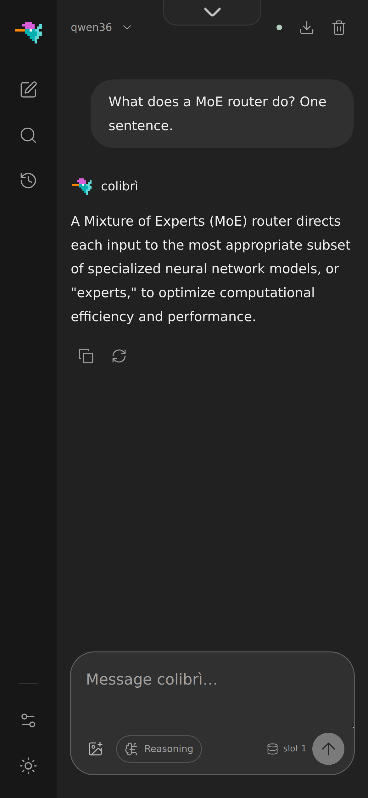
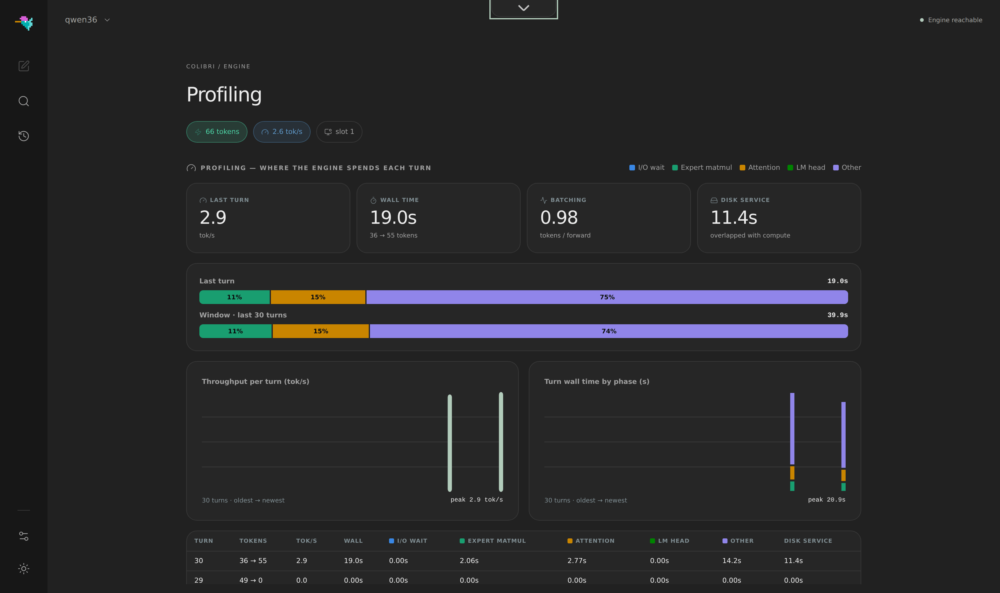

<a id="openai-compatible-api-kv-contexts-web-ui"></a>
# OpenAI-совместимый API, контексты KV и веб-интерфейс

<a id="coli-serve"></a>
## `coli serve`

`coli serve` сохраняет загруженным один процесс модели и предоставляет доступ только к текстовому процессу.
HTTP API, совместимый с OpenAI. Шлюз использует только стандартную библиотеку Python;
вывод по-прежнему выполняется в том же механизме C без зависимостей.

```bash
cd c
COLI_MODEL=/nvme/glm52_i4 COLI_API_KEY=local-secret ./coli serve \
  --host 127.0.0.1 --port 8000 --model-id glm-5.2-colibri

curl http://127.0.0.1:8000/v1/chat/completions \
  -H 'Authorization: Bearer local-secret' \
  -H 'Content-Type: application/json' \
  -d '{
    "model": "glm-5.2-colibri",
    "messages": [{"role": "user", "content": "Hello"}],
    "stream": true
  }'
```

Реализованные конечные точки: `GET /v1/models`, `GET /v1/models/{model}`,
`POST /v1/chat/completions`, наследие `POST /v1/completions` и
API единого решения `POST /v1/systemone`, colibri ([systemone.md](systemone.md)):
запрос и ответ Jev API TypeSafe, оцененный по языковой модели через
его канал logprob или изначально отвечает такой моделью принятия решений, как
[Laya](laya.md),
[GLiNER2.5-Decide](gliner_decide.md) или [Ключ](clef.md). Чат и
запросы на завершение поддерживают ответы JSON, потоковую передачу SSE, счетчики использования,
`max_tokens`/`max_completion_tokens`, `temperature`, `top_p` и до четырех
пользовательские `stop` последовательности. `max_tokens` — это потолок, а не цель: когда
подсказка оставляет меньше места, чем требует бюджет, каждый движок зажимает
бюджет в соответствии с контекстом, и ответ заканчивается `finish_reason:
"длина"`; отклоняется только промпт, которое не подходит, с
`context_length_exceeded` (№260, №1641). Запрос без бюджета получает сервер
потолок (`--max-tokens`, обозначенный `GET /health` как `max_tokens`); чат-сервер, запущенный
`coli serve`, `coli web` или `coli chat` без `--ngen` не задают ничего, поэтому ответ может привести к
конец контекста: очередь модели рассуждения — это рассуждение плюс ответ (#382).
Стоп-последовательности удаляются из ответа и завершают генерацию раньше как в JSON, так и в JSON.
режимы потоковой передачи.

В движке GLM устаревший `POST /v1/completions` также принимает непустой
`prompt` массив целочисленных идентификаторов токенов, например `[12, 345, 6]`. Идентификаторы идут
непосредственно к предварительно токенизированному впускному коллектору движка; они должны быть неотрицательными и
в словаре модели. Идентификатор за пределами словарного запаса получает `prompt`
400. Другие системы в настоящее время отклоняют запросы идентификатора токена с именем 400, и
Пакетные запросы (массивы строк или массивы массивов) остаются неподдерживаемыми.

Завершающее сообщение `assistant` *продолжает* этот ход вместо начала нового.
один: промпт заканчивается внутри него, который является официальным шаблоном, отображаемым с помощью
`add_generation_prompt=False`. По умолчанию это включено — список сообщений заканчивается на
непустой ход `assistant` продолжается, тот же контракт, что и API Anthropic — и
для него нет поля запроса, потому что завершающий поворот помощника уже говорит
«Продолжить», и расширение тела будет доступно только с помощью рукописного JSON.
а не от клиентов, которые этого хотят. Серверный коммутатор
`COLI_CONTINUE_ASSISTANT=0` восстанавливает старое поведение (свернуть поворот в
завершил одну реплику и добавил новую реплику). В продолжении отказано вместе с
`tools`/`tool_calls`, поскольку анализаторы вызовов инструментов считывают ход помощника из
его начало, а поворот должен содержать текст, не заканчивающийся пробелами: шаблон
удаляет конечные пробелы, поэтому модель возобновляется с других байтов, чем
те, что отправили. Семья, рендерер которой не имеет формы с открытым поворотом, но проваливается.
к старому поведению, а не к ошибкам — хотя каждое отправленное семейство поддерживает
продолжение сегодня, в комплекте Kimi K3 (его открытый поворот обрамлен со стороны движка, в
`kimi_k3.c`, не получено в средстве визуализации шлюза).

Продолжение возобновляется с тех байтов, которые вы отправили, что делает разделение
укажите часть подсказки. Разделение среднего слова помещает модель на границу токена.
он бы не создал себя, и первый сгенерированный токен обусловленна этом разделении: измерено на GLM-5.3-Flash, `The capital of France is Par`
завершается до `París`, а не до `Paris` — детерминировано, на каждом уровне усилий
и обе конечные точки. Продолжение реально (модель закончила частичную
слово, а не перезапуск, для которого и существует эта функция);
орфография является результатом того, где произошел раскол. Это присуще
возобновление с произвольного смещения байта, а не с учетом этого движка, и
это та же опасность, что и конечный пробел выше — в той форме, которая
отказать нельзя, потому что разбиение в середине слова – это иногда именно то, что
звонящий хочет. Разделите по границе токена, когда написание имеет значение. Расширение
`x_colibri_ignore_leading_stop: true` отбрасывает ведущие стоп-последовательности до тех пор, пока
первое содержимое ответа без пробелов, что полезно для локальных шаблонов
которые иногда перед ответом выдают маркер роли; строгая остановка OpenAI
поведение остается значением по умолчанию для последовательностей, предоставленных клиентом. Запросы в чат GLM
без клиента `stop` автоматически использовать шаблон `<|user|>` и
`<|observation|>` ролевые маркеры, терпеливо игнорируя только ведущие маркеры; это
предотвращает автоматическую генерацию нового пользователя или инструмента при завершенном повороте модели
поворот. Запросы на завершение чата Inkling и устаревшие версии не получают неявной остановки GLM.
последовательности. Расширение
`enable_thinking: true` включает блок рассуждений GLM-5.2; стандарт
Поле `reasoning_effort` также включает его, если не установлено значение `none`.

В Qwen3.6 расширение `preserve_thinking` является кваргом официального шаблона.
одно и то же имя: прошлые ходы помощника сохраняют блок `<think>`, при этом
`reasoning_content` клиент отправляет обратно, пусто, если ничего не отправляет. Это
по умолчанию установлено значение `true`, когда мышление выключено, и `false`, когда оно включено. С
Если подумать, пустой блок — это тот, который создавался после каждого предыдущего хода,
поэтому клиент, который повторно отправляет только `content`, уже отправляет историю движку
сохраняется, и префикс KV используется повторно вместо предварительно заполненного (#1759). С
размышления о стандартном клиенте отбрасывают рассуждения, история не может совпасть
в любом случае применяется значение шаблона по умолчанию; клиент, который отправляет
`reasoning_content` назад можно установить `preserve_thinking: true`, чтобы получить повторное использование
тоже. Оба значения отображают байт за байтом, как официальное значение `chat_template.jinja`.

Сервер обслуживает одно поколение за раз: модель остается в одном постоянном
процесс, поэтому параллельная очередь HTTP-запросов вместо загрузки повторяющейся модели
копии. Вызов инструмента зависит от активного движка; см. матрицу поддержки ниже.
Штрафы за изображения и токены возвращают явную ошибку, а не молчат.
игнорируется. Конечные точки, совместимые с OpenAI, запрашивают вероятности журнала только у
движок glm (см. ниже); на любом другом движке такой запрос отклоняется с
названная ошибка, никогда молча не игнорируемая. `seed` принимается и игнорируется (см.
ниже). Звук принимается только на контрольно-пропускных пунктах Inkling с поддержкой звука.
адрес привязки по умолчанию — localhost; установите `COLI_API_KEY` перед экспонированием
сервер за пределами машины.

Тело запроса должно умещаться в пределах 4 МБ, а работающий синтаксический анализатор JSON Python
пределы. Целое число или глубина вложенности, которые среда выполнения не может проанализировать, получает HTTP.
400 до работы движка; шлюз сохраняет ограничения среды выполнения.

Поля бухгалтерского учета размещенной платформы `store`, `metadata`, `service_tier`,
`user`, `safety_identifier`, `parallel_tool_calls`, `prompt_cache_key`,
`verbosity`, `web_search_options`, `moderation` и
`stream_options.include_obfuscation` принимаются и намеренно игнорируются:они не имеют местного эквивалента и не влияют на генерацию. Не поддерживается
Запросы на формирование результата явно отклоняются: `best_of` значения выше 1,
непустые `logit_bias` и `suffix` заполнение. Необязательный массив `modalities`
принимает только текстовый вывод; неверные значения и запросы на другой вывод
модальности получают именованный 400, а не молча возвращают текст.

<a id="seed"></a>
### `seed`

`seed` принимается (не отклоняется) для совместимости формы запроса OpenAI-API;
значение не подтверждено. Этот сервер не отправляет начальное значение для каждого запроса на
провод, поэтому значение не влияет ни на какую температуру.

<a id="log-probabilities-and-prompt-echo"></a>
### Записывать вероятности и отображать подсказки

`/v1/completions` принимает устаревшее целое число `logprobs` (**0–32**; 0 означает отсутствие журнала
вероятности вообще см. ниже; верхняя граница - это показания движка из топ-32.
интерфейс, а все, что выше 32, является именованным 400) и логическим значением `echo`;
`/v1/chat/completions` принимает логическое значение `logprobs` плюс целое число `top_logprobs` (0–32) и
возвращает `choices[].logprobs.content[]` (`{token, logprob, bytes, top_logprobs}` за
сгенерированный токен) — чат не имеет концепции `echo` и отклоняет один с 400. Каждая конечная точка
принимает для него форму запроса OpenAI и отклоняет запрос другого по имени. Нелогическое значение
`echo` — это именованный номер 400 (`invalid_value`) на обеих конечных точках, независимо от того,
`logprobs` вообще запрашивается. В чате `top_logprobs` даже проверяется по типу и диапазону.
когда `logprobs` ложно или отсутствует, поэтому искаженное `top_logprobs` является именованным 400, независимо от того,
или нет, ворота, которые он питал бы, открыты; остается действительный `top_logprobs` со скидкой `logprobs`
документально подтвержденное отсутствие операции.

Нулевая семантика очевидна и не является случайностью истинности: на `/v1/completions`,
`logprobs: 0`, `false` и `null` все означают **нет вероятности регистрации** (запрос успешен
с `choices[].logprobs: null`, точно так же, как если бы поле было опущено), а логическое значение
`true` — это именованное число 400 — устаревшее поле представляет собой целочисленное значение, а логическое значение не содержит
считать. На `/v1/chat/completions` поле представляет собой логический вентиль (`null` ведет себя как `false`;
любое целое число имеет имя 400). `echo: null` нормализуется и отсутствует на обеих конечных точках, поэтому
клиент, который сериализует всю свою модель запроса с нулями, никогда не получает отказ для поля, которое он
не хотел ставить. `logprobs` вместе с `stream` представляют собой именованный журнал 400: подельта.
вероятности не строятся.

`/v1/completions` с `echo: true` возвращает полный устаревший объект `logprobs` (`tokens`,
`token_logprobs`, `top_logprobs`, `text_offset`), охватывающие отображаемую подсказку плюс любые
сгенерированные токены, а `text` само по себе является восстановленным промптм, за которым следует завершение
(стандартное поведение OpenAI для `echo: true`), а не только завершение;
`echo: true` без активного запроса `logprobs` — это именованный номер 400 (`echo` требует
`logprobs`): эхо-подсказка строится на основе записей движка для каждого токена, поэтому без
им нечего повторять, и просьба, которая просит об этом, произносится так, а не
служил без него. Отображение промпта без каких-либо журналов предлагается в качестве отдельного раздела.
предложение. `text_offset` — это смещение символов в
та же самая возвращаемая строка `text`, всегда отсчитываемая от 0, включая случаи, когда `echo` имеет значение false,
где `text` содержит только завершение, а смещения описывают только этот текст, а не
позиция в (невозвращенном) промпте.

`"".join(tokens)` — это возвращенный `text`: где последовательность `stop` совпадает на полпути
токен, запись `tokens` этого токена усекается до фактически испускаемых символов (
`stop` из `"lo"` против декодирования токена в `"Hello"` отчеты `"Hel"`), а непропущенные или сообщающие символы, которые клиент не получил. В чате обрезанная запись
`bytes` — и его записи `top_logprobs` и `bytes` — усекаются вместе с ним до UTF-8
символы, о которых сообщает запись. Запись, которая не была усечена, сохраняет собственный фрейм.
полезная нагрузка, которая не обязательно должна быть кодировкой `token`: кадр, несущий только часть
сообщает многобайтовый код `token: ""` с байтами этого кадра.

Запрошенная таблица top-k **несортирована** в сети — не предполагайте, что первая запись
аргмакс. Значения для каждого токена печатаются механизмом с точностью до шести десятичных знаков.
Неконечные значения (скажем, вырожденная логит-строка all-`-inf`) сериализуются как JSON `null`, никогда
зажатый номер.

Эти конечные точки запрашивают числовой канал для каждого токена только у glm или механизма MiMo.
двое, которые считывают все необходимые позиции `echo`; на любом другом движке
request возвращает именованный номер 400, а не игнорируется молча. Это
заявление о том, что запрашивают эти конечные точки, и ни о чем другом.

Известные ограничения, текущая сборка:

- **Стоимость.** Запрос `logprobs` вообще — завершение или чат, `echo` или нет — спрашивает
  механизм для полного считывания всего промпта, поскольку запрос содержит один
  добровольное участие, а не отдельное «эхо». Такой запрос обычно теряет префиксный кеш.
  повторное использование. Для него нет ограничения на длину промпта, поэтому за очень длинное промпт придется заплатить
  соответственно большие разовые затраты.
- **Ожидание.** Запрос logprobs ожидает механизма точно так же, как ожидает любой другой запрос.
  Механизм, который никогда не подтверждает отправку — один старше этого расширения или один
  чей парсер не согласен с формой заголовка — оставляет запрос в ожидании, так как он
  будет через холодную предварительную заливку. Отдельного ограниченного ожидания для согласия не существует. Запрос
  чьи кадры по токену не удалось прочитать, ждет таким же образом: ход принадлежит
  движок, пока он не отправит терминальный кадр, поэтому отказ ниже доставляется тогда, а не
  чем момент поступления нечитаемого кадра. Движок отправляется на одну остановку, когда это
  случается, поэтому очередь не тратит остаток своего бюджета на ответ, который никто не получает.
- **Отмена.** Отмена может не вступить в силу до тех пор, пока не будет запрошен запрос.
  завершилось, поэтому окно, в котором дисконнект остается незамеченным, на длинной дистанции шире.
  подскажите, чем без `logprobs`.
- **Метки альтернативных токенов.** `top_logprobs` записей для идентификаторов токенов-кандидатов, отличных от
  собственный фактический токен позиции не является декодированным текстом (никакого токенизатора на стороне сервера не существует, по
  дизайн) — они имеют маркировку `<token_id:N>`. Только собственный токен позиции, идентифицируемый
  точное совпадение logprob, а не по идентификатору, получает реальный декодированный текст.
- **Выбранный токен не обязательно появится в отдельной таблице `top_logprobs`.**
  цифровой канал механизма сообщает о топ-k кандидатах по собственным показаниям; если выбранный
  токен находится за пределами этой таблицы, его не представляет ни одна запись, и ответ
  Поле `token_logprobs`/`logprob` по-прежнему является собственным значением выбранного токена, считанным из
  кадр напрямую, а не поиск в таблице.
- **Массивы описывают именно текст, полученный клиентом, и ничего сверх него.**Каждый сгенерированный токен располагается в возвращаемом тексте по его диапазону в необработанном движке.
  поток, поэтому этап, на котором был использован персонаж, решает, какая часть записи этого токена
  достигает массива: токен, соответствующий `stop`, разрезанный на полпути, сообщает о символах
  которые были испущены, и сгенерирован текст, не доходящий до `message.content` — рассуждения,
  маркеры шаблонов, синтаксис вызова инструментов, маркер проглоченной роли — там не описано.
  Таким образом, токены рассуждений, шаблонов и вызовов инструментов не описываются
  `logprobs.content`; отдельное поле для полного потока предлагается отдельно. Вкл.
  каждый ответ, содержащий logprobs, `"".join(tokens)` — это возвращаемый `text` и
  `"".join` больше `logprobs.content` составляет `message.content`. Когда записи движка не могут
  поддерживают это — они не дотягивают до сгенерированного текста или вообще не доходят —
  запрос отклоняется по имени, а не отвечает массивами, описывающими префикс.
- **Ошибки на стороне механизма именуются, а не являются общими.** Когда записи каждого токена механизма не могут
  ответьте на запрос, на кузове 5xx имеется цифра `code`, говорящая о том, что сделал движок:
  `engine_logprob_tail_malformed` (цифровой хвост, который этот сервер не может прочитать — это не удается)
  один запрос и никакой другой), `engine_echo_position_malformed` (нечитаемое эхо-подсказка
  позиция, которая представляет собой другое поле того же кадра),
  `engine_duplicate_logprob_candidate` (таблица топ-k, повторяющая кандидата за один раз)
  позиция), `engine_logprob_records_incomplete` (записи, останавливающие
  за исключением сгенерированного текста, вообще нет или — под `echo` — нет записей подсказки,
  любой из которых оставил бы массивы, описывающие префикс), и
  `engine_pinned_prefix_not_echoed` (слот KV, содержащий снимок контакта, поэтому эхо
  позиции не начинались бы с 0). Ни один ответ, содержащий logprobs, никогда не является усеченным или
  наполовину описанный 200.
- **Буферизация на стороне сервера.** Запрос, запрашивающий отображение отображаемого промпта (`echo: true` на
  `/v1/completions`) полная эхо-таблица хранится в памяти на протяжении всего времени существования запроса; нет
  потоковая передача разрешена вместе с `logprobs`, так что удержание ограничено одним
  непотоковый ответ. Запрос logprobs, который не запрашивает эхо — весь чат,
  и каждое завершение `echo: false` — ничего не сохраняет: движок по-прежнему отправляет кадр ECHO
  для каждой быстрой позиции, и они отбрасываются по мере поступления, а не сохраняются.

<a id="tool-calling-support"></a>
### Поддержка вызова инструментов

| Движок | OpenAI `tools` | Антропный `tool_use` | Родной формат |
|---|---|---|---|
| GLM-5.2 (`colibri`) | да | да | `<tool_call>` блоков |
| GLM-5.3-Вспышка | да | да | `<tool_call>` блоков с блоком объявлений 5.3 |
| ДипСик V4 | да | да | собственные блоки вызова инструментов DSML |
| намек | нет | нет | объявления/выборы активных инструментов возвращают HTTP 400 |
| Kimi K3 | да | да | собственные блоки XTML `tools`/`call`/`argument` (#1143) |
| MiMo-В2.6 | да | да | родные блоки `<tools>`/`<tool_call>` |
| Квен3.6 | да | да | собственные блоки `<tool_call>`/`<tool_response>`, та же XML-форма, что и Qwen3.8 |
| Qwen3.8-Flash-Следующий | да | да | родные блоки `<tool_call>`/`<tool_response>` |
| OLMoE | нет | нет | объявления/выборы активных инструментов возвращают HTTP 400 |

В поддерживаемых движках передайте OpenAI `tools` и дополнительно `tool_choice` в
`/v1/chat/completions`. Антропная конечная точка переводится как `tools`,
`tool_use`/`tool_result`, а также `auto`, `any`, `none` и выбор принудительного инструмента
режимы в встроенную подсказку активного механизма и обратно в ответы протокола.
Поддержка протокола не гарантирует, что каждая квантованная модель выдает действительныесинтаксис инструмента; `COLI_TOOL_SALVAGE=1` — это добровольный путь восстановления для некорректного GLM.
Вызовы инструментов int4. Вместо этого DeepSeek V4 использует собственный строгий анализатор DSML.

`tool_choice: "required"` — это инструкция на уровне подсказки, а не выборка.
ограничение. Каждый рендерер, предлагающий блок инструментов, добавляет одну и ту же строку к
это, и никакой рендерер не фильтрует токены и не принудительно использует сэмплер, поэтому модель, которая
ответы в прозе в любом случае не сделали ничего, что API считал невозможным.
Форсирование грамматики не является лекарством: этот путь питает движок, а затем
проверяет, поэтому схема, которую движок не может скомпилировать, требует ускорения и ничего
еще. Движок без блока инструментов для прикрепления инструкции (Inkling, OLMoE
без `COLI_TOOL_FALLBACK=1`) отвечает на HTTP 400, а не принимает выбор
и игнорировать это.

Вынужденный выбор, `tool_choice: {"type": "function", "function": {"name": …}}`,
применяется для каждого движка, и движки не пришли к единому мнению относительно того, как: некоторые сужают
предлагаемые инструменты названному, некоторые сохраняют полный список и называют инструмент в
вместо этого проза, а некоторые (Qwen3.6, Qwen3.8) не делают ни того, ни другого. Прочтите отрисованную подсказку
вместо того, чтобы предполагать, что просьба была удовлетворена.

Для вызовов GLM, которые будут запускать инструменты, запрос чата OpenAI может установить
`"strict_tool_calls": true`. При этом согласии принимаются только полные `<tool_call>`
блоки, функция и аргументы которых соответствуют объявленной схеме инструмента. Он возвращает
HTTP 502 с кодом `invalid_model_tool_call` для неполного, повторяющегося, неизвестного,
или недопустимые аргументы, а также для вызова инструмента, прерванного пределом генерации. Это
никогда не восстанавливает и не сохраняет искаженный вызов. Поведение восстановления по умолчанию:
без изменений. Строгий режим в настоящее время требует `stream: false` и не поддерживает
`logprobs`; эти комбинации перед генерацией получают HTTP 400.

Когда обратный прокси-сервер или имя хоста MagicDNS сохраняет общедоступный заголовок `Host`,
доверяйте этому точному имени хоста с повторяемыми параметрами `--allowed-host`.
Переменная среды `COLI_ALLOWED_HOSTS`, разделенная запятыми, эквивалентна:

```bash
COLI_ALLOWED_HOSTS=llm.example.com ./coli serve --model /nvme/glm52_i4
# or: ./coli serve --model /nvme/glm52_i4 --allowed-host llm.example.com
```

Настраивайте только имена хостов или IP-адреса, которые вы контролируете; подстановочного знака нет.
Этот параметр расширяет список разрешенных перепривязок DNS и не зависит от CORS и
Аутентификация по API-ключу.

Доступ через браузер с сервера разработки Vite и локального источника Tauri.
включен по умолчанию. Повторите `--cors-origin https://your-ui.example`, чтобы разрешить
другое точное происхождение или используйте `--cors-origin '*'` только на проверенном локальном компьютере.
сеть.

Движок владеет своими контекстами KV, поэтому при генерации HTTP используется ограниченный FIFO.
очередь на вход вместо того, чтобы притворяться, что запускаете небезопасные параллельные последовательности.
Настройте его с помощью `--max-queue N` (по умолчанию 8) и `--queue-timeout SECONDS`.
(по умолчанию 300) или среда `COLI_MAX_QUEUE`/`COLI_QUEUE_TIMEOUT`
переменные. Запросы с насыщением и временем ожидания получают HTTP 429 в форме OpenAI.
ошибки перед отправкой заголовков потоковой передачи. С помощью `--max-queue 0` запрос
прикрепленный к занятому слоту KV, немедленно отклоняется, даже если другой слот
бесплатно. Перед назначением слотов проверяются сроки очереди: истекший
официант получает `queue_timeout`, даже если место теперь доступно. `GET /health` разоблачает
счетчики активных/поставленных в очередь/завершенных/отклоненных и успешные ответы генерации
включите `x-colibri-queue-wait-ms`.
Запросы, нацеленные на любой слот, могут использовать свободный слот, не зарезервированный предыдущими ожидающими.
Ранее закрепленный запрос сохраняет приоритет для своей цели; более ранний любой слот
запрос сохраняет приоритет во всех слотах. Полная очередь ожидания не отклоняет
запрос, который может сразу занять незарезервированный свободный слот; лимит очереди
ограничивает ожидающие запросы независимо от активной мощности.### Когда движок останавливается

`coli serve` снова запускает движок, когда он умирает (сбой, нехватка памяти
убийца, убийство). Пока новый движок загружается, `GET /health` отвечает на 503 сообщением
`{"status": "restarting"}` и `Retry-After: 5`, и ничего не допускается: a
запрос ожидает в очереди нового движка, в пределах `--queue-timeout`, точнее
чем провалиться на старом. Запрос, на который отвечал мертвый движок, не выполняется.
`engine_error` и освобождает свой слот. Неудачный запуск повторяется через 2 с.
затем каждый раз вдвое дольше, до 60 с. Аутентифицированный `/health` считает
перезагружается в `engine_restarts`, и в журнале указывается причина:

```
[gateway] the engine stopped (colibri engine exited unexpectedly (killed by signal 9, SIGKILL, most often the out-of-memory killer)); starting it again
[gateway] the engine is running again (restart 1)
```

`coli chat` ожидает перезапуска сервера вместо запуска второго.

<a id="when-the-engine-stops"></a>
## Метрики Прометея

`GET /metrics` возвращает текстовую экспозицию Прометея (версия 0.0.4). Когда
Ключ API настроен, укажите тот же код `Authorization: Bearer ...` или
`x-api-key` заголовок, используемый для генерации; возврат отсутствующих или неверных учетных данных
401. Без ключа API конечная точка следует за обычным сервером без аутентификации.
политика доступа. Метрики не содержат подсказок, путей к моделям или меток идентификатора запроса.

Все имена начинаются с `colibri_scheduler_`:

| Суффикс | Тип | Значение |
|---|---|---|
| `active`, `queued`, `capacity`, `max_queue` | манометр | Допущенные запросы, официанты, емкость слота KV и ограничение очереди |
| `admitted_total` | счетчик | Запросы, допущенные к слоту KV |
| `completed_total` | счетчик | Принятые запросы, которые возвращаются нормально |
| `failed_total` | счетчик | Допущенные запросы, вызвавшие ошибку, за исключением `ClientCancelled` |
| `rejected_total`, `timed_out_total` | счетчик | Отказы при заполнении очереди и тайм-ауты в очереди |
| `cancelled_total` | счетчик | Отмены, обнаруженные до поступления или во время приема на работу |
| `queue_wait_seconds` | гистограмма | Дождитесь приема, только для принятых запросов |
| `slot_duration_seconds` | гистограмма | Занятость слота до завершения, сбоя или отмены |
| `first_output_seconds` | гистограмма | Начало вызова механизма для первого непустого обратного вызова текста или вывода инструмента |
| `engine_call_seconds` | гистограмма | Продолжительность каждого завершенного вызова генерации движка, включая сбой/отмену |

Периоды гистограммы: 0,001, 0,01, 0,05, 0,1, 0,5, 1, 5, 10, 30, 60, 300 секунд,
и `+Inf`; каждая гистограмма отображает `_bucket`, `_sum` и `_count`.
Счетчики сбрасываются при перезапуске шлюза. Коллекция не вызывает движок
или использовать слот генерации. `failed` также включен в `/health`
аутентифицированный снимок планировщика; неудачи больше не увеличивают `completed`.

Отмена проверяется перед приобретением доступного слота KV, в том числе при
ожидающий запрос просыпается, когда емкость освобождается. На этом запрос отменен
количество очков увеличивается на `cancelled_total`, но не на `admitted_total`, и способствует
нет выборки ожидания приема или продолжительности слота. Очередь заполнена и планировщик закрыт
проверки все еще могут отклонить запрос до того, как будет достигнута проверка отмены.


Гистограммы вызовов механизма исключают ожидание в очереди на вход и быстрый рендеринг.
Первый вывод наблюдается до остановки фильтрации шлюза, рассуждения о разделении,
или HTTP-сериализация: это могут быть рассуждения или данные инструмента, не обязательно
видимый пользователю текст ответа. Пустые обратные вызовы, кадры ACCEPT и сообщения проверки активности SSE
не считать. Вызовы, которые завершаются или завершаются неудачей без вывода, не добавляют выборку первого вывода;
сбой после вывода сохраняет эту выборку. Продолжительность вызова системы включает обратный вызов
обработка и запись ответов во время генерации. Один запрос может вызватьнесколько раз (например, подсчет очков System One), поэтому эти значения гистограммы
вызовы механизма, а не подсчет HTTP-запросов.

Это наблюдения шлюза, а не сквозного клиентского TTFT, задержки каждого токена,
или измерения ядра графического процессора. Выходные обратные вызовы не обязательно должны соответствовать один к одному
токены. Занятость слота включает любую обработку ответа, пока слот удерживается. Неудачи валидации/аутентификации перед допуском не учитываются.
`completed` означает, что допущенный обработчик вернулся нормально, а не то, что клиент
получил каждый байт ответа. Исключения запроса могут включать ввод данных клиента или
транспортные ошибки, а также отказы движков.

Пример PromQL для очереди допущенных запросов p95:

```promql
histogram_quantile(0.95, sum by (le) (rate(colibri_scheduler_queue_wait_seconds_bucket[5m])))
```

<a id="prometheus-metrics"></a>
## Конечная точка антропного протокола (`/v1/messages`)

Тот же сервер также поддерживает **API антропных сообщений**, поэтому клиенты, которые только говорят,
к антропным конечным точкам — Claude Code, Anthropic SDK — работают с colibri
без шайбы. Включать нечего: `/v1/messages` обслуживается вместе
`/v1/chat/completions` на том же порту.

```bash
curl http://127.0.0.1:8000/v1/messages \
  -H 'x-api-key: local' -H 'content-type: application/json' \
  -d '{"model":"glm-5.2-colibri","max_tokens":128,
       "messages":[{"role":"user","content":"Hello"}]}'
```

Для кода Claude укажите его на сервер и дайте ему любой непустой ключ:

```bash
export ANTHROPIC_BASE_URL=http://localhost:8000
export ANTHROPIC_API_KEY=local            # only enforced if you set COLI_API_KEY
export ANTHROPIC_MODEL=glm-5.2-colibri
claude
```

Поддерживается на каждой обслуживаемой архитектуре: системные подсказки (строки или текстовые блоки),
многооборотные сообщения `user`/`assistant`, потоковая передача с полным именованным событием
последовательность (`message_start` → `content_block_*` → `message_delta` → `message_stop`,
плюс протокол `ping` Keepalive во время длительных предзаполнений), `stop_reason`, Anthropic
`usage` имена полей и `x-api-key` аутентификация (`Authorization: Bearer`
тоже работает). Шлюз обрабатывает каждый запрос с использованием встроенных средств активного механизма.
шаблон чата; Подсказки GLM, Inkling, Kimi K3, Qwen3.8, OLMoE и DeepSeek V4 не поддерживаются.
взаимозаменяемый. Когда движок предоставляет режим рассуждения, расширенное мышление
включается с помощью `{"thinking": {"type": "enabled"}}` и переводится в это значение
протокол рассуждений архитектуры; OLMoE явно отключает его.

Использование инструментов соответствует приведенной выше матрице для каждого движка. Неподдерживаемые движки отклоняют активный
объявления и выбор инструментов явно, вместо того, чтобы передавать другим
маркеры архитектуры в несовместимый токенизатор.

Не поддерживается и скорее отказывается, чем игнорируется: `stop_sequences`,
`top_k` и блоки нетекстового контента (изображения, документы). Ошибки используют собственную версию Anthropic
`{"type":"error","error":{...}}` конверт на этом пути. Архитектура-местная
функции, которые не были подключены к этому протоколу, также отклоняются с
явная ошибка.

Завершающее сообщение `assistant` продолжает этот поворот по умолчанию на обоих
Конечные точки, совместимые с Anthropic и OpenAI (`COLI_CONTINUE_ASSISTANT=0` восстанавливает
старое поведение, когда эта конечная точка добавляла новый сигнал). Обратите внимание на эти изменения
что видит существующий клиент Anthropic на `/v1/messages`: сопровождающий помощник
ход теперь продолжается, а не начинается заново — что и есть настоящая антропия
контракт, а выключатель — это запасной выход для тех, кто полагается на старый
поведение.

> Предупреждение о предварительном заполнении, приведенное ниже, применимо и здесь, и оно *сложнее всего* относится к Claude Code:
> его системная подсказка и каталог инструментов большие и находятся на пути к процессору с потоковой передачей на диск.
> это долгое молчаливое ожидание перед первым токеном. Прочтите его перед подключением.

<a id="anthropic-protocol-endpoint-v1messages"></a>
## Подключите CLI или редактор кодирования

API совместим с OpenAI, поэтому большинство CLI для кодирования и расширений редактора работают
указав им Colibri как *OpenAI-совместимого* провайдера. Три настройки:

- **Базовый URL** — `http://localhost:8000/v1`
- **Модель** — `glm-5.2-colibri` (или то, что вы передадите `--model-id`)- **Ключ API** — любая непустая строка, например. `local`

Colibri по умолчанию требуется **нет** API-ключа, но многие клиенты отказываются запускаться без него.
один — присвойте им любое фиктивное значение. Ключ применяется только в том случае, если вы установите `COLI_API_KEY`.

Сначала выполните дымовое тестирование конечной точки (ключ не требуется, если вы его не установили):

```bash
curl http://127.0.0.1:8000/v1/chat/completions \
  -H 'Content-Type: application/json' \
  -d '{"model":"glm-5.2-colibri","messages":[{"role":"user","content":"hi"}]}'
```

**помощник**

```bash
export OPENAI_API_BASE=http://localhost:8000/v1
export OPENAI_API_KEY=local
aider --model openai/glm-5.2-colibri     # the openai/ prefix routes to OPENAI_API_BASE
```

**crush** — добавьте провайдера в `crush.json` (`~/.config/crush/crush.json` или
`%USERPROFILE%\AppData\Local\crush\crush.json` в Windows):

```json
{
  "$schema": "https://charm.land/crush.json",
  "providers": {
    "colibri": {
      "name": "Colibri",
      "type": "openai-compat",
      "base_url": "http://localhost:8000/v1/",
      "api_key": "local",
      "models": [
        { "name": "GLM-5.2 (Colibri)", "id": "glm-5.2-colibri",
          "context_window": 131072, "default_max_tokens": 1024 }
      ]
    }
  }
}
```

Манекен `"api_key": "local"` — это то, что удовлетворяет клиентов, которым требуется ключ.
`context_window` — это только отображение бюджета клиента — установите его по своему усмотрению.
Конфигурация КВ действительно позволяет.

**pi** — добавьте собственный провайдер в `~/.pi/agent/models.json` ([pi](https://github.com/earendil-works/pi-coding-agent) загружает каждый OpenAI-совместимый сервер через свой `openai-completions` API):

```json
{
  "providers": {
    "colibri": {
      "baseUrl": "http://localhost:8000/v1",
      "api": "openai-completions",
      "apiKey": "local",
      "compat": {
        "supportsDeveloperRole": false,
        "supportsReasoningEffort": false
      },
      "models": [
        {
          "id": "glm-5.2-colibri",
          "name": "GLM-5.2 (Colibri)",
          "contextWindow": 131072,
          "maxTokens": 1024
        }
      ]
    }
  }
}
```

Фиктив `apiKey` удовлетворяет требованию аутентификации pi; colibri только обеспечивает
ключ, если вы установите `COLI_API_KEY`. Флаги `compat` сообщают pi, что нужно отправить системе
подсказать как простое сообщение `system` и опустить `reasoning_effort`, что сохранит
запрос внутри того, что шлюз принимает по умолчанию. Если вы обслуживаете GLM-5.2
и хотите получить блок рассуждений, установите `"reasoning": true` на модели и отбросьте
`supportsReasoningEffort` — стандартное поле `reasoning_effort` включает
думаю об этом движке. Затем выберите модель с помощью `pi --list-models` или
`/model` сборщик (`colibri / GLM-5.2 (Colibri)`).

`contextWindow` — это только отображение бюджета клиента — установите его по своему усмотрению.
Конфигурация КВ действительно позволяет. Вызов инструмента в pi работает на движках в
[матрица вызова инструментов](#tool-calling-support) выше; на неподдерживаемых движках
Вызовы инструментов pi терпят неудачу так же, как и любой запрос OpenAI `tools`.

Одна и та же запись поставщика обслуживает другие движки — поменяйте модель `id` и
`name` (`qwen3.6-colibri` для Qwen3.6, `deepseek-v4-flash-colibri` для DeepSeek
Вспышка V4; `coli status` печатает идентификатор работающей модели). Подавать с
контекст, который соответствует преамбуле числа «пи» и рабочему набору: «пи» отправляет свою систему
подсказка, каталог инструментов и инструкция по проекту — около 5000 токенов — перед
первое слово пользователя, поэтому запустите сервер, например, `coli serve --ctx 32768` и установите
`contextWindow` на то же значение. Измерено с помощью pi 1.4.0 против
Резидент Qwen3.6-35B-A3B в оперативной памяти (Vulkan, Ryzen 9 9950X): токен ~4900
преамбула заполняется примерно за 30 с, а последующие этапы повторно используют кэшированный префикс.

**Продолжить, Cline/Roo, `llm`, OpenAI SDK, …** — установить базу провайдера
URL-адрес `http://localhost:8000/v1`, модель `glm-5.2-colibri` и любой пустышка.
ключ (`OPENAI_API_KEY`/`OPENAI_BASE_URL` для инструментов на основе env).

> **Определите свои ожидания, прежде чем подключать агентный интерфейс командной строки.** Преобладают две затраты:
> и первый невидим, пока вы не узнаете, что он там:
>
> 1. **Предварительное заполнение.** Агенты кодирования (crush, aider in repo-map mode, Cline, …) отправляют
> большая системная подсказка и определения инструментов — часто 10–20 000 токенов — *до
> твое первое слово*. Предварительное заполнение на пути потоковой передачи CPU выполняется за несколько токенов за единицу.
> второй (он привязан к вниманию, см. № 153), поэтому преамбула агента размером 15 000 токенов
> **час молчаливого «размышления» перед первым выводом токена**. Клиент
> выглядит повешенным; это не так. Сначала проведите дымовой тест с крошечным `curl` выше — если это так.
> ответы примерно через минуту, конвейер работает и вы платите за это
> Подскажите размер.
> 2. **Декодирование.** Примерно 1 tok/s для большой модели, поэтому многооборотный цикл агента
> (которые каждый раз возмещают растущий контекст) усугубляют затраты.
>
> Практическое руководство: одиночные хирургические вопросы с краткой контекстной работой; итеративный> Сеансы агентов в модели 744B с потоковой передачей данных на диск не похожи на размещенные
> API и ждать, скорее всего, не стоит. Если ваш клиент позволяет вам обрезать или отключить
> свою системную преамбулу и каталог инструментов, сделайте это.

<a id="connect-a-coding-cli-or-editor"></a>
### Агенты: Агент Гермеса, OpenClaw, Клайн

Этим агентам нужно место: агент Гермес отказывается от окна ниже 64 000 токенов, и
только их первый запрос составляет 5-14 тыс. токенов (системная подсказка плюс несколько десятков инструментов
схемы). Сервер, контекст которого никто не установил, дает модели чата 65536 токенов.
всякий раз, когда это умещается в четверть памяти (больше, где это позволяет десятая часть, см.
[ниже](#conversations-longer-than-the-context)), и `GET /v1/models` отчеты
это как `context_length` и `max_model_len`. Агент Гермеса читает его оттуда; для
остальные помещают тот же номер в свою конфигурацию (`coli serve` печатает его:
`[gateway] 65536 tokens of context ...`). Агент, который верит в большее
окно, то сервер задерживает компакты слишком поздно и заканчивается
`context_length_exceeded`.

Измерено 11 октября 2026 г. по сравнению с Qwen3.6-35B-A3B (int4) на Ryzen 7 PRO 8700GE.
каждый агент просил посчитать файлы в каталоге с помощью инструмента:

| Агент | Первый запрос | Инструменты отправлены | Результат |
|---|---|---|---|
| Агент Гермес 0.19.0 | 13 753 токена | 27 | `terminal` позвонили, правильный кол |
| OpenClaw 2026.10.1 | 10 855 токенов | 11 | `ls` позвонили, правильный кол-во и имена |
| Клайн CLI 3.0.70 | 5 566 токенов | 25 | `run_commands` позвонили, правильный счёт, всего 2 минуты |

Первый запрос медленный: около 35 токенов в секунду на предварительное заполнение.
машина, шесть с половиной минут для 13 753 токенов Гермеса, с включенной системой поддержки активности.
поток каждые 10 секунд, чтобы клиент не сдавался. Следующие повороты
повторно используйте префикс и заполняйте только то, что является новым.

**Агент Гермеса** (`~/.hermes/config.yaml`):

```yaml
model:
  default: qwen3.6            # the --model-id of coli serve
  provider: custom
  base_url: http://localhost:8000/v1
  api_key: local
```

**OpenClaw** (`~/.openclaw/openclaw.json`; `contextWindow` — это имя сервера
`context_length`):

```json
{
  "agents": { "defaults": { "model": { "primary": "colibri/qwen3.6" } } },
  "models": {
    "mode": "merge",
    "providers": {
      "colibri": {
        "baseUrl": "http://localhost:8000/v1",
        "apiKey": "sk-local",
        "api": "openai-completions",
        "timeoutSeconds": 3600,
        "models": [{ "id": "qwen3.6", "name": "Qwen3.6 (colibri)", "reasoning": false,
                     "input": ["text"], "contextWindow": 65536, "maxTokens": 8192 }]
      }
    }
  }
}
```

**Клин CLI**: `cline auth -p openai -b http://localhost:8000/v1 -k local -m qwen3.6`,
затем `cline "..."`. В расширении редактора выберите *OpenAI Compatible*.
поставщика с тем же базовым URL-адресом и моделью и установите для его контекстного окна значение
сервер `context_length`.

<a id="agents-hermes-agent-openclaw-cline"></a>
## Разговоры длиннее контекста

Запрос чата может включать сжатие контекста с помощью поля расширения.
`"context_compaction": "auto"` (`"off"` — значение по умолчанию, стандартное поведение;
`COLI_COMPACT=1` на сервере делает `auto` значением по умолчанию для каждого клиента).
панель управления и `coli chat` отправить его, чтобы разговор никогда не заканчивался
`context_length_exceeded`:

1. Когда разговор не вписывается в контекст или меньше уходит от ответа
   места, чем запрашивается (до четверти контекста), сервер запрашивает
   моделируйте себя для подведения итогов разговора перед новым сообщением.
   запрос на подведение итогов приходит после истории, которую уже хранит движок, поэтому
   только этот запрос предварительно заполнен.
2. Затем ход запускается на системном сообщении с добавленной к нему сводкой.
   и последние сообщения дословно (около четверти контекста, по крайней мере
   новое сообщение).
3. Сервер сохраняет сводку с указанием сообщений, которые он заменяет. Клиент
   продолжает отправлять всю свою историю; каждый последующий ход находит одно и то же резюме и
   отображает одно и то же промпт, поэтому повторное использование префикса движка работает, как и раньше, до тех пор, пока
   следующее уплотнение. Перезапущенный сервер суммирует еще раз.

В ответе говорится, что произошло: объект `compaction`,
`{"summarized_messages": 8, "summary": "..."}`, в ответе JSON и в
фрагмент потока (пустой `choices`) перед первым токеном и заголовком
`x-colibri-compacted-messages`. Картинки в сводных сообщениях становятся`[image]`. Последнее сообщение, длиннее, чем сам контекст, по-прежнему отклоняется.
`context_length_exceeded`.

Сам контекст: сервер, переменную контекста которого никто не установил (`--ctx` или
семейные `CTX`, `Q36_MAXT`, ...) выбирает самый большой из 16384, 32768, 65536, 131072
и 262144 токена (до максимума семьи), состояние разговора которых, за каждый
Слот КВ, занимает от силы четверть памяти до 65536 токенов и десятую часть
за пределами (`RAM_GB`, если установлено, в противном случае доступная память) и собственная память семьи.
по умолчанию, когда даже 16384 не подходит. Большая доля до 64 тыс. предназначена для
агенты кодирования, которые не работают на меньшем количестве. DeepSeek V4.1 и MiMo, чей экспертный кэш
размеры плана и которые не запускаются без слота слоя, посчитайте подсказку
рабочее пространство рядом с состоянием: V4.1 предварительно заполняет подсказку в одном перенаправлении (около 200 КБ в секунду).
токен), поэтому блок размером 64 ГБ получает 65536 токенов, а не 262144 (6,4 КБ токена).
состояние разрешено, что ничего не оставляет в кеше. В журнале запуска указано, какой
(`[gateway] 65536 tokens of context ...`), а `GET /v1/models` сообщает об этом как
`context_length` (и `max_model_len`), где его читают агенты.

<a id="conversations-longer-than-the-context"></a>
## Изолированные контексты KV

`coli serve --kv-slots N` выделяет до 16 независимых контекстов последовательности.
Запросы выбирают один с необязательным целочисленным полем `cache_slot`; обычный
Клиенты OpenAI опускают его и сохраняют исходное поведение слота 0.

```json
{
  "model": "glm-5.2-colibri",
  "messages": [{"role": "user", "content": "Continue this conversation"}],
  "cache_slot": 1
}
```

Каждый слот имеет свою историю токенов и состояние диалога: кэш KV и
на движках, которые имеют состояния DeltaNet, KDA и свертки, а также
сжал внимание DeepSeek. Механизм сопоставляет токенизированное промпт каждого запроса.
против истории слота и повторно использует общий префикс, поэтому HTTP без сохранения состояния
сохраняйте свой кеш между запросами. В GLM-5.2 каждый слот также имеет свое окно MTP и
устойчивый к сбоям файл персистентности (`.coli_kv`, `.coli_kv.1`, ...), поэтому кеш
выдерживает и перезапуск движка. Используйте `COLI_KV_SLOTS=N` в качестве окружения.
эквивалент. Начните с малого: в контексте токенов по умолчанию 4096 каждый слот стоит
сотни МБ, и `coli plan` их считает.

Каждый текстовый движок обслуживает слоты одновременно. Запросы в разных слотах
декодируются вместе: каждый шаг принимает следующий токен каждого активного
разговор как одна партия, поэтому весы и разгромленные эксперты на шаг читаются
обслуживать их всех, в то время как внимание и повторяющееся состояние каждого ряда остаются собственными
разговор. Запрос получает токены, которые он получил бы в одиночку (жадно на CPU,
те же байты; `tests/serve_mux_check.py` проверяет его на каждом движке). Подсказка
предварительно заполняется по прибытии, между двумя шагами. Если имеется более одного слота,
движки кроме GLM-5.2 и GLM-5.3-Flash ничего не тяготят (MTP, DSpark и
быстрый поиск после одного разговора), и их плотная сеть Vulkan, DeltaNet на
пути GPU и Metal остаются выключенными; Экспертный уровень Vulkan обслуживает все
эксперты разговора.

<a id="isolated-kv-contexts"></a>
## Веб-панель

Одна команда обслуживает OpenAI-совместимый API **и** веб-консоль на
тот же порт, а затем открывает браузер, когда движок будет готов:

```bash
cd web && npm install && npm run build   # once
./coli web --model <model-dir>
```

`coli web` отличается от `coli serve` только открытием браузера — оба служат
приборная панель на том же порту. На безголовом хосте (без дисплея, часто вообще без графического процессора)
используйте `coli serve` или `coli web --no-browser` и наведите на него курсор в браузере
другая машина. Ничто в информационной панели не требует сеанса рабочего стола на хосте.

Вы получаете одно рабочее пространство с док-станцией для переключения страниц:- **Чат**: потоковая передача ответов, переключение рассуждений, ввод изображений, где движок
  поддерживает его, слот KV для ответа и экспорт разговора в файл;
- **Система Один**: ответы с закрытым набором. Документ, вопрос и единственные ответы
  разрешено; движок считывает вероятность каждого ответа, ничего не генерирует,
  и сообщает энтропию, которая говорит, когда она не уверена. То же самое, что и
  `POST /v1/systemone` (см. [systemone.md](systemone.md));
- **Мозг**, два взгляда. *Исследуйте* рисует
  [измеренный экспертный атлас](https://github.com/JustVugg/colibri/issues/175) GLM-5.2 как коры головного мозга с десятью областями
  введите (опубликовать `experts.json` из `tools/expert_atlas/analyze.py --web`).
  *Маршрутизация в реальном времени* показывает фактическую работу модели: одна ячейка на эксперта,
  цвет = уровень, яркость = отвод тепла, и эксперты, разбитые в каждом
  вспышка станет белой и затухнет;
- **Профилирование**: где движок проводит каждый оборот, по фазам (ожидание ввода-вывода, эксперт
  matmul, внимание, LM head, другое), дисковый сервис перекрывал вычисления,
  и последние 30 разворотов как тренд;
- светлая и темная тема.

Панель управления взаимодействует с движком по протоколу небольшой линии и простому JSON.
конечные точки — ничего тяжелее самого движка. `web/` — это чистый OpenAI-API.
клиент (React + TypeScript), а также работает с любыми другими совместимыми
конечная точка; терминал `coli chat` остается первоклассным интерфейсом.

Макет адаптирован к ширине телефона; разбивка времени на ход и
тренд tok/s доступен на странице профилирования:

<p align="center">
  
    
  
</p>