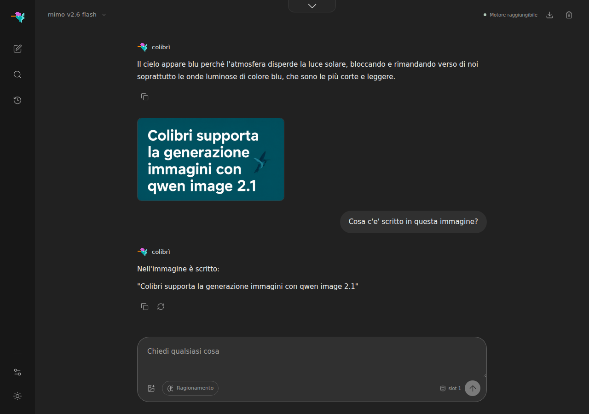
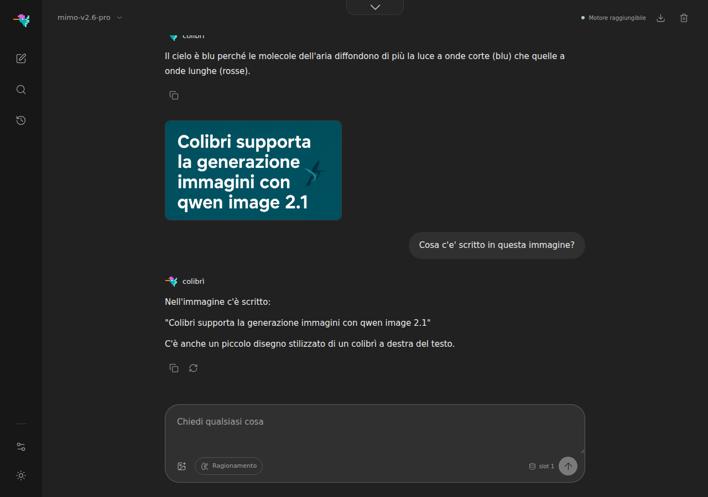

<a id="mimo-v26-xiaomi"></a>
# MiMo-V2.6 (Сяоми)

MiMo-V2.6 от Xiaomi, лицензия MIT, двух размеров с одной архитектурой:

| | Флэш | Про |
|---|---|---|
| параметры | 309Б, 15Б активный | 1,02Т, 42Б активный |
| слои | 48: 39 раздвижных окон + 9 полного внимания | 70:60+10 |
| разгромленные эксперты | 256, топ-8, общего эксперта нет | 384, топ-8 |
| на диске | 177,7 ГБ | 573,5 ГБ |
| экспертов за токен (холодный) | 8 x 47 слоев x 12,75 МБ = около 5 ГБ | около 11 ГБ |

Контрольная точка считывается по мере ее выпуска, **без преобразования**:

- **маршрутизированные эксперты** — это MXFP4 (значения e2m1 — два на байт, одна шкала e8m0 на 32
  столбцы), тот же макет colibri уже используется для Kimi K3 и DeepSeek V4.1.
  Шесть тензоров эксперта расположены в шарде спиной друг к другу, поэтому эксперт — это один
  читать (`O_DIRECT` по умолчанию).
- **плотные веса** остаются в том виде, в котором они были выпущены: FP8 e4m3 со шкалой на блок 128x128 для
  qkv и MLP Layer-0, BF16 для o_proj, роутер, норм, встраивания и голова.
  Повторное квантование экспертов в int4 colibri будет стоить больше байтов (4,5 бита на
  вес против 4,25 у MXFP4) и второе округление.

<a id="running-it"></a>
## Запускаем это

```sh
hf download XiaomiMiMo/MiMo-V2.6-Flash-MOPD --local-dir ~/Models/MiMo-V2.6-Flash
make -C c mimo
coli chat --model ~/Models/MiMo-V2.6-Flash
```

Pro — тот же движок и те же команды. Три файла релиза никогда не
загружено (редактор DFlash, аудиотокенизатор и уровень MTP, 9,9 ГБ вместе),
поэтому загрузка может их пропустить, 563,6 ГБ вместо 573,5:

```sh
hf download XiaomiMiMo/MiMo-V2.6-Pro-MOPD --local-dir ~/Models/MiMo-V2.6-Pro \
  --exclude "dflash/*" --exclude "audio_tokenizer/*" --exclude "model_mtp.safetensors"
coli chat --model ~/Models/MiMo-V2.6-Pro --ram 54
```

`coli chat`, `coli serve` и `coli web` размер экспертного кэша из плана ресурсов.
когда `--cap` опущен; `--ram N` дает бюджет. Автономный движок берет на себя
кэш (эксперты на уровень) в качестве первого аргумента и никогда не опускается ниже одной маршрутизации.
шаг (8).

```sh
SNAP=~/Models/MiMo-V2.6-Flash SERVE=1 ./c/mimo 64            # the SERVE protocol
./c/mimo ~/Models/MiMo-V2.6-Flash --prompt "Ciao" --ngen 64  # one prompt, by hand
```

<a id="what-the-engine-implements"></a>
## Что реализует движок

Каждая часть отражает `modeling_mimo_v2.py` релиза:

- **гибридное внимание**: `hybrid_layer_pattern` отмечает скользящее окно каждого слоя (1) или
  полное внимание (0). У этих двух типов есть собственное количество КВ (8 и 4 на Flash).
  и их собственная тета RoPE (1e4 и 1e7). Оконный слой сохраняет кольцо из 128
  позиции, поэтому на Flash длинный контекст стоит КВ из 9 слоев.
- **частичный RoPE** на первых `int(192 * 0.334) = 64` размерах каждой головки q/k,
  стиль поворота пополам; запросы и ключи имеют ширину 192, значения — 128.
- **шкала значений**: значения умножаются на `attention_value_scale` (0,707 Flash,
  0,612 Pro) перед вниманием.
- **приемник внимания** на оконных слоях: один логит на голову, которая присоединяется к
  знаменатель softmax и ничего больше.
- **маршрутизатор**: оценки сигмовидной кишки; `e_score_correction_bias` выбирает экспертов, но не делает
  не взвешивать их; выбранные оценки перенормируются.
- **видение**: MiMo ViT (выпуск 681M). 2D RoPE, внимание к групповым запросам,
  полное внимание в 4 из 28 блоков и одномерное окно из 64 токенов в остальных,
  чередующийся порядок строк и столбцов блоков слияния 2х2, сток на первой клавише
  оконных блоков и слияние LayerNorm + GELU. Фотографии предварительно обрабатываются
  шлюз точно так же, как это делает процессор Qwen2-VL (`tools/qwen38_image.py`).

Одна деталь хранилища не описана в коде моделирования: слитый `qkv_proj`
**предварительно сегментирован** на `num_key_value_heads` куски, `[Q_0|K_0|V_0|Q_1|K_1|V_1|...]`, с
сетка масштабирования FP8, разбитая на фрагменты (слой полного внимания Flash имеет 108 строк шкалы,
а не 106, которые были бы в смежной сетке). Макет — это тот, который загружает vLLM.
(`vllm/model_executor/models/mimo_v2.py`); движок отменяет его во время загрузки.

Еще не реализовано: три слоя MTP и отдельный редактор DFlash (нетспекулятивное декодирование), аудио- и видеовход.

<a id="chat-template"></a>
## Шаблон чата

Шлюз отображает `chat_template.jinja` MiMo вручную, байт за байтом (удерживается на
настоящий шаблон от `tests/test_mimo_chat_template.py`): ChatML без новой строки после
`<|im_end|>`, каждый помощник несет свой блок `<think>`, инструменты свои.
системный поворот, вызовы записываются в строке как
`<tool_call><function=NAME><parameter=KEY>VALUE</parameter></function></tool_call>`,
инструмент приводит к повороту на `tool`. Через API мышление включено, если запрос
выключает его (`enable_thinking: false` или `reasoning_effort: "none"`), как в
шаблон; с размышлением по реплике заканчивается на `<think>`, токене, который пишет модель.
сначала. `coli chat` начинается с обдумывания, потому что примерно в 1 tok/s шаблон
рассуждение по умолчанию — минуты токенов до ответа; `coli chat --think` поворачивает
включено (в сети есть собственный переключатель рассуждений).

<a id="system-one-mode-and-prompt-reuse"></a>
## Режим System One и повторное использование

[Режим System One](systemone.md) работает на MiMo, как и на других движках. `POST /v1/systemone` получает оценку
закрытый набор вариантов вместо генерации, и `logprobs` на `/v1/chat/completions` и
`/v1/completions` (с `echo`) тоже подается. Особенностью MiMo является то, что
снимок (`SUBMIT pin=1`) должен содержать:

- **9 слоев с полным вниманием** сохраняют свои строки K/V по положению и ничего после
  снимок записывается под ним, поэтому они остаются на месте. Снимок содержит идентификаторы токенов, а
  перед возобновлением движок проверяет, что состояние все еще удерживает их. Подсказка, которая
  разошлись между собой, переписали их, и снимок выпущен;
- **39 слоев скользящего окна** содержат кольцо из 128 слотов, позиция p в слоте p mod 128,
  с позицией, которую занимает каждый слот. Первый вариант перезаписывает слоты
  последние позиции снимка, поэтому кольцо копируется в снимок и обратно: о
  50 МБ на снимок во Flash (39 x 128 x 8 головок x (192 + 128) с плавающей запятой), ограниченный
  `COLI_PIN_SLOTS` (по умолчанию 4);
- позиция, равная длине снимка. Больше ничего не переносится из одного
  токен к следующему: приемники являются весами, а маршрутизатор не имеет состояния.

Подсказка с изображением не делает ни одного снимка и возобновляется с нуля, ни снимка
ни состояние предыдущего хода: его идентификаторы не описывают изображение.

Считывание (`logprobs=k`) возобновляется только со снимка, сохраненные логиты которого предсказывают
первый свежий токен. Без снимка он считывает каждую позицию, начиная с 0 и первой.
несущий `nan`. Он никогда не возобновляется из состояния активности предыдущего хода, потому что
позиции до того, как у него не будет рамки. Поворот в чате без `logprobs` сохраняет
обычное повторное использование префикса.

Возобновление выполняется с точностью до бита, и для этого потребовалось одно изменение в прямом направлении. Результаты МО
строки суммировались в том порядке, в котором ее эксперты впервые появлялись ** в предварительном заполнении
блок**, который зависит от других строк блока. Такая же позиция была высказана
разные младшие биты в блоке из 64 строк, чем в однострочном резюме, вплоть до 1,2e-4 на
логиты прибора. Эксперты каждой строки теперь добавляются в том порядке, в котором ее выбрал маршрутизатор.
их, поэтому строка зависит только от своих собственных входных данных. Шаг декодирования добавляется в том же порядке, что и
раньше. Предварительное заполнение теперь всегда дает биты, которые подаются в подсказку по одному токену за раз.
дал.

<a id="correctness"></a>
## Правильность

`make -C c mimo-tiny-check` генерирует крошечную контрольную точку (нумерованную, детерминированную), хранящуюся
точно так же, как релиз хранит свои тензоры и сравнивает движок с токенами из
Собственный `modeling_mimo_v2.py` Xiaomi (файлы поставщиков, закрепленные SHA-256,`tools/make_mimo_ref.py`): жадный и по принуждению учителей, с картинкой и без нее,
каждая точная конфигурация движка (родной плотный, экспертный кеш, который вытесняет
на каждом слое предварительно заполняйте блоки 1 и 3) и проверяет, что портит эксперт
масштаб, масштабная сетка qkv или картинка меняют ответ. Также требуются логиты
быть одинаковыми **байтами** независимо от блоков предварительного заполнения и экспертного кеша, текста и
картинка: именно это позволяет возобновлению промпта с префикса или снимка быть одинаковым
подскажите расчетный холод.

`make -C c mimo-tiny-serve-check` обслуживает тот же прибор и сравнивается с холодным
движок, кадр за кадром: повторное использование префикса при поворотах, параметры System One, которые сдвигают окно
мимо снимка, вложенных снимков и родственного вопроса, снимок устарел из-за
несвязанные подсказки, подсказки с изображением, `/v1/systemone` и пробы журнала чата через
шлюз. Каждая опция должна обрабатывать только свои токены. Патчи шлюза
соответствует официальному процессору Qwen2-VL на изображении прибора.

На реальной контрольной точке `tools/mimo_real_check.py` строит модель Xiaomi из
собственный релиз `modeling_mimo_v2.py` (эксперты делали по одному, как вендора
`MiMoV2MLP`, значит в ОЗУ помещается 48 слоев) и сравнивает его с движком по тем же байтам.
Измерено на MiMo-V2.6-Flash-MOPD:

| | аргмакс | максимальная логит-разница | Макс КЛ |
|---|---|---|---|
| текст, 2 слоя, 25 позиций | 25/25 | 6.3e-7 логит-диапазона | 1.4e-11 |
| текст, 48 слоев, 25 позиций | 25/25 | 2,5e-6 логит-диапазона | 1.9e-10 |
| текст с картинкой, 48 слоев, 271 позиция | 271/271 | 1.7e-4 логит-диапазона | 1.0е-6 |

252 выходных ряда ViT для этого изображения отличаются от Xiaomi не более чем на 3,7e-5.
(относительно 1.6e-5), а патчи шлюза в точности соответствуют официальному процессору.

На MiMo-V2.6-Pro-MOPD с тем же инструментом и той же подсказкой из 25 токенов:

| | аргмакс | максимальная логит-разница | Макс КЛ |
|---|---|---|---|
| 2 слоя | 25/25 | 1.2e-6 логит-диапазона | 7.3e-11 |
| 8 слоев | 25/25 | 1.3e-6 логит-диапазона | 8.9e-11 |
| 16 слоев | 25/25 | 2.2e-6 логит-диапазона | 3.9e-10 |
| 32 слоя | 25/25 | 4.9e-6 логит-диапазона | 1,5е-10 |

Эталон содержит плотные веса в f32, что для всех 70 слоев Pro составляет около
80 ГиБ, поэтому сравнение останавливается на 32 из 70 слоев, которые умещаются в 61 ГиБ
тестовая машина.

<a id="measured"></a>
## Измерено

Ryzen 7 PRO 8700GE (8 ядер, 16 потоков), 64 ГБ DDR5, NVMe RAID, Linux, без ничего
остальное бегает. MiMo-V2.6-Flash, CLI из холодного экспертного кэша, жадный, 33-токенный
подсказка в чате (обдумывание) и 128 сгенерированных токенов:

```sh
./mimo /models/mimo-v2.6-flash --cap N --ngen 128 \
  --prompt $'<|im_start|>user\nScrivi un racconto lungo e dettagliato su un colibri che attraversa il Mediterraneo.<|im_end|><|im_start|>assistant\n<think></think>'
```

| эксперты кэшируются для каждого слоя | плотные гири | нити | декодировать | последние 64 токена | резидент | эксперт читает |
|---|---|---|---|---|---|---|
| 32 | как выпущено (точно) | 8 | 2.34 tok/s | 2.33 tok/s | 30,1 ГБ | 264 ГБ |
| 32 | как выпущено (точно) | 16 | 2.31 tok/s | 2.30 tok/s | 30,1 ГБ | 264 ГБ |
| 64 | как выпущено (точно) | 8 | 2,95 tok/s | 2,94 tok/s | 49,8 ГБ | 167 ГБ |
| 64 | как выпущено, `MIMO_IDOT=1` | 8 | 2,95 tok/s | 2,96 tok/s | 49,8 ГБ | 166 ГБ |
| 64 | int8 (`MIMO_DENSE_BITS=8`) | 8 | 3.37 tok/s | 3.39 tok/s | 47,5 ГБ | 166 ГБ |

- Загрузка занимает около 5 с, а промпт 33-х токенов из холодного кэша 10-11 с.
- Экспертное чтение выполняется со скоростью от 9,8 до 10 ГБ/с при `O_DIRECT`.
- С 64 кэшированными экспертами и плотными весами, 54 секунды пробега разделились наэксперт читает 17 с, эксперт матмул 15,5 с, внимание с его qkv и выводом
  проекции 18 с, остальные (плотный МЛП, фрезер, голова) 4 с.
- 16 потоков ничего не дают сверх 8 физических ядер; движок выбирает 8, когда
  `OMP_NUM_THREADS` не установлено.
- Два прогона 16-поточной конфигурации совпали в пределах 1%.
- плотные веса int8 не точны: токены являются частью точного прогона внутри
  первое предложение, и последующая история читается так же хорошо.

Через шлюз: вызов инструмента возвращается как `get_weather({"city": "Roma", "days": 3})`
с введенным целым числом, как было объявлено, и спросил, что написано на картинке, сделанной
На Qwen-Image из colibri модель отвечает текстом, слово в слово. То же самое в
`coli web` и `coli chat`:



<a id="pro"></a>
### Про

Плотные веса остаются резидентными; из заголовков контрольных точек, что держит движок:

| | как выпущено (точно) | int8 (`MIMO_DENSE_BITS=8`) | ф32 |
|---|---|---|---|
| проекция мощности внимания (BF16) | 13,1 ГиБ | 6,6 ГиБ | 26,3 ГиБ |
| внимание qkv (FP8) | 11,2 ГиБ | 10,9 ГиБ | 43,5 ГиБ |
| встраивания, голова, Vision Tower, маршрутизатор, слой-0 MLP | 5,8 ГиБ | 4,2 ГиБ | 9,8 ГиБ |
| **всего** | **30,2 ГиБ** | **21,7 ГиБ** | **79,6 ГиБ** |

Каждый кэшированный эксперт занимает 18,9 МБ, поэтому один слот на каждый слой из 69 слоев MoE занимает
1,27 ГиБ. Кэш KV охватывает только 10 уровней полного внимания (остальные 60 сохраняют
кольцо из 128 позиций): 0,78 ГиБ в контексте 8k.

Та же машина, промпт и 128 токенов, что и в таблице Flash выше:

| эксперты кэшируются для каждого слоя | плотные гири | декодировать | последние 64 токена | резидент | эксперт читает |
|---|---|---|---|---|---|
| 12 | как выпущено (точно) | 0,66 tok/s | 0,66 tok/s | 48,0 ГБ | 1056 ГБ |
| 20 | int8 (`MIMO_DENSE_BITS=8`) | 0,79 tok/s | 0,79 tok/s | 50,7 ГБ | 955 ГБ |

- Загрузка занимает 16,5 с при выпущенных плотных весах и 39 с в int8 (они
  квантуется при нагрузке); запрос на 33 токена из холодного кэша около 32 с.
- Экспертные чтения выполняются со скоростью 10 ГБ/с, и большую часть времени они таковы: от 12 до 20 из 384.
  эксперты кэшируются на каждом уровне, только от 32 до 39% перенаправленных экспертов уже являются резидентными,
  поэтому токен читается около 6 ГБ. Далее следует внимание, потому что каждый токен считывает все
  плотные гири; int8 сокращает оба, оставляя меньше плотных байтов и больше оперативной памяти.
  для кэша.

Через шлюз (`coli serve --ram 54`, который планирует 11 экспертов на уровень), на
настоящий профессионал: время от времени думая, тот же вызов инструмента с целым числом, набранным как объявлено,
потоковая передача, и изображение Qwen-Image считывается слово в слово; `coli chat` с
путь к изображению в начале строки и `coli web` с кнопкой загрузки:



<a id="on-a-gpu-vulkan"></a>
## На графическом процессоре (Vulkan)

При запуске сборки `make mimo VK=1` с `COLI_VULKAN=1` перенаправленные эксперты помещаются в
общий экспертный уровень Vulkan ([vulkan.md](vulkan.md#the-routed-expert-tier-vk_tierc)):
байты MXFP4 выпуска, находящиеся в оперативной памяти, показатели группы e8m0 расширились до
f32 масштабирует чтение шейдера, SwiGLU на устройстве. Каждый шаг МО отправляет
(строка, выбор) пары, эксперт которых находится в устройстве как один пакет, и
Тем временем CPU читает и вычисляет остальные; эксперт, который держит прибор, не читается
с диска. Затем каждая строка добавляет своих экспертов в своем собственном порядке маршрутизации,и CPU одинаковы, как и работа CPU. Движок не хранит экспертную историю, поэтому
Уровень начинается пустым и заполняется по мере прохождения экспертов: эксперты, вычисленные CPU,
предлагается ему после каждого шага (максимум `COLI_VK_TIER_RATE` за токен), и как только его
бюджет переполнен, более горячий эксперт вытесняет самого холодного жителя. Маршрутизатор остается включенным
CPU, поэтому выбранными экспертами являются CPU.

Плотные матрицы подчиняются одному правилу серверной части (`COLI_VK_DENSE`): на дискретном
GPU они идут на устройство; на встроенном графическом процессоре или Lavapipe, память которого является
ОЗУ CPU, они остаются в CPU во время работы уровня. `COLI_VK_TIER=0` (или
`MIMO_VK_EXPERTS=0`) сохраняет эксперты на CPU, а плотные матрицы на
устройство, как и раньше.

Устройство выполняет вычисления с активациями f32, как это делает CPU по умолчанию: запуск с
Уровень предоставляет токены запуска CPU на крошечном приборе в каждом плотном формате, текстовом и
изображение и передает оракул Xiaomi (`tests/vulkan_engines.sh mimo-qwenimage`). Это
логиты отличаются от CPU последними цифрами, которые зависят от того, какие эксперты были
резидентный: указанные выше свойства с точностью до байта (инвариантность блока, возобновление запроса с
фотография, равная той же подсказке, вычисленной в холодном состоянии) являются процессорами и удерживаются с помощью
`COLI_VULKAN` не установлено, где движок — это байты, которые были до уровня.

<a id="environment"></a>
## Окружающая среда

| Переменная | По умолчанию | Эффект |
|---|---|---|
| `MIMO_DENSE_BITS` | 0 | 0: плотные веса в том виде, в каком они были выпущены (FP8, BF16), точные. 8: int8 на строку, меньше ОЗУ, неточно. 32: f32, конфигурация оракула. |
| `MIMO_IDOT` | 0 | 1: активации int8 для экспертных матмулов (неточно; не быстрее в приведенном выше измерении). |
| `MIMO_DIRECT` | 1 | 0: буферизованный эксперт читает вместо `O_DIRECT`. |
| `MIMO_READ_THREADS` | 8 | Параллельное экспертное чтение для каждого слоя. |
| `MIMO_CHUNK` | 64 | Токены подсказки для каждого блока предварительного заполнения. |
| `MIMO_CTX` / `CTX` | 8192 | Контекст, для которого рассчитан кэш KV (ограничен контрольной точкой). |
| `MIMO_CAP` | 64 | Слоты экспертного кэша на уровень, если аргумент не дает их. |
| `MIMO_MAX_IMAGE_TOKENS` | не установлен | Шлюз: потолок стоимости одного изображения в токенах быстрого доступа. |
| `MIMO_LOGITS` | не установлен | Oracle: сохраните логиты каждой позиции запроса (f32) в этот файл. |
| `MIMO_TRACE` | не установлен | Oracle: сбрасывать остаток после каждого подслоя первого блока. |
| `MIMO_DIRS` | не установлен | Дополнительные каталоги, содержащие шарды (многодисковые). |
| `COLI_VULKAN` | 0 | 1, в сборке `make mimo VK=1`: перенаправленные эксперты передаются на общий экспертный уровень Vulkan, а плотные матрицы (qkv, o_proj, плотный MLP, lm_head и Vision Tower) на устройство, куда их помещает `COLI_VK_DENSE`, загружаемые при запуске в форме, которую дал им `MIMO_DENSE_BITS`: FP8 с блоком из 128 столбцов масштабирует и BF16 по умолчанию, int8 — 8, f32 — 32. См. [На графическом процессоре](#on-a-gpu-vulkan). |
| `MIMO_VK_EXPERTS` | не установлен | При `COLI_VULKAN=1`: 0 сохраняет каждый перенаправленный эксперт на CPU (без уровня); N определяет бюджет экспертного уровня равным N экспертам (`COLI_VK_TIER_GB`, который выигрывает, если установлен). Не установлено: собственный бюджет уровня. Хранится на собственном уровне движка перед общим, который заполняется до N и никогда не вытесняется. |