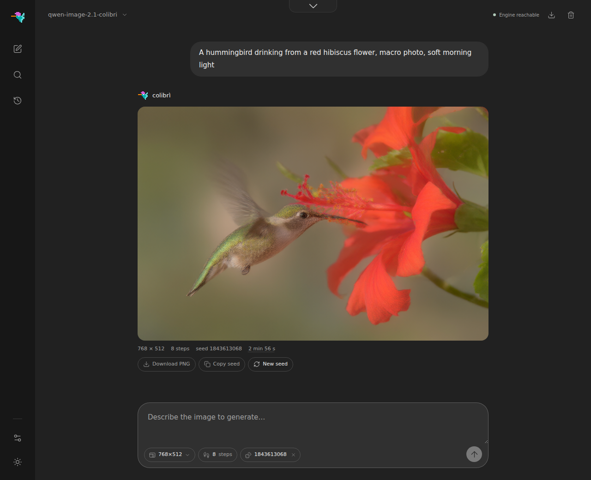
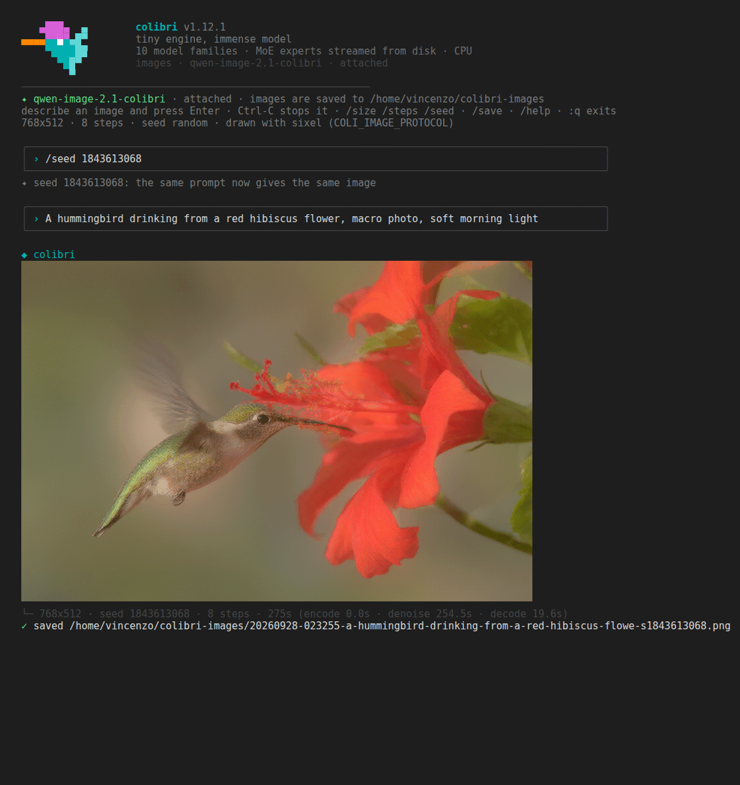
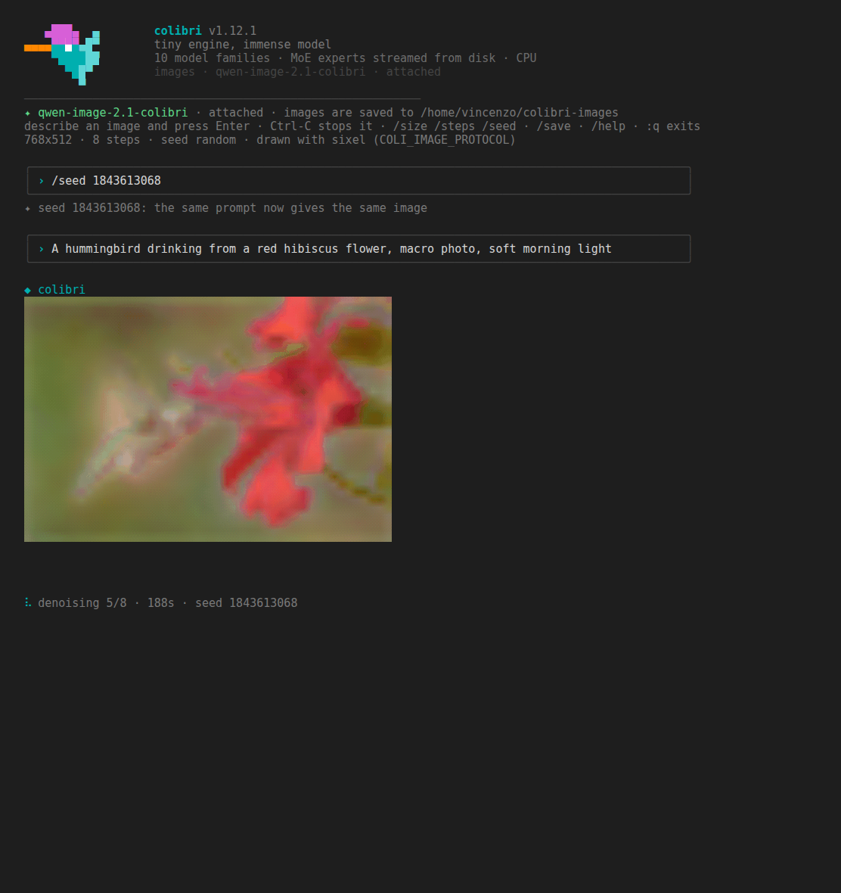

<a id="qwen-image-21-on-colibri"></a>
# Qwen-Image-2.1 на colibri

`c/qwenimage` превращает текстовую подсказку в картинку с
[`Qwen/Qwen-Image-2.1`](https://huggingface.co/Qwen/Qwen-Image-2.1), читай
прямо с официального GGUF диффузоров. Нет этапа преобразования:
движок квантует текстовый кодер и диффузионный преобразователь в int8
пока он их загружает.

Те же внешние интерфейсы, что и текстовые модели:

- `coli chat` — сеанс изображения: введите описание, наблюдайте за прогрессом,
  и изображение рисуется **внутри терминала**, а затем сохраняется в формате PNG.
- `coli run "prompt"` создает одно изображение и записывает его в файл.
- `coli serve` (и `coli web`) выставьте `POST /v1/images/generations`,
  API изображений OpenAI.

<p align="center">
  
</p>
<p align="center">
  
</p>

Оба изображения взяты из реальной контрольной точки на 8-ядерном сервере.
промпт и начальное значение: веб-интерфейс выше, `coli chat`, прикрепленный к тому же серверу
ниже, как это показано на терминале Sixel (скриншот xterm.js, терминал
VS Code, подававший собственные байты сеанса; Терминал Windows 1.22 и более поздние версии, фут,
WezTerm и котенок показывают одну и ту же картину). Терминалы без графики получают половину
блоки, по два пикселя на символ.

<a id="download"></a>
## Скачать

GGUF около 33 ГБ: кодировщик текста (Qwen3-VL, 17,5 ГБ bf16),
диффузионный преобразователь (14,2 ГБ bf16), VAE (1,4 ГБ f32), токенизатор и
планировщик, каждый в своей папке.

```sh
hf download Qwen/Qwen-Image-2.1 --local-dir ~/Models/Qwen-Image-2.1
make -C c qwenimage
```

Сохраните загруженный макет: coli распознает модель из
`model_index.json` в корне папки, а `config.json` нет
туда добавить. `coli info --model ~/Models/Qwen-Image-2.1` перечисляет его части.
найдены и их размер на диске.

<a id="ram"></a>
## ОЗУ

Языковая модель кодировщика текста и преобразователь сохраняются как int8 с
одна шкала в ряду; башня обзора текстового кодировщика и его выходная головка
никогда не загружался. По данным реального GGUF `coli plan` (измерения от
заголовки защитных датчиков):

| часть | на диске | в оперативной памяти |
|---|---|---|
| текстовый кодер | 17,5 ГБ bf16 | 7,6 ГБ int8 |
| диффузионный трансформатор | 14,2 ГБ bf16 | 7,1 ГБ int8 |
| ВАЭ | 1,4 ГБ ф32 | 1,4 ГБ ф32 |
| **все резиденты** | | **16,0 ГБ** |
| **кодер текста по запросу** | | **8,5 ГБ пиковая** |

Кодировщик текста по требованию загружается для каждого запроса и освобождается перед этим.
начинается шумоподавление, поэтому пик получается большей из двух фаз за счет
перечитывая его снова для каждой подсказки. Рабочие буферы (активации,
Карты объектов VAE в полном разрешении) располагаются поверх обоих чисел. Измерено на
настоящая контрольная точка: `coli run` при разрешении 768x512 с пиком **9,0 ГБ** (текст
энкодер освобождается перед шумоподавлением), и `coli serve`, который сохраняет все
загружено: **14,0 ГБ** после готовности. Собственный рабочий комплекс VAE на
Разрешение 1024x1024 занимает 1,9 ГБ сверх своего веса.

```sh
coli plan --model ~/Models/Qwen-Image-2.1          # both schedules against your free RAM
coli plan --model ~/Models/Qwen-Image-2.1 --json   # the same as JSON
```

<a id="chat-images-in-the-terminal"></a>
## Чат: изображения в терминале

```sh
coli chat --model ~/Models/Qwen-Image-2.1
```

<p align="center">
  
</p>

Каждая строка, которую вы вводите, представляет собой подсказку. Пока движок работает, в строке состояния отображается
этап (кодирование подсказки, шаг шумоподавления k из N, декодирование) и
прошедшее время; когда движок отправляет превью, маленькая версия картинки
перерисовывается на месте над ним. Затем окончательное изображение рисуется в терминале
и сохранен. Ctrl-C останавливает текущее изображение (движок завершает заданный шаг).
и сообщает о его отмене); уходит второй Ctrl-C.

Команды (их завершает TAB, а размеры после `/size`):

| команда | эффект |
|---|---|
| `/size WxH` | размер изображения; Только `/size` перечисляет пресеты |
| `/steps N` | шаги шумоподавления: чем больше, тем медленнее и обычно чище || `/seed N` | фиксированное начальное значение: то же промпт затем дает то же изображение |
| `/seed random` | новое начальное значение для каждого изображения (по умолчанию) |
| `/render MODE` | как рисуются изображения: `kitty`, `iterm`, `sixel`, `blocks`, `none` |
| `/save [PATH]` | копию последнего изображения там, где вы хотите: папку (имя сохраняется) или имя файла (добавляется `.png`); никогда не перезаписывает. В одиночку он говорит, где изображение уже находится |
| `/help`, `/quit` | список и выйти (`:q` тоже работает) |

Первый размер, шаги и начальное число также можно указать в качестве флагов:
`coli chat --model ... --size 1024x576 --steps 12 --seed 42`.

Если `coli serve` с этой моделью уже работает на `127.0.0.1:8000`,
`coli chat` прикрепляется к нему вместо загрузки второго движка (модель остается
загружается после выхода). `--attach URL` выбирает другой сервер, `--no-attach`
сил частный движок.

<a id="one-image-from-the-command-line"></a>
## Одно изображение из командной строки

```sh
coli run --model ~/Models/Qwen-Image-2.1 --size 1024x576 --seed 42 \
  --out lighthouse.png "a lighthouse on a cliff at dusk, oil painting"
```

Без `--out` PNG переходит в папку изображений. Когда выходной сигнал
терминал, там тоже рисуется картинка; когда он подключен, печатается `coli run`
только путь на стандартном выводе.

<a id="sizes-steps-seed"></a>
## Размеры, шаги, семена

- **Размер**: обе стороны кратны 32, от 256 до 2048. Группы движков
  токены изображения 2x2, поэтому 32, а не 16: 16:9 — это 1024x576 или 512x288,
  никогда не 768х432. По умолчанию — 768x512. Пресеты, те же, что и в веб-интерфейсе.
  предлагает: 512x512, 768x512, 512x768, 1024x576, 576x1024, 1024x1024.
- **Шаги**: по умолчанию 8, от 2 до 200. Восемь — хороший вариант для фотографий;
  16 дает заметно лучшую анатомию и цвет, и какой текст внутри
  изображение должно быть разборчивым (по сравнению с эталонным конвейером на
  8, 16 и 30 ступеней; 30 добавляет чуть больше 16). Время растет вместе с шагами.
- **Seed**: целое число от 0 до 4294967295. Если вы не выберете ни одного значения,
  случайное начальное число рисуется и печатается вместе с изображением, поэтому можно сделать любое изображение
  снова. Сиды являются собственными движком: одно и то же семя не дает одинакового изображения.
  как конвейер диффузоров Python.

<a id="where-the-images-go"></a>
## Куда идут изображения

Каждое изображение сохраняется в формате PNG (RGBA) в формате `~/colibri-images`, названном в честь
время, подсказка и семя:

```
~/colibri-images/20260927-153012-a-lighthouse-on-a-cliff-at-dusk-s42.png
```

`COLI_IMAGE_DIR=/some/folder` помещает их в другое место. Ничего не перезаписывается:
второе изображение с таким же именем получает `-2`, `-3`, ... Путь печатается под
каждое изображение, а `/save PATH` в `coli chat` сохраняет копию последнего, где
вы выбираете (путь Windows, например `C:\Users\me\Desktop`, работает из WSL).

<a id="terminal-support"></a>
## Поддержка терминала

coli выбирает лучший способ рисования, который поддерживает ваш терминал, и возвращается к
Полублоки Unicode, которые работают в любом терминале с цветом.

| терминал | как рисуется изображение |
|---|---|
| котенок, Призрак | графический протокол котенка (полное разрешение, прозрачность) |
| iTerm2, WezTerm | Встроенные изображения iTerm2 (полное разрешение) |
| Терминал VS Code | Встроенные изображения iTerm2, когда `terminal.integrated.enableImages` включено, в противном случае половина блокируется |
| Windows Terminal 1.22 или новее (также из WSL) | Sixel, когда терминал сообщает об этом; полублоки иначе |
| foot, mlterm, xterm с Sixel, консолью, мятным | Sixel, когда об этом сообщает терминал |
| tmux, экран | полублоки (для графики требуется передача tmux) |
| что-нибудь еще с цветом | полублоки, два пикселя на символьную ячейку, 24-битный цвет |

Поддержка Sixel проверяется путем запроса терминала (запрос атрибутов устройства
с таймаутом 0,4 с); терминал, который не отвечает вовремя, получает половину
блоки. Отмените выбор с помощью `COLI_IMAGE_PROTOCOL`:

```sh
COLI_IMAGE_PROTOCOL=sixel coli chat --model ...    # kitty | iterm | sixel | blocks | none
```

`/render` переключает его внутри сеанса. Другие ручки: `COLI_IMAGE_PREVIEW=0`отключает предварительный просмотр в реальном времени и `COLI_IMAGE_MAX_PX` ограничивает ширину шестизначного числа.
изображение в пикселях (по умолчанию 1024).

<a id="http-api"></a>
## HTTP API

`coli serve --model ~/Models/Qwen-Image-2.1` запускает шлюз
`127.0.0.1:8000`, с тем же ключом API, правилами CORS и хоста, что и для текста.
модели (`--api-key` или `COLI_API_KEY`).

```sh
curl -s http://127.0.0.1:8000/v1/images/generations \
  -H 'Content-Type: application/json' \
  -d '{"model": "qwen-image-2.1-colibri", "prompt": "a red fox in the snow",
       "size": "1024x576", "steps": 8, "seed": 42}' \
  | python3 -c 'import sys, json, base64; d = json.load(sys.stdin);
open("fox.png", "wb").write(base64.b64decode(d["data"][0]["b64_json"])); print(d["colibri"])'
```

Поля запроса: `model`, `prompt`, `size` (`"WxH"` или `width` и
`height`), `steps`, `seed`, `n` (должно быть 1), `response_format` (только
`b64_json`), `stream`. Ответ:

```
{"created": <unix time>,
 "data": [{"b64_json": "<PNG, base64>", "revised_prompt": null}],
 "colibri": {"width": 1024, "height": 576, "seed": 42, "steps": 8,
             "timings": {"encode": <s>, "denoise": <s>, "decode": <s>}}}
```

`colibri.seed` — это фактически используемое начальное число, полученное сервером при запросе
не дал ни одного.

С `"stream": true` ответом будут события, отправленные сервером:

```
event: image_generation.progress
data: {"stage": "denoise", "step": 3, "steps": 8, "elapsed": <seconds so far>}

event: image_generation.partial_image
data: {"b64_json": "<small PNG>", "partial_image_index": 0}

event: image_generation.completed
data: {"created": ..., "data": [...], "colibri": {...}}

data: [DONE]
```

`step` подсчитывает уже выполненные шаги шумоподавления (0 как первый
начинается). Частичные изображения представляют собой небольшие превью и появляются только тогда, когда движок
отправляет их; `"partial_images": 0` выключает их, а `"partial_images": k`
распространяется не более чем k из них на протяжении пробега. Если генерация не удалась после
стрим начался, стрим заканчивается `event: error` переносом
`{"error": {"message": ..., "type": ...}}`, а затем `data: [DONE]`.
Закрытие соединения отменяет генерацию.

Ошибки имеют форму OpenAI: HTTP 400 за неправильный размер, пустое промпт или
`n` отличное от 1 (сообщение называет правило); 503, когда очередь заполнена,
поскольку движок рисует одно изображение за раз. `GET /v1/models` обозначает модель
с `"capabilities": ["image_generation"]` и его правилами размера;
`/v1/chat/completions` отвечает на 400 и указывает на конечную точку изображения.

<a id="timings"></a>
## Тайминги

Измерено на сервере с 8 ядрами Zen 4 (AVX-512, 8 потоков OpenMP), 768x512,
8 шагов, веса int8:

| | за шаг шумоподавления | одно изображение |
|---|---|---|
| активации int8 в DiT (по умолчанию, если существует VNNI) | от 18,3 до 19,6 с | 3,4 мин с `coli run` (с нагрузкой), 2 мин 40 с с нагруженной `coli serve` |
| активации f32 (`COLI_IMG_ACT8=0`) | 34,3 с | 5,5 минут с `coli run` |

- Кодировщик текста и подсказка преобразователя занимают около 3,5 с.
  на загруженном сервере и вообще ничего, когда возвращается то же промпт с
  новое начальное число: они вычисляются один раз за каждое промпт и сохраняются.
- VAE декодирует 512x512 за 7 с, 768x512 за 10–12 с, 1024x1024 за 29 с.
- Без VNNI трансформатор принимает активации f32. i5-10500H (6 ядер, AVX2 и FMA,
  32 ГБ) нарисовал 512x512 за 8 шагов за 7,7 мин с `coli run` (с нагрузкой) и за 12 шагов за
  10,9 мин, пиковый RSS около 15,5 ГБ
  ([#2221](https://github.com/Developer3000S/colibri-rus/issues/2221)).
- Для справки: конвейер диффузоров в PyTorch выполняет тот же шаг, что и в
  17,2 с в bf16 на той же машине, а его f32 достиг максимума в 31,8 ГБ
  ОЗУ; colibri имеет размер в пределах 9 ГБ и не требует ни Python, ни torch для
  генерировать.
- Активации int8 — это то, что VNNI делает быстро (четыре умножения на полосу).
  вместо одного). Они не попадают в текстовый кодировщик, чьи скрытые состояния
  несут несколько очень больших каналов, которые не может вместить один масштаб на токен, и
  используется только в блоках трансформера: против ссылки f32 изображение
  с ними получается 30,1 дБ и без них 35,6 дБ, и на глаз их невозможно определить.
  рассказал отдельно.

На графическом процессоре сборка `make qwenimage VK=1` с `COLI_VULKAN=1` запускает
трансформатор там. С помощью цепочки устройств (`qwenimage_chain.h`, включено по умолчанию на
дискретный графический процессор и на Radeon 780M — `COLI_VK_CHAIN=0`, чтобы он не выключался) каждый блок
шаг выполняется на устройстве с токенами изображений, резидентными от входного слоя до
выходной уровень: модулированные нормы, q/k/v, нормы на душу населения и RoPE,
внимание токенов изображения над токенами подсказки и собственными, закрытыми
остатки и MLP. Ключи и значения промпта отображаются один раз за каждое промпт.модуляция временного шага один раз за шаг, скрытые значения увеличиваются, а прогноз уменьшается один раз
за шаг. Без цепи (`COLI_VK_CHAIN=0` или устройства, отказывающегося от
буферы цепочки) матрицы запускаются там одна за другой и внимание уделяется процессору,
как раньше. Веса сохраняют предоставленное им хранилище `COLI_IMG_BITS` (по умолчанию int8,
bf16 или f32), а активации остаются f32, поэтому `COLI_IMG_ACT8` не применяется к
устройство, и результатом является `COLI_IMG_ACT8=0` процессора, достигающий порядка суммирования. Когда
цепочка работает, VAE декодирует и на устройстве (`qwenimage_vae_vk.h`: это 3x3
извилины как отводы группы и один GEMM, нормы, ярлыки; средний блок
внимание к каждому пикселю CPU), с декодированием CPU в качестве резервного варианта.
текстовый кодер работает на процессоре.

Карта, свободная память которой не вмещает трансформер (в int8 это 7,1 ГБ: 6 или
Карта емкостью 8 ГБ) сохраняет подходящие блоки и загружает остальные на каждом этапе, по два за раз.
время, каждый из которых увеличивается, пока выполняется предыдущий блок; их матрицы никогда не проходят
путь один за другим, поэтому устройству не запрашивается больше памяти, чем у него есть.
start говорит, сколько блоков осталось (`[VK] qwenimage: 9 из 32 блоков остаются на
устройство`), and `COLI_VK_QI_RESIDENT=n` приводит к принудительному вводу номера. На 780M потоковое вещание
каждый блок стоит 0,3 с на шаге 512х512 (5,64 с против 5,35); дискретная карта
перемещает их через PCIe, примерно 6,5 ГБ на шаг. При потоковой передаче блоков VAE декодирует
процессор.

`COLI_VK_QI_ATTN=coop` обращает внимание на матричные единицы устройства (тензорные
ядра, WMMA, XMX; кооперативные матрицы в подгруппах 32 или 64) с весами int8:
операнды f16, результат внимания f32 составляет примерно одну тысячную. Это
по умолчанию выключен, потому что на 780M он медленнее (шаг 1024x1024 внимание 32,5 с)
против 17,9): матричные блоки RDNA3 всего в два раза превосходят частоту f32. Карта, матрица которой
единицы, опережающие его f32, могут выиграть; это не было измерено.

Измерено на Radeon 780M (встроенный графический процессор, использующий оперативную память 8-ядерного Zen 4).
выше), 8 шагов:

| | 512x512, шаг | 1024x1024, шаг | 512x512, одно изображение |
|---|---|---|---|
| процессор | 11,6 с | 67 с | 1 мин 52 с |
| GPU, матрицы одна за другой | 11,8 с | 63 с | |
| GPU, цепочка | 5,4 с | 38 с | 61 с |

Время пребывания изображения в цепочке: 11 с на загрузку и кодирование подсказки, 42 с
шумоподавление, 7,5 с VAE (из них 6,1 с на устройстве; 8,0 с на CPU). В разрешении 1024x1024
VAE занимает 24 секунды на 780M против 28–30 секунд на процессоре: встроенный графический процессор f32
продукты от этого выигрывают мало, дискретная карта - больше. В этом релизе загрузка ушла с 34 с до 7,5 с: четыре
слои одновременно, каждая матрица квантуется прямо из строк bf16
(`COLI_IMG_LOAD_THREADS` устанавливает количество; каждый содержит байты bf16 одной матрицы, до
около 140 МБ, пока он квантуется). На шаге 1024x1024 780M тратит половину
время нахождения во внимании (изображения токенов друг над другом, их 4096), другой
половина в матрицах. Дискретная карта на этом пути еще не измерялась; тот
путь «матрицы одна за другой» прошел шаг 512x512 за 4,5 с на RTX 5060 Ti 16 ГБ
(#1910), внимание по-прежнему сосредоточено на процессоре.

Каждая ступень движка проверяется по трубопроводу диффузоров: на
реальная контрольная точка в f32, кодировщик текста, все восемь шагов шумоподавления и VAEсогласен примерно на одну миллионную и на миллион байт конечного
изображение 13 отличаются друг от друга. Крошечный случайный конвейер в той же схеме запускает
то же сравнение в CI.

<a id="license"></a>
## Лицензия

Qwen-Image-2.1 выпускается под лицензией **Qwen Research License**: исследования и
только для другого некоммерческого использования. Прежде чем читать `LICENSE` в папке контрольных точек,
использовать изображения или модели для чего-либо еще и никогда не перераспределять
веса. Код colibri находится под собственной лицензией; весов нет.