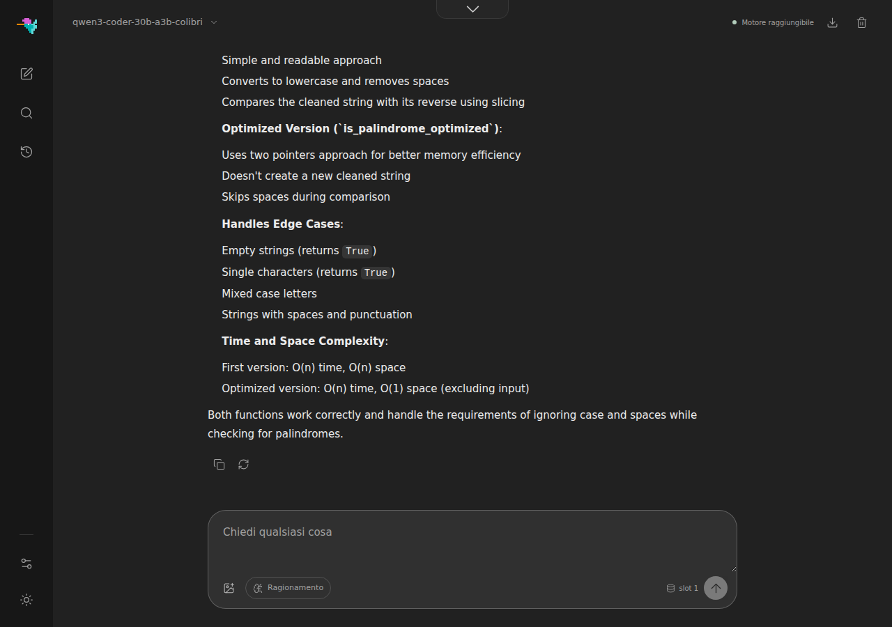

<a id="qwen36-35b-a3b-on-colibri"></a>
# Qwen3.6-35B-A3B на colibri

`c/qwen36.c` пробегает [Qwen/Qwen3.6-35B-A3B](https://huggingface.co/Qwen/Qwen3.6-35B-A3B)
(всего 35 млрд / ~3 млрд активных, Apache 2.0) — гибридная архитектура: 25 % закрытого типа.
Уровни внимания, 75 % Слои Gated DeltaNet (линейное внимание), каждый отслеживается
по потоковому блоку МЧС (256 экспертов, топ-8 + 1 общий). Плотные веса остаются
резидент; маршрутизируемый экспертный поток из контейнера через LRU + закреплен
кэш. Заметки о разработке доступны в `docs/qwen36-phase01.md` /
`qwen36-phase02.md`.

Идентичные по архитектуре контрольные точки (одинаковая геометрия конфигурации, например
КАТ-Кодер-В2.5-Дев) работают на этом движке без изменений.

<a id="quickstart"></a>
## Быстрый старт

Предварительно преобразованные контейнеры (эксперты int4, автономные, ~23 ГБ):

```sh
# group-scaled int4 (gs64) — recommended, see "Which container" below
hf download Kreuzzelg/qwen36-35b-a3b-colibri-i4-gs64 --local-dir ~/Models/qwen36_i4_gs64

# per-row int4
hf download Kreuzzelg/qwen36-35b-a3b-colibri-i4 --local-dir ~/Models/qwen36_i4
```

или самостоятельно конвертируйте исходную контрольную точку bf16 (загрузка ~70 ГБ):

```sh
python3 c/tools/convert_qwen36.py --repo Qwen/Qwen3.6-35B-A3B --out ~/Models/qwen36_i4_gs64 --gs 64
```

Стройте и общайтесь:

```sh
make -C c qwen36
COLI_MODEL=~/Models/qwen36_i4_gs64 ./c/coli chat
```

`coli` считывает `config.json` модели и сопоставляет ее `model_type` с
семейный реестр (`qwen3_5_moe` / `qwen3_5_moe_text` — точное совпадение, поэтому другие
Архитектуры Qwen этим движком не востребованы), берёт его и гонит по протоколу обслуживания — `coli web` и
`coli serve` (API-совместимый с OpenAI) работает таким же образом.

Вызов инструментов поддерживается через HTTP-шлюз с использованием встроенных возможностей Qwen3.6.
Протокол `<tool_call>`/`<tool_response>`. Шлюз осуществляет перевод между
собственный формат и поддерживаемые представления инструментов API; увидеть
[матрица API для каждого движка](api.md#tool-calling-support).

Прямой вызов без шлюза:

```sh
SNAP=~/Models/qwen36_i4_gs64 TOK=~/Models/qwen36_i4_gs64/tokenizer.json \
N_NEW=200 ./c/qwen36 256 4 prompt.txt
```

<a id="cpu-prefill-batching"></a>
## Пакетная обработка предварительного заполнения процессора

На процессорах AVX2/FMA плотные проекции int8 обрабатывают две строки подсказок на каждый вес.
декодировать.  Одно и то же ядро используется вниманием, маршрутизатором, проекциями DeltaNet,
и общий эксперт CPU.  `S=1` декодирование сохраняет исходный четырехрегистровый GEMV,
и сборки, отличные от AVX2, сохраняют установленную реализацию по строкам.  Общий
эксперт дополнительно группирует вызовы «ворота/вверх/вниз» по строкам подсказок с не более чем
32 МБ временных активаций; экспертный уровень CUDA сохраняет общий доступ к каждому токену
работать так, чтобы он мог продолжать перекрывать группы графических процессоров в полете.

Обе оптимизации являются побитовыми и включены по умолчанию.  Для контролируемых A/B:
`QWEN_DENSE_BATCH=0` восстанавливает GEMV с плотностью int8 для каждой строки и
`QWEN_SHARED_BATCH=0` восстанавливает вызовы общего эксперта для каждой строки.  Позитивный
`QWEN_SHARED_BATCH=N` ограничивает каждый общий фрагмент `N` строками.

Требования: ~30 ГБ ОЗУ для удобного профессионального кэширования и хранилище NVMe для
контейнер. Сборка по умолчанию рассчитана только на процессор; `make -C c qwen36 CUDA=1` добавляет
дополнительный экспертный уровень CUDA VRAM, описанный в
[`qwen36-cuda-tier.md`](qwen36-cuda-tier.md). Сборки того же уровня для AMD
через ROCm с `make -C c qwen36 HIP=1 HIP_ARCH=<gfx>` (например
`HIP_ARCH=gfx1151`, где `ROCM_HOME` и `HIPCC` указывают на цепочку инструментов):
измерено на Ryzen AI MAX+ 395, выходной бит идентичен пути CPU и 2,4x
быстрее, чем только процессор (#1502).

<a id="vulkan"></a>
## Vulkan

В сборке `VK=1` (`make -C c qwen36 VK=1`) `COLI_VULKAN=1` добавляет плотный ствол.
устройство Vulkan и перенаправленные эксперты на общем экспертном уровне Vulkan.
(`c/vk_tier.c`, [vulkan.md](vulkan.md#the-routed-expert-tier-vk_tierc)): кэш
эксперты в памяти устройства, заполняемые при запуске из экспертной истории и адаптированные
пока вы общаетесь, вычисляется устройством, пока CPU вычисляет остальную часть
шаг слоя, результаты каждого эксперта присоединяются к своей строке в ранговом порядке. Это занимает каждый
контейнер, который этот движок читает: плоские слоты общего ядра int4-g64, int8
копия контейнера int4 (упакованная обратно в int4 на устройстве), int8 для каждой строки или gs64,
и смешанная раскладка int4gate/up + int8 down. На встроенном графическом процессоре (или Lavapipe)Транк по умолчанию остается на CPU, пока включен уровень, где он стоит больше на
устройство, чем получает уровень; дискретный графический процессор принимает и то, и другое. `COLI_VK_DENSE=0` сохраняет
транк на CPU в любом месте и `COLI_VK_DENSE=1` помещает его на устройство в любое место;
`COLI_VK_TIER=0` выключает ярус (потом транк переходит на устройство).

Раньше этот движок не вёл экспертной истории; с этим уровнем он сохраняет Route_trace.h
`.coli_usage` рядом с контейнером (`COLI_USAGE` перемещает его), сохранено в конце
каждый ход и подачу и заполняет уровень от него при следующем запуске. `coli
setup` дает Qwen3.6-35B-A3B стартовый ([vulkan.md](vulkan.md#the-routed-expert-tier-vk_tierc)). С
`COLI_CUDA=1` также побеждает уровень CUDA.

На интегрированном Radeon 780M, с контейнером int4 gs64 в кап 64 и багажнике
на CPU уровень декодировался на уровне 8.03 tok/s по сравнению с 6.02 CPU и достиг
первый токен промпта из 512 токенов за 12,3 с против 35,7 с, тот же текст; тот
измерения и то, что они не учитывают, находятся в
[vulkan.md](vulkan.md#measured-on-a-radeon-780m). И с плотной цепью.
(по умолчанию для этого движка на интегрированном графическом процессоре этого уровня), декодирование достигло
9,94 tok/s по сравнению с 6,01 процессора и промптм на 512 токенов 9,5 с.
([vulkan.md](vulkan.md#the-chain-on-a-radeon-780m)).

<a id="prompt-lookup-drafts-on-by-default-coli_lookup0-turns-them-off"></a>
## Черновики с быстрым поиском (по умолчанию включено, `COLI_LOOKUP=0` отключает их)

Когда последние токены повторяют n-грамму промпта или вывода (редактирование кода,
цитата, повторяющаяся структура), движок создает до 5 следующих за ней токенов
и проверяет их за одну проверку вперед. Состояние DeltaNet копируется после каждой проверки.
строка, поэтому отклоненный черновик откатывается путем замены копии. Ворота создают черновик только там, где
измеренная приемка и проверка стоимости говорят, что она окупается. Результатом является простое декодирование,
жадный или выборочный, на CPU, в плотной цепочке Vulkan и в цепочке CUDA с каждым
Направленный эксперт по устройству. Поиск остается отключенным на уровне CUDA, удерживающем часть
эксперты, `CACHE_ROUTE` и контейнер qpack, результаты которого зависят от того, что является резидентным. При редактировании кода Qwen3.6-35B-A3B декодировал 7,90 tok/s с поиском по 7,42 без (1,56 токена на пересылку); в чате ворота отклоняли все предложения, а скорость не менялась. Как это работает, гейт, настройки и тесты:
[speculative.md](speculative.md).

<a id="the-mtp-head-q36_mtp"></a>
## Глава MTP (`Q36_MTP`)

`tools/convert_qwen36.py` переносит тензоры релиза `mtp.*` в
`model-mtp.safetensors`. Плотные веса и нормы остаются f16; перенаправленные эксперты используют
именно объединенный формат int8/int4, групповой масштаб или смешанный формат магистрали.
`Q36_MTP=1` загружает этот блок из `SNAP`; не установлено или `0` оставляет его непрочитанным. А
контейнер без блока все еще нормально декодирует и сообщает, что голова
недоступен. Никакой отдельной загрузки модели не требуется.

Для полной конвертации используйте обычную команду. Чтобы добавить голову к существующему
контейнере, только исходные фрагменты, названные `mtp.*` в индексе релиза, являются
необходимо. Эта команда создает новый каталог, связывает базовые файлы и записывает
только заголовок и обновленные метаданные. База никогда не модифицируется; пункт назначения
должно быть новым или пустым, а экспертное квантование наследуется от базового.

```sh
python3 c/tools/convert_qwen36.py --model /path/to/hf-checkpoint \
  --mtp-only --base-container /path/to/converted-int4 \
  --out /path/to/converted-with-mtp
SNAP=/path/to/converted-with-mtp Q36_MTP=1 ./c/qwen36 8 4 "Explain speculative decoding."
```

Вычисления следуют модулю MTP Квена: в позиции p объединяем
нормализованное внедрение токена p+1 с нормализованным выходом магистрали h_p,
затем `mtp.fc`, один уровень вентилируемого декодера с полным вниманием и собственным KV-кэшем,МО (топ-8 из 256 экспертов и закрытый общий эксперт), `mtp.norm` и общий
`lm_head`. **h_p — это выходные данные магистрали после окончательной нормы**, еще раз нормализованные
`mtp.pre_fc_norm_hidden`; более глубокий черновик использует собственные результаты головы после `mtp.norm`.
На выпущенной GGUF 35Б эта проводка прорисовывается лучше, чем остаточная ранее
норма: первые проекты приняли 89,2/88,6/85,7% против 85,1/88,6/84,0% на
Немецкий, английский и кодовая подсказка. `tools/qwen36_mtp_ref.py` вычисляет это с помощью Квен
Слой декодера трансформаторов из точных преобразованных весов и проверки жгутов
движка нет, другая проводка.

Каждый магистральный форвард передает заполненные пары токен/скрытые в головной узел.
КВ-кэш; только черновые строки нуждаются в полном вычислении декодера. Отклонено подтверждение
строки перематываются, а контакты сохраняют ожидающий остаток. Та же проверка
путь при поиске подсказки фиксирует токены: выходные и конечные логиты равны обычным
декодирование, включая выборочные `serve` витки. Что касается поиска, спекуляции отключены
на уровне CUDA, содержащем часть экспертов, `CACHE_ROUTE` и qpack.

`Q36_MTP_DRAFTS=1` — значение по умолчанию; `1`–`7` задают максимальную глубину и
`auto` позволяет измеряемым воротам выбирать. `Q36_MTP_PMIN` (по умолчанию `0`) прекращает добавление
более глубокие проекты, когда вероятность самого нового проекта ниже порога.
`Q36_MTP_VOCAB_IDS` называет список идентификаторов токенов, разделенных пробелами: заголовок
оцениваются только те строки общей выходной матрицы, дубликаты удаляются.
Вероятность тогда зависит от этого словаря. Проверка еще
использует полный словарь модели. Оценки более 20 ниже лучших опускаются.
из суммы вероятностей с плавающей запятой.

`Q36_MTP_VOCAB=N` вместо этого имеет список наиболее часто используемых токенов.
(`draft_vocab.h`, список головы Qwen3.8): токены `N` с наивысшим
засчитывается каждая фишка, содержащая не менее 3/4 от счёта `N`-го, и каждая
маркер разговора; токен, который используется в разговоре вне списка, присоединяется
это сразу. Счет взят из `<model>/.coli_vocab` (`COLI_VOCAB_USAGE` имен
другой файл), каждые 1024 подсчитанных токена делятся пополам и записываются обратно при выходе.
если только `USAGE_SAVE=0`; хотя токены менее `N` имеют счетчик, самые низкие идентификаторы
заполните список. Там, где главный черновик цепочки CUDA, список включен по умолчанию.
с `N` = 16000; в другом месте его просят, и `Q36_MTP_VOCAB=0` всегда дает результат
весь словарь (`N` должен быть целым числом от 0 до номера словаря
размер). Он остается в стороне от цепочки Vulkan и от `Q36_MTP_DUMP`, и
`Q36_MTP_VOCAB_IDS` имеет приоритет. Черновик может быть только зарегистрированным токеном, и
его вероятность в списке условна: при двух и более шашках то есть
что читают `Q36_MTP_PMIN` и `Q36_MTP_PSTEP`. Движок qwen36 остановился из-за
сигнал не пишет отсчёты, ни у кого голова не отключилась во время бега
(`[mtp] ... it stays off`); `coli serve` первым закрывает свой вход, так и происходит.

В цепочке Vulkan голова работает на устройстве: его уровне, его маршрутизации и его
Направлены экспертами через цепочку устройств МЧС, один кадр черновика. `Q36_MTP_GPU=0`
держит голову на процессоре, как и `Q36_MTP_DMOE=0` или устройство без
МО сети. С цепочкой CUDA и каждым маршрутизированным экспертом на карте голова работает
его устройство аналогично (`qwen36_mtp_cuda.h`: оперативники сети, специалисты руководителя
загружен один раз как int8 или int4-g64 уровня и прочитан из экспертной таблицы их
адреса). Там голова, которая не может включить устройство, остается выключенной: рядом с картойГоловка процессора стоила 5,1 мс черновая строка и скорость декодирования упала с 98 до 85-88tok/s. Под
Уровень CUDA, удерживающий часть экспертов, спекулятивных шагов нет, и `Q36_MTP=1`
оставляет голову без головы и говорит так. В цепочке CUDA руководитель также выбирает свой черновик и
вероятность черновика на устройстве (`cc_pick`): 8 байтов составляют черновик, а не
логиты словаря. `Q36_MTP_VOCAB_IDS` и `Q36_MTP_DUMP` снижают баллы.
В списке `Q36_MTP_VOCAB` голова читает только перечисленные строки списка `lm_head`.
уже на карте (`cc_matmul_rows`), а не вся матрица; на карте хранится копия
списка, отправленного целиком после перестроения и по новым идентификаторам после добавления. А
бэкэнд без `matmul_rows` забивает весь словарь.

Измерено на RTX PRO 4000 до списка `Q36_MTP_VOCAB`, голова получила оценку
весь словарь (Qwen3.6-35B-A3B int4-g64, `coli serve`, ответы из 128 токенов, два
чередующиеся раунды по три):

| `Q36_MTP_DRAFTS` | Цепь Vulkan | Цепочка CUDA | принятые проекты |
|---|---|---|---|
| нет головы | 84,2-86,0 tok/s | 97,9-98,2 tok/s | |
| 1 (по умолчанию) | 93,9-97,4 tok/s | 106,8-108,5 tok/s | 84-87% |
| 2 | 82,0-83,7 tok/s | 90,6-91,3 tok/s | 62% |
| 3 | 67,6-70,7 tok/s | | 42% (ответ в 300 токенов) |

Проверка большего количества строк считывает больше перенаправленных экспертов: из прямых подсчетов прогонов
проверка двух строк занимает около 1,5 шагов декодирования, а проверка одной из трех — около 2.
черновой ряд от 1,5 до 1,7 мс, один черновой — это та глубина, которая окупается. Жадная история 232
слова — это один и тот же текст в обеих цепочках, с головой и без нее. Только на процессоре этой машины
(Core i5-13500, ответы 96 токенов) один черновик занимает декодирование с 13,7-13,9 до
14,7-14,9tok/s, принято 74% проектов. Жадные ответы с заголовком и без него побайтно идентичны.
`tests/vulkan_engines.sh qwen-spec` управляет жгутом ниже в цепи на Lavapipe.

Исторические измерения более раннего прототипа MTP, Radeon 8060S (Strix
Halo, RADV), Qwen3.6-35B-A3B int4-g64, уровень 24 ГБ, цепочка включена, ответ на 256 токенов:

| багажник | без головы | с головой | принятие |
|---|---|---|---|
| int8 | 37,6 tok/s | 44,4 tok/s | 90,6% |
| int4 | 45,6 tok/s | 52,0 tok/s | 89,0% |

Отдельное сравнение глубины составило 65,3/63,0/63,0tok/s и 1,78/2,07/.
2,48 токена за пересылку на глубине 1/2/3. Они сохраняются как исторические.
контекст, **не измерения этого порта контрольной точки**: веса и скрытое состояние
проводку поменяли, поэтому приёмку и скорость надо замерять заново.

`make -C c qwen36-tiny-mtp-check` генерирует прибор со слитыми экспертами и
случайная голова под названиями релизов. В контейнерах int8 и int4-g64 проверяется
черновые логиты по независимому эталону (абсолютный допуск `1e-6`),
каждая глубина до семи с естественными/принудительными предложениями, байтовый вывод
и окончательные логиты, контроль словарного запаса/вероятности и несколько ходов `serve`.
включая повторное использование префиксов и восстановление контактов. `Q36_MTP_FORCE=reject|accept|mixed|cycle|row1..row7`
и `Q36_MTP_DUMP=<file>` — контрольные тесты, соответствующие жгуту Qwen3.8.

<a id="the-expert-kernel"></a>
## Экспертное ядро

Направленные эксперты проходят через `c/expert_ffn.h`, заголовок общий с остальными.
Движки MoE, а не набор собственных GEMV этого движка. Три вещи
изменилось вместе с ним, измерено на реальном контейнере gs64 при полной резидентности на
8-ядерный блок AVX-512 (61 ГБ, DDR5-5600, чтение DRAM 58 ГБ/с):

- **Int4 остаётся int4.** Движок, используемый для распаковки каждого эксперта в int8 внагрузка; ядро сохраняет полубайты контейнера, один раз переупакованные в планарный
  макет, где `and 0x0F` дает 32 элемента по порядку, а `srli 4` — другой
  32, поэтому блок не требует инструкций по распаковке. Половина байтов на токен и половина
  RSS экспертного кэша: пиковый размер RSS при ограничении 256 увеличился с 25 ГБ до 15 ГБ.
- **Слой — это единица работы.** Gate+up разделяет один проход активации,
  и элементы разделения потоков (эксперт, фрагмент строки): два региона OpenMP на слой
  вместо 3 х топ-к. Строка запроса направлена эксперту, уже есть другая строка
  Used читает этот эксперт из кэша, а не из DRAM.
- **Те же токены.** Активации остаются f32 (в ядре также есть int8
  режим активации, `mode 1`, сюда не подключен: та же политика, что и `IDOT`).
  единственное отличие от старого пути — порядок накопления внутри точки;
  жадное декодирование 1024 токенов в реальном контейнере идентично по байтам, а CI
  контакты старые и новые на крошечном приспособлении int4 на контактах 1, 2, 8 и 16.

При жадном декодировании из 1024 токенов с ограничением 256 (та же подсказка, байт-идентичная
текст): 12,8 -> 15,7 tok/s, МоЭ на токен 34 -> 20 мс в среднем и 30 -> 17
мс в последних виндах, пик RSS 29 -> 17 Гб. Из 20 мс 11 — ядро
(пол DRAM для байтов int4 равен 9), а 6 — это остаточные промахи
97,6% попаданий, скачивание по одному; эта выборка - это следующее, что нужно сделать
перекрытие, а не это ядро. `tests/test_expert_ffn` содержит цифры.
`QWEN_EXPERT_KERNEL=0` восстанавливает путь int8 для A/B. Экспертный уровень CUDA
использует это ядро и для экспертов, которые оно оставляет CPU, и преобразует
плоские байты в свою собственную парную компоновку при их загрузке (#2090).

<a id="the-dense-trunk-integer-dot-products"></a>
## Плотный ствол: целочисленные скалярные произведения

Каждый плотный GEMV токена, входящие и исходящие проекции DeltaNet,
внимание q/k/v/o, общий эксперт и lm_head, используемые для умножения int8
веса активациями f32: каждый байт веса преобразуется в f32 и подается в
FMA, восемь весов на команду. На 16-ядерном хосте AVX-512 lm_head
(248320 x 2048 int8, 508 МБ) работал со скоростью 29 ГБ/с на шине памяти, которая выполняет 80:
ядро было пределом, а плотная часть токена - 1,9 ГБ int8
на 35Б - в три раза больше, чем прочитали разгромленные эксперты.

Начиная с версии 1.12.1 активация квантуется до int8 один раз за вызов (одна шкала,
amax/127, тот же контракт, который используют экспертные целочисленные ядра) и продукты
являются целыми числами: 16 весов на инструкцию в SSSE3 (пары maddubs + madd), 32 в AVX2, 64 в AVX-512 VNNI, точные
Суммы int32 масштабируются один раз для каждого вывода. Разгромленные эксперты идут тем же путем для
их активации. Измерено на Qwen3.6-35B-A3B, 8 потоков, 300 декодированных
токены, каждый резидент-эксперт, недоумение на 4 x 512 токенах английского текста:

| | tok/s | мс/токен: проект DeltaNet/выход, внимание, lm_head, экспертные вычисления | недоумение |
|---|---|---|---|
| активации f32 (1.12.0) | 6,71 | 21,9/8,6, 9,5, 12,6, 22,7 | 13,79 |
| активации int8, плотный ствол (`COLI_DENSE_IDOT=1`) | 7.35 | 17,4/6,3, 7,7, 10,2, 22,7 | 13,92 (+1,0%) |
| активации int8, перенаправленные эксперты (`QWEN_EXPERT_ACT=i8`) | 7.20 | 21,9/8,6, 9,5, 12,6, 15,9 | 13,80 (+0,1%) |
| оба (по умолчанию 1.12.1) | **8,23** (+22,6%) | 17,2/6,3, 7,5, 10,1, 15,6 | 13,97 (+1,3%) |

Оба являются значениями по умолчанию; `COLI_DENSE_IDOT=0` и `QWEN_EXPERT_ACT=f32`
восстановить ядра f32, которые остаются побитно идентичными своим ссылкам.**int4 для магистрали предоставляется по желанию, для каждого компонента.** `COLI_DENSE_BITS=4` магазинов
плотные матрицы типа int4 в блоках по 64 с одной шкалой на блок (
планарное расположение сгруппированного экспертного ядра) и уменьшает вдвое байты токена.
читает, но части ствола платят 4 бита совсем по-разному, поэтому
`COLI_DENSE_INT4` выбирает, кто его возьмет:

| int4 на | tok/s | недоумение |
|---|---|---|
| ничего (int8) | 7.35 | 13,92 |
| `lmhead` | 8.15 (lm_head от 10,1 до 8,4 мс; общее количество находится в пределах шума потепления кэша) | 14,13 (+2,4% против f32) |
| `lmhead,dnproj,dnout` | | 14,56 (+5,6%) |
| `lmhead,dnproj,dnout,shexp` | | 14,94 (+8,3%) |
| все (`attn` включено) | 8.09 | 15,17 (+10%) |

Было опробовано уточнение блочной шкалы по методу наименьших квадратов, но ничего не изменилось.
(15,16 против 15,17): потеря связана с чувствительностью матриц, а не с
квантователь. Если вы возьмете один, возьмите `lmhead`: на 254 МБ меньше за токен для
наименьшая стоимость.

<a id="canonicalqc-the-dense-trunk-converted-once"></a>
## `canonical.qc`: плотный ствол конвертировался один раз

При каждом запуске движок считывает плотные матрицы (16-битные числа с плавающей запятой).
контейнер) и квантует их до int8 (`qw_quantize`): 1,9 ГБ int8 на
35B, сделанный из 3,9 ГБ копий от f16 до f32. `qwen36-canonical` делает это
преобразование один раз и записывает результат рядом с моделью (1,94 ГБ диска для
35Б). Инструмента нет в архивах релиза; соберите его из исходного кода:

```sh
make -C c qwen36-canonical
./c/qwen36-canonical /path/to/model        # writes /path/to/model/canonical.qc
```

Когда присутствует `canonical.qc` (или `QWEN_DENSE_CACHE` называет его), движок читает
матрицы из него вместо их преобразования: те же байты, значит, те же
логиты, без конвертации и ее f32-копий при запуске. Они копируются в
обычная память, как после преобразования, и файл закрывается, как только они будут:
CPU считывает каждую плотную матрицу в каждом токене. Тогда на M1 с 8 ГБ памяти будет модель 35B.
готовность за 3,6 с вместо 4,4 с пиковым объемом памяти 3,5 ГБ вместо
4.7 и той же скорости ([манифест эксперимента](experiments/qwen36-canonical-dense-2026-10-07/manifest.json)).

Перед использованием файл сверяется с моделью: список матриц
и их формы, квантователь (`QDF_QUANTIZER`), а также первый и последний 128
байты каждой исходной матрицы. Итак файл сделанный из других весов (полная доводка
той же формы) или для другого квантователя не используется. Контрольные образцы
источник и не является контрольной суммой: редактирование, ограниченное серединой матрицы,
не виден, а строки int8 файла не проверяются. Файл рядом с
модель, которая не соответствует (другие веса, преобразователь, измененный с помощью
обновление движка, поврежденный файл) откладывается с указанием причины, а матрицы
конвертируются при старте как и без него; тогда снова запусти `qwen36-canonical`. Файл
имя по `QWEN_DENSE_CACHE`, которое не соответствует, останавливает запуск с указанием причины.

Он используется только там, где каждая плотная матрица является копией int8, которую сделал бы движок:
вся модель, `COLI_DENSE_BITS=8` (по умолчанию), нет `COLI_KEEP_F32` и запуск
на CPU, а не с `COLI_CUDA=1` или `COLI_VULKAN=1`, и не в Сегменте и
Краевые адаптеры. Сборка `VK=1`, работающая на процессоре, как Linux и Windows.
двоичные файлы релиза обходятся без `COLI_VULKAN=1`, используют его. Инструмент конвертирует BF16, F16
и плотные матрицы F32 с префиксом `language_model.` или без него (
контейнеры `convert_qwen36.py`); он не конвертирует контейнер qpack
аффинные матрицы. Удалите файл, чтобы вернуться к первоначальному преобразованию.

<a id="cache-aware-routing-cache_route-off-by-default"></a>
## Маршрутизация с учетом кэша (`CACHE_ROUTE`, по умолчанию отключено)

Остаточные промахи, указанные выше, являются целью рычага. `CACHE_ROUTE=1` портируетПеренаправление максимального ранга движка GLM ([CACHE_ROUTE.md](CACHE_ROUTE.md),
arXiv:2412.00099) к этому движку с двумя уровнями резидентности: внутри верхнего-`M`
окно, прорезь за священным верхом - `J` предпочитает эксперт, уже во VRAM
уровень, затем один в кэше ОЗУ, затем обычный рейтинг. Это **с потерями**: это
изменения, которые запускают эксперты, поэтому семантический контракт отключен, пока он установлен, и
в нижнем колонтитуле указана его стоимость, `route_agree` (перекрытие с настоящей вершиной-K)
и `route_kl` (массовый KL), рядом со ставками свопа и попадания. Сбросил настройки, роутер
— это исходный цикл, а идентификаторы токенов побайтно идентичны; `ROUTE_AGREE=1`
самостоятельно печатает счетчики со значением 100 %/0, не трогая маршрутизацию.

Qwen3.6 направляет топ-8 (плюс общий эксперт), поэтому по умолчанию `ROUTE_J=2`
оставляет шесть заменяемых слотов на токен; крошечный прибор направляет топ-2 и
требуется `ROUTE_J<2`, чтобы вообще показать какой-либо обмен. A/B это так, как это сделано в документе GLM:
та же подсказка и начальное значение, tok/s и процент попаданий по соглашению и KL, и обработка
`PPL=1` по требованию учителя как планке качества.

<a id="which-container"></a>
## Какой контейнер?

Контейнер gs64 имеет по одной весовой группе на 64 веса вместо одной на каждую весовую группу.
ряд. По отношению к контейнеру для каждой строки он измерил косинус к якорю int8
0,99313 вместо 0,98777 и KL 0,080 вместо 0,109, примерно на 44% меньше.
ошибка квантования. В GLM построчный int4 был основной причиной циклов режима мышления и
бесконечные поколения (#455), а групповые шкалы фиксировали их в
контролируемые A/B — с `moe_intermediate_size=512` строки Квен короткие, поэтому
ошибка квантования на строку концентрируется таким же образом. Стоимость контейнера gs64
Еще ~1,7 ГБ на диске и несколько процентов при холодном запуске; скорость теплого декодирования
то же самое или немного лучше.

**Смешанный: int8 `down`, int4 Gate/up.** `convert_qwen36.py --ebits 4 --gs 64
--down-bits 8` (`--down-gs` для сгруппированных вниз масштабов, 0 = для каждой строки) записывает один
плита на эксперта с `down_proj` в int8 и воротами/вверх, как указано выше — 5,7 бита на
вес против 4,5 у gs64. Это ручка, которая создала цифры #1370 на
wikitext-2 (16 x 512 токенов): gs64 7,325, смешанный 7,281, все эксперты int8 7,153,
Q4_K_M Олламы 7.147 -- `down` в одиночку восстанавливает четверть отставания от int8,
остальное находится в гейте/вверх, и при равных битах асимметричный квантователь Q4_K_M
впереди. Используйте его как инструмент измерения и промежуточный этап для коробок с оперативной памятью.
запасной; это не ответ на пробел. Движок различает макет по
размер и считывает каждую матрицу в своем формате на пути CPU; CUDA видеопамять
уровень принимает один формат для каждого эксперта, поэтому маршрутизируемые эксперты смешанного контейнера
оставайтесь на процессоре, говорит строка под `COLI_CUDA=1`; плотный ствол все еще
переходит на карту (#2090).

<a id="which-checkpoints-and-what-the-banner-calls-them"></a>
## Какие контрольно-пропускные пункты и как они называются на баннере

Эти контрольно-пропускные пункты Qwen относятся к этому движку: два гибридных MoE, которые заявляют
`model_type: qwen3_5_moe_text`, плотный, который объявляет `qwen3_5`, и
все внимание Qwen3 MoE (`qwen3_moe`) Qwen3-Coder:

| контрольно-пропускной пункт | слои | эксперты | скрытый | баннер |
|---|---|---|---|---|
| Qwen/Qwen3.6-35B-A3B | 40 (10 внимание) | 256, топ-8 | 2048 | `Qwen3.6-35B-A3B · 35B MoE` |
| Qwen/Qwen3.8-2.4T-A95B | 92 (23 внимание) | 512, топ-10 | 8192 | `Qwen3.8-2.4T-A95B · 2.4T MoE` |
| Квен/Квен3.8-27B | 64 (16 внимание) | нет: один MLP из 17408 на слой | 5120 | `Qwen3.8-27B · 27B` |
| Qwen/Qwen3-Coder-30B-A3B-Инструкция | 48 (все внимание) | 128, топ-8 | 2048 | `Qwen3-Coder-30B-A3B · 30B MoE` || мозг/Qwen3-Coder-REAP-25B-A3B | 48 (все внимание) | 103, топ-8 | 2048 | `Qwen3-Coder-REAP-25B-A3B · 25B MoE` (название, здесь не указано) |

Реестр называет контрольную точку по ее геометрии (`display_variants` на
`qwen36` дескриптор), поэтому на баннере указано, что находится на диске. Конфигурация, которая
не соответствует ни одному из них, например, крошечный прибор имеет собственное имя
`model_type` и измеренная геометрия, а не параметр родственного брата
считать (#1045).

GGUF 2.4T **архитектура идентична** 35B: тот же уровень.
шаблон, каждая защита движка держит, а планировщик реестра ставит свой КВ
кэш размером 1,44 ГиБ для контекста 8 КБ и 46 ГиБ при максимуме 256 КБ, с
контекстно-свободное состояние DeltaNet размером 0,55 ГиБ. Чего этот движок не может сделать для этого
удерживается экспертами: теплый старт по замыслу удерживает каждого эксперта в оперативной памяти (см.
`--ram` ниже), что составляет ~1,4 ТБ int4 для 2,4T. Для его обслуживания необходимо
дизайн потоковой передачи с диска, а не этот. Преобразование и проверка геометрии
так что работа начинается с проверенной формы, а не с предположения.

<a id="the-dense-27b"></a>
### Плотный 27Б

Qwen3.8-27B (#1757) — это `Qwen3_5ForConditionalGeneration`: тот же Закрытый
DeltaNet + уровни контролируемого внимания, с одним SwiGLU MLP на каждый уровень и без
маршрутизатор. Движок загружает этот MLP как общий эксперт, нерегулируемый и маршрутизирует.
ничего; конвертер записывает `num_experts: 0` и ширину MLP в
`qwen36_meta.json`. Он поставляется с Qwen3.8 `chat_template.jinja`, а не с Qwen3.6.
(тот же файл, к которому привязан рендерер qwen38): конвертер копирует его
в контейнер, а шлюз распознает его и выполняет рендеринг с помощью
Правила Qwen3.8 (по умолчанию `xhigh`, форма вызова инструмента XML,
история, которая продолжает думать), пока движок остается qwen36. Модель API
идентификатор `qwen3.8-27b-colibri`.

```bash
python3 tools/convert_qwen36.py --model <Qwen3.8-27B download> --out q27_c
./coli chat --model q27_c --gpu none
```

Контейнер сохраняет веса в f16 (51 ГБ), а движок квантует.
их во время загрузки. Каждый вес считывается для каждого токена, поэтому скорость устанавливается
пропускная способность памяти, а не диска. Измерено на сервере с 16-поточным процессором.
(8 потоков OpenMP), недоумение над 1000 токенами рукописного текста:

| плотные гири | RSS | подсчет очков | недоумение, английский | недоумение, итальянский |
|---|---|---|---|---|
| int8 (по умолчанию) | 29,1 ГБ | 2.25 tok/s | 4,85 | 11.19 |
| `COLI_DENSE_BITS=4 COLI_DENSE_INT4=shexp,lmhead` | 21,6 ГБ | 3.15 tok/s | 4,94 (+1,8%) | 11,69 (+4,5%) |
| `COLI_DENSE_BITS=4` (все) | 18,8 ГБ | 3,72 tok/s | 5,02 (+3,5%) | 12,15 (+8,6%) |

Через шлюз (`coli serve`) жадное декодирование выполнялось со скоростью 2.1 tok/s в int8 и
3.45 tok/s со всем в int4, после загрузки 73 и 114 с; ответы
к тому же английскому, итальянскому и турецкому вопросы были одинаковыми, но на слово.

MLP — это 17 из 27 миллиардов параметров, поэтому int4 в MLP и голове LM
сохраняет большую часть сбережений при половине потерь. С матрицей в int4 движке
больше не сохраняет свою копию int8 (`COLI_DENSE_KEEP_I8=1` сохраняет); вот что
увеличивает полный пробег int4 с 42,4 до 18,8 ГБ.

<a id="images"></a>
#### Изображения

Qwen3.8-27B читает изображения. Его обзорная башня — это ViT всей семьи.
(27 блоков, скрытые 1152, патч 16, объединение 2x2; следует только ширина вывода
текстовую модель), поэтому движок пропускает ее через тот же самый `qwen38_vision.h`
использует движок qwen38, теперь разделенный на потоки OpenMP. Конвертер копирует
его в `model-vision.safetensors` и записывает его форму в
`qwen36_meta.json` вместе с `preprocessor_config.json`.

Особенностью этой семьи является то, где изображение находится на веревке.
В слоях внимания используется чередующийся M-RoPE (`mrope_section` [11, 11, 10]):токен изображения при слиянии (строка, столбец) поворачивается на (начало, начало + строка,
start + col), текст после возобновления изображения в start + max(rows, cols),
и каждая последующая позиция несет это смещение (`rope_deltas` HF).
движок точно следует за `Qwen3_5Model.get_rope_index`; с простым 1D
позиции крошечный оракул ниже теряет 10 из 16 токенов.

Изображение достигает его так же, как оно достигает других зрительных систем: путь в
сообщение `coli chat`, вложение в `coli web` или часть `image_url`
`/v1/chat/completions`. Одно изображение на запрос. `Q36_MAX_IMAGE_TOKENS`
ограничивает токены, стоящие за изображением (собственный потолок препроцессора намного выше
чего хочет предварительная загрузка CPU); изображение сжимается, а не обрезается.

`tools/make_qwen36_vl_tiny.py` собирает игрушку `Qwen3_5ForConditionalGeneration`
и референс от трансформеров с одним изображением размером 4 х 8 патчей; движок
соответствует токену за токеном, а `tests/test_qwen36_vision_serve.py` содержит
Путь кадра IMAGE к тем же токенам. Qwen3.6-35B несет такую же башню, поэтому
Контейнер 35B, преобразованный с помощью этого конвертера, также получает изображения; только у 27B есть
был запущен с реальными фотографиями.

Еще нет: уровень CUDA (плотная контрольная точка выполняется на CPU), голова MTP
(пропускается конвертером), видео и контейнер int4 на диске.

<a id="qwen3-coder-30b-a3b"></a>
### Qwen3-Coder-30B-A3B

Qwen/Qwen3-Coder-30B-A3B-Instruct (Apache-2.0) — `Qwen3MoeForCausalLM`: 48
слоев внимания и нет DeltaNet, нет выходных шлюзов внимания, нет общего эксперта,
вращающийся по всей головке (`rope_theta` 1e7), простые гири RMSNorm и 128
эксперты топ-8 перенормированы (`norm_topk_prob`). Конвертер распознает
`model_type: qwen3_moe` и записывает именно это в `qwen36_meta.json`
(все внимание `layer_types`, `shared_inter: 0`, `partial_rotary_factor: 1.0`,
`zero_centered_norms: false`); затем движок пропускает общий эксперт и
передает выход внимания без ограничения. Чернослив REAP такой же
архитектура с меньшим количеством экспертов и решение одной семьи под их руководством
собственное имя. Шаблон чата собственный: инструменты в виде XML, звонки в виде
`<tool_call><function=...><parameter=...>`, и вообще не думать. Шлюз
распознает его из шаблона, визуализирует побайтно
(`tests/test_qwen3_coder_chat_template.py` привязывает его к релизу
`chat_template.jinja`) и держит `enable_thinking` выключенным. Идентификатор модели API:
`qwen3-coder-30b-a3b-colibri`.

```bash
hf download Qwen/Qwen3-Coder-30B-A3B-Instruct --local-dir qwen3-coder     # 61.1 GB, bf16
python3 tools/convert_qwen36.py --model qwen3-coder --out qwen3-coder-i4 --ebits 4 --gs 64
coli serve --model qwen3-coder-i4 --cap 128     # every expert in RAM
coli serve --model qwen3-coder-i4 --cap 32      # 6.5 GB resident
```

Контейнер int4 gs64 имеет размер 19 ГБ и преобразуется менее чем за минуту; `--ebits 8`
дает 30 ГБ int8. Как и везде на этом движке, размер `--cap`
экспертный кэш, а `--ram` нет (см. ниже).

Против выпуска bf16, по коду из 325 токенов, вопрос и ответ, учитель
принудительно (логиты каждой позиции; ссылка считывает релиз на одном уровне
время в f32):

| эксперты | плотный ствол | топ-1 = bf16 | перекрытие топ-5 | среднее значение \|Δ log p\| | макс \|Δ log p\| |
|---|---|---|---|---|---|
| int4 gs64 | int8 (по умолчанию) | 96,9% | 91,1% | 0,176 | 3,74 |
| int4 gs64 | f32 (`COLI_DENSE_I8=0`) | 96,0% | 91,7% | 0,134 | 2,59 |
| int8 | int8 | 95,1% | 95,2% | 0,098 | 2.13 |
| int8 | ф32 | 98,1% | 97,8% | 0,022 | 0,60 |

Декодирование на Ryzen 7 PRO 8700GE (8 ядер, 64 ГБ, NVMe RAID), CLI с холода
кэш, 128 токенов, плотный ствол int8:

| контейнер | эксперты кэшируются для каждого слоя | декодировать | резидент |
|---|---|---|---|
| int4 gs64 | 128 (все) | 8.5 и 9.6 tok/s (два прогона) | 15,2 ГБ |
| int8 | 128 (все) | 6.4 tok/s | 25,1 ГБ |
| int4 gs64 | 32 | 5.1 tok/s | 6,5 ГБ |
| int8 | 32 | 3.8 tok/s | 9,6 ГБ |

Через `coli chat` с `--cap 128` и теплым кэшем, ответ из 577 токенов
трансляция в 13tok/s. Предварительное заполнение — это медленная часть CPU: запрос, инструмент которого
блок выдает подсказку о 500 токенах, занимает около двух минут с холода
кэш.

<a id="flint"></a>
### Флинт

[RecursiveSI/flint](https://huggingface.co/RecursiveSI/flint) (Apache-2.0) — это
40B MoE с активным 2,5B (`model_type: flint`): 49 слоев внимания,
первые два плотные (один МЛП из 6144), остальные 47 с 256 экспертами топ-6 (512
шириной) рядом с нерегулируемым общим экспертом (шириной 1024), проложенным по сигмовидной и
перенормированный. У каждой головы внимания есть ученый приемник
(`self_attn.softmax_offset`: еще один логит в знаменателе softmax, при этом
нет значения); 35 слоев видят скользящее окно на 513 позиций (свои
включено) с RoPE, остальные 14 каждой позиции без него; 32 головки запросов,
4 головки КВ, головка габарит 128.

Все это управляется CPU, цепочкой Vulkan и цепочкой CUDA. Токенизатор
разбивает цифры на три, и CJK запускается раньше, чем правила букв o200k
(`tests/test_qwen36_tokenizer_flint.c` против токенизаторов HF). Чат
шаблон — это форма вызова инструментов GLM без переключения мышления: модель пишет
`<think>`, когда он решает рассуждать, и шлюз записывает следующее:
рассуждения (`tests/test_flint_chat_template.py` удерживает рендерер на
шаблон релиза побайтно). Ход заканчивается на любом из четырех токенов
модель объявляет (`<|end_of_text|>`, `<|user|>`, `<|observation|>`,
`<|developer|>`: `eos_token_id` config.json, `eog_token_ids` GGUF);
после вызова инструмента модель пишет `<|observation|>`, а инструмент отвечает
там. `tools/make_flint_tiny.py` пишет крошечное
Flint со ссылкой на float32; CI запускает его по пути GGUF («Linux (сгенерированный
qwen36 оракулы)`).

```bash
hf download RecursiveSI/flint --local-dir flint                    # 75 GB, bf16
python3 tools/convert_qwen36.py --model flint --out flint-i4 --ebits 4 --gs 64
coli import flint-UD-Q3_K_XL.gguf                                   # or any unsloth/flint-GGUF file
```

Каждый опубликованный файл и контейнер int4 gs64 на RTX PRO 4000.
(24 ГБ) с 62 ГБ ОЗУ: подсказка на 161 токен и 127 токенов, подсказка/декодирование
в tok/s, медиане трех пробежек после разминки. НЛЛ – это метод, навязанный преподавателем.
потеря в натах на токен за первые 2048 токенов текста GPL-3, на
Цепочка Vulkan: текст, который модель знает почти наизусть, поэтому теряется каждый бит.
шоу. (По тексту, который он не знает, 2048 токенов собственных документов colibri и
коде, каждый файл от BF16 до UD-IQ1_M находится между 2,30 и 2,42, а
порядок теряется в шуме.)

| файл | размер | НЛЛ | процессор | Цепь Vulkan | Цепочка CUDA |
|---|---|---|---|---|---|
| БФ16 | 79,6 ГБ | 0,534 | 9 / 2,4 | 66 / 28,1 | 9 / 2,4 |
| Q8_0 | 42,3 ГБ | 0,537 | 89/13,9 | 81 / 54,5 | 57 / 29,8 |
| UD-Q6_K_XL | 36,3 ГБ | 0,541 | 86/15,4 | 116 / 65,7 | 104/51,4 |
| UD-Q5_K_XL | 29,9 ГБ | 0,547 | 89/15,4 | 208/79,6 | 153 / 62,5 |
| UD-Q4_K_XL | 25,1 ГБ | 0,560 | 95/15,8 | 210/77,7 | 248 / 77,4 |
| int4 gs64 (`convert_qwen36.py`) | 25,2 ГБ | 0,599 | 124 / 17,1 | 903/94,6 | 949/99,0 |
| UD-Q3_K_XL | 18,5 ГБ | 0,661 | 73 / 15,8 | 748/95,9 | 745/113,8 |
| UD-IQ3_XXS | 14,5 ГБ | 0,859 | 59 / 15,0 | 755/90,3 | 696/120,0 |
| UD-Q2_K_XL | 13,6 ГБ | 0,864 | 64 / 16,6 | 802/97,7 | 734/128,1 |
| UD-IQ2_XXS | 11,9 ГБ | 1,045 | 67 / 17,7 | 811/95,8 | 738 / 133,0 |
| УД-IQ1_М | 11,4 ГБ | 1.139 | 65/17,3 | 816/95,8 | 743/131,3 |

До UD-Q3_K_XL на карте сидит каждый эксперт. Из UD-Q4_K_XL на GGUF
нет, и промпт будет соответствовать тому, что дают пул хостов и CPU; тот
Пул хостов сети Vulkan поддерживает больше декодирования, чем уровень CUDA. БФ16
эксперты файла не являются типом, который вычисляет цепочка CUDA: с `COLI_VULKAN`
unset сборка CUDA передает такой файл в цепочку Vulkan на той же карте
([gguf.md](gguf.md)); столбец CUDA работает с `COLI_VULKAN=0`, все включенопроцессор. UD-IQ3_XXS стоит того же качества, что и UD-Q2_K_XL, за еще один ГБ:
UD-Q3_K_XL — самый маленький файл, в котором хранится большая часть данных.

<a id="muse-spark-open"></a>
### Муза Искра Открыть

[мета-модели/Muse-Spark-Open-816B-A42B](https://huggingface.co/meta-models/Muse-Spark-Open-816B-A42B)
запускается из своих GGUF ([unsloth/Muse-Spark-Open-816B-A42B-GGUF](https://huggingface.co/unsloth/Muse-Spark-Open-816B-A42B-GGUF),
от UD-IQ1_S (176 ГБ) до UD-Q4_K_XL (505 ГБ), только текст. Его лицензия позволяет вам использовать,
изменить и перераспределить его; продукт, в котором он используется, имеет надпись «Создано с помощью Muse Spark».
Открыто», а бизнес модели как услуги с оборотом более 20 миллионов долларов в год нуждается в
соглашение с Meta (LICENSE.md в репозитории).

62 слоя внимания, скрытых 8192, 128 головок запроса из 64, свыше 16 головок КВ: 46
слои видят окно из 2048 позиций с RoPE, остальные по 16 в каждой позиции
без этого. Что добавляет для него движок (`model_type: muse_spark`, GGUF's
`muse-spark`):

- RMSNorm без веса на вложении, на каждой голове внимания
  выход и по ветке внимания; ворота внимания сами по себе
  проекция ввода внимания;
- остаточный вентиль после внимания и после прямой связи:
  x = альфа * x + бета * ветвь;
- роутер по скрытой ширине, его логиты умножены на 0,177, топ-8 из 256
  выбирается на основе сигмовидной кости + смещение и взвешивается по сигмовидной кости; эксперты по ширине
  4096 между проекцией вниз и одной назад, нормализованной спереди, и
  результаты каждого эксперта масштабируются, а затем нормализуются перед суммированием;
- логиты, умноженные на 0,177, ограниченные 20 tanh(x/20).

Опубликованные GGUF содержат строки q и k с двумя половинками каждой головы.
чередующиеся (вращающиеся пары соседние); движок возвращает их под нагрузку, а
байтовая копия целых строк, поэтому каждое ядро вращает половины, как и другое
модели (`Q36_GGUF_ROPE_PERM=0` сохраняет порядок в файле). Токенайзер принадлежит o200k.
разделить по правилу tiktoken, согласно которому фрагмент словаря является этим токеном
(`tests/test_qwen36_tokenizer_o200k.c`: идентификаторы HF в 102 текстах, в приборе и
на выпуске 202048 штук).

Формат чата — сообщения получателям: модель пишет `to=self` для своего
рассуждения, `to=commentary` для обновлений между вызовами инструментов, `to=user` для
ответ и имя функции для вызова, записанное как `<atem:function_calls>`
блок. Шлюз отображает `chat_template.jinja` байт за байтом релиза.
(`tests/test_muse_chat.py`; шаблона нет в репозитории, его лицензия
путешествует с каждой копией: `COLI_MUSE_TEMPLATE=path/to/chat_template.jinja` пробегов
чек), сохраняет рассуждение как `reasoning_content`, анализирует вызовы с помощью
схемы инструментов и останавливается на `<|eot|>`. `reasoning_effort` устанавливает рассуждение
сила (низкая 8, средняя 32, высокая 256, xhigh 512, значение шаблона по умолчанию); тот
В шаблоне нет переключателя, позволяющего отключить рассуждения, поэтому отключение размышлений является низким.

```bash
coli import Muse-Spark-Open-816B-A42B-UD-IQ1_S-00001-of-00005.gguf    # every part next to it
coli serve --model Muse-Spark-Open-816B-A42B-UD-IQ1_S.colibri
```

UD-IQ1_S (175,6 ГБ) на RTX PRO 4000 (24 ГБ) с 62 ГБ ОЗУ и двумя NVMe
диски в массиве md через `coli serve`: промпт из 303 токенов (шаблон
системное сообщение и вопрос из 120 слов) и 63 токена, по три запуска каждый, tok/s:

| путь | подсказать | декодировать |
|---|---|---|
| Цепочка, уровень и пул хостов Vulkan | 5,0-5,3 | 1,55-1,58 |
| Цепочка и уровень CUDA | 3,5 | 1,34-1,40 |
| процессор | 3.0 | 0,83-0,89 |

Плотная часть (17,3 ГБ блоков файла) находится на карте. Уровень Vulkanа
вмещает 193 эксперта и еще около 3600 в хост-пуле объемом 34,5 ГБ на карте
читает через PCIe; кэш ОЗУ хранит 8 слоев, а остальные 15872 приходятс диска. Подсказка касается почти каждого эксперта каждого уровня, поэтому она запускается
при чем диск дает. На CUDA вычисляются эксперты, которых нет на карте.
на CPU подсказки отправляются в одном пакете для каждого эксперта.

`tools/make_muse_tiny.py` пишет крошечная Muse Spark GGUF в опубликованном
расположение файлов, включая ротационный порядок и его жадное продолжение (CI: `Linux
(сгенерированные оракулы qwen36)`): CPU, цепочка и уровень CUDA, а также Vulkan.
цепочка и уровень дают свои токены. С помощью экспертов Q8_0, `--act f32` пишет Vulkan
ссылка (он считывает входные данные экспертов как числа с плавающей запятой, CPU и CUDA как int8),
и `--max-new 8 --min-gap 0.2` сохраняет int8 без округления, которое
отличается от одного процессора к другому. Уровень Vulkan содержит экспертов F32 как int8.
32 (блоки, которые он не может прочитать, поскольку они есть в файле), поэтому Vulkan выдает F32.
токены оракула с `COLI_VK_TIER=0`.

###ЛФМ3-ВЛ

[LiquidAI/LFM3-VL-2B](https://huggingface.co/LiquidAI/LFM3-VL-2B) работает как
текстовая модель из опубликованных GGUF ([LiquidAI/LFM3-VL-2B-GGUF](https://huggingface.co/LiquidAI/LFM3-VL-2B-GGUF):
BF16, F16, Q8_0, Q6_K, Q5_K_M, Q4_K_M, QAD-Q4_0) или из GGUF, преобразованного в
контейнер этого движка (`tools/convert_qwen36.py`, плотный ствол в int8, или
в int4 за 64 с `COLI_DENSE_BITS=4`). Его лицензия — Открытая лицензия LFM v1.0.
(ЛИЦЕНЗИЯ в репозиториях). Также изображения: см. [Вышка обзора LFM3-VL](#lfm3-vls-vision-tower).

24 слоя, скрытых 2048, SwiGLU MLP по 7680 в каждом. 13 с короткими воротами
извилин, 11 внимания (16 голов запроса из 128 голов по 4 КВ), из них 5 свыше
окно из 256 позиций. Что для него добавляет движок (`model_type: lfm3`,
GGUF `lfm3`):

- конвальный слой: in_proj для B, C и x, затем C * conv(B * x), причинная свертка
  7 отводов по каналу, последние 6 входов которого являются состоянием слоя (DeltaNet
  кольцо слоев, поэтому снимки, повторное использование префиксов и несколько диалогов сохраняют его как
  они сохраняют свои), затем out_proj;
- внимание с RMSNorm на каждой голове q и k и по одному сигмовидному вороту на голову,
  собственная проекция воздействия внимания; RoPE на уровне 1e6 на полных слоях для
  первые 32 из 64 частот головы (об этом говорится в опубликованных файлах в
  `rope_freqs`), по 1e4 на каждой частоте на скользящих;
- каждая ветвь нормируется до ее остатка (нормы после конв. или
  внимание и после МЛП).

Токенизатор — это разделение Llama 3 (цифры на три), причем сначала целые части; тот
движок выдает идентификаторы HF по текстам в шести скриптах, из GGUF и из
`tokenizer.json`. Шлюз побайтно отображает шаблон чата релиза.
(`tests/test_lfm3_chat.py`; шаблона нет в репозитории, его лицензия
путешествует с каждой копией: `COLI_LFM3_TEMPLATE=path/to/chat_template.jinja` запускает
проверь). Рассуждение включено по умолчанию, как и в шаблоне (`<think>` открывается каждые
ответ; `enable_thinking: false` записывает замкнутую пару); вызовы инструментов - это
`<tool_call><function=...>` блокирует запись Qwen3.6. Поворот на `developer` — это
системный поворот.

```bash
coli import LFM3-VL-2B-Q4_K_M.gguf
coli serve --model LFM3-VL-2B-Q4_K_M.colibri
```

Принудительное NLL учителя (nats на токен) более 1280 токенов после 256, двух текстов (
карточка модели, docs/qwen36.md и docs/gguf.md этого репозитория); поплавок32
ссылка — это собственный код LiquidAI:

| гири | карточка модели | документы |
|---|---|---|
| float32, код LiquidAI | 1,528173 | 4.065100 |
| F16/BF16 GGUF, наш контейнер в ф16 | 1,528213 | 4.065153 |
| Q8_0 | 1,533722 | 4,065982 |
| наш контейнер, багажник int8 | 1,543601 | 4,076783 |
| Q6_К | 1,606276 | 4.089019 |
| Q5_K_M | 1,537449 | 4.095028 || QAD-Q4_0 | 1,518271 | 4.070037 |
| Q4_K_M | 1,518874 | 4.154267 |
| наш контейнер, int4 за 64 (`COLI_DENSE_BITS=4`) | 1.302078 | 4.138606 |

Файл F16 и контейнер f16 предоставляют токен ответа float32 для токена (32 из
32 жадных токена, без кэша); часть квантованных единиц, где находятся два ее старших логита
0,012 друг от друга. На карточке модели int4 меняет модель больше, чем говорит ее NLL: ее
conv-проекции только в int4 (остальные int8) увеличивают NLL до 1,29, число с плавающей запятой
симуляция того же округления до 1,26, а в документации сохранение их int8 - это
хуже (4,29), поэтому число является округлением, а не ошибкой чтения.

`tools/make_lfm3_tiny.py` записывает крошечный LFM3 GGUF в макет опубликованных файлов.
и его жадное продолжение float32 (проверено один раз по коду LiquidAI на
одинаковые веса). CPU, цепочка CUDA и цепочка Vulkan передают свои токены с помощью
КВ кэш тоже в float16, в кольце строк окна и с черновиками; Vulkan
цепочка также в частичной цепочке (`COLI_VK_CHAIN_LAYERS`) и в кадре режима подачи для
создавать CPU с помощью контактов, повторно используемых префиксов, подсказок на устройстве и декодировать на
CPU и два разговора одновременно (`tests/vulkan_engines.sh`). С матрицами Q8_0
`--act f32` записывает ссылку на графические процессоры (они считывают входные данные матриц как числа с плавающей запятой,
процессор как int8); цепочка CUDA принимает блоки GGUF, а не матрицы F32.

<a id="lfm3-vl"></a>
### Обзорная башня LFM3-VL

Движок приводит в движение башню и проектор LFM3-VL (`lfm3_vision.h`, расшифровано из
версия `modeling_lfm3_vl.py`): 14 слоев шириной 1024, 8 из них закрытые 2D
свертки (in_proj в B, C и x, C раз по глубине 3 x 3 свертки B * x
над сеткой патчей, out_proj) и 6 двунаправленных слоев внимания (16 заголовков запросов
более 8 головок KV, RMSNorm на каждой головке q и k, осевой RoPE: половина
частоты в строке, половина в столбце), SwiGLU MLP по 2560 в каждом; тогда
проектор помещает четыре токена каждого блока 2 x 2 рядом (сначала LayerNorm),
От 4096 до 4096 с GELU, до модели 2048. Шлюз обрезает картинку как
процессор релиза делает (патчи по 16, два кадра неподвижного изображения, слияние 2,
среднее и стандартное 0,5) и записывает `<|vision_start|>`, один `<|image|>` объединенный блок,
`<|vision_end|>`; текст сохраняет свою позицию вокруг них.

Препроцессору шлюза необходимы Pillow и numpy (`pip install pillow numpy`); без них
на картинку отвечают цифрой 400, которая говорит об этом.

Башня происходит от `mmproj-LFM3-VL-2B-BF16.gguf` GGUF (`coli import` связывает одну
он находит рядом с моделью, `--mmproj` называет одну, `--no-mmproj` исключает ее;
`Q36_MMPROJ` поверх gguf.json) или из преобразованной контрольной точки (`tools/convert_qwen36.py`
копирует его в bf16, `qwen36_meta.json` приобретает свою форму). Он работает на процессоре в float32,
какое бы устройство ни запускало текстовую модель: на 14-ядерном компьютере RTX PRO 4000 разрешение 512 x 384
картинка (192 токена) занимает 0,67 с, картинка 1024х1024 (1024 токена) — 5,9 с. Изображение
удерживается 1024 токена (`LFM3_MAX_IMAGE_TOKENS`; собственное окно процессора достигает 16384):
внимание в своих участках квадратично, и картина за потолком сжимается,
не обрезанный.

Сравнивал с float32-транскрипцией кода релиза на реальной картинке:
строки в пределах 1.4e-4 от их RMS из mmproj и из преобразованной контрольной точки
(5.6e-4 при 1024 токенах, softmax суммируется в другом порядке) и LFM3-VL-2B Q4_K_M
описывает тестовую картинку красного круга, синего квадрата и зеленого треугольника по ихцвета и места в процессоре, цепочке CUDA и цепочке Vulkan.
`tools/make_lfm3_tiny.py --vision` записывает крошечную башню как mmproj и выдает строки
для картины; CI проверяет строки движка в пределах 1e-4 и продолжение, к которому они ведут.

<a id="lfm3-vls-vision-tower"></a>
### Тензорный контракт конвертера

Оба контрольно-пропускных пункта отправляют экспертов **слитыми** для каждого слоя (`mlp.experts.gate_up_proj`,
`mlp.experts.down_proj`), однослойная голова прогнозирования нескольких токенов (`mtp.*`,
`mtp_num_hidden_layers: 1`), а у 35B дополнительно обзорная башня.
(`visual.*`). `tools/qwen36_tensor_kinds.py` классифицирует каждое имя тензора.
перед чтением первого шарда: тензоры слоев, голова `mtp.*` и
`visual.*` башни преобразуются в отдельные осколки, а имя
контракт не знает, останавливает преобразование. Преобразователь, который бесшумно
отбрасывает то, что он не распознает, создает контейнер, который загружается и
тихо пропускает тензор; вместо этого этот отказывается (прецедент GLM-5.3).
`tests/test_qwen36_tensor_kinds.py` привязывает контракт к обоим реальным индексам.

<a id="the-converters-tensor-contract"></a>
### Проверка формы 2,4Т без единого груза

`tools/make_qwen36_tiny.py --geometry qwen38-2p4t` строит приспособление с помощью
Структурные числа 2.4T при ширине игрушки — 92 слоя, интервал 4, 512 экспертов.
топ-10, внимание 16:1, голова DeltaNet 8:1 — и переписывает шард
в реальную компоновку: слитые эксперты плюс голова `mtp.*`. Преобразователь должен
расколоть знатоков и нести голову, а движок должен соответствовать трансформаторам
ссылка на токен для токена. CI запускает его с емкостью кэша 1, 2 и 512, и
под ASan/UBSan. Локально:

```sh
cd c && make qwen36
python3 tools/make_qwen36_tiny.py --geometry qwen38-2p4t --seed 3 \
        --out q24 --ref-mode full --emit-ref q24/ref_full.json
python3 tools/convert_qwen36.py --model q24 --out q24_c --ebits 8
COLI_DENSE_I8=0 SNAP=q24_c ./qwen36 512 8 q24/ref_full.json
```

(`--seed 3`: начальное значение по умолчанию сворачивает ссылку этой геометрии на одну
повторяющийся токен, который все еще может быть воспроизведен из-за ошибки формы; семя 3 урожайности
двенадцать различных токенов больше шестнадцати.)

<a id="validating-the-24t-shape-without-a-single-weight"></a>
## `--ram` не поддерживается этим движком

Движок считывает «нет» `RAM_GB`: `grep -c RAM_GB c/qwen36.c` возвращает 0, и передача
`--ram` ничего не меняет. Сказано здесь, а не оставлено для раскрытия, потому что
флаг, который работает, но не хуже, чем тот, который задокументирован как
не поддерживается.

Размер экспертного кэша зависит от того, где живут эксперты. На
Путь CPU, по которому они передаются из контейнера по требованию, через LRU, описанный в разделе
вверху этой страницы, а `--cap N` — это прямой показатель количества слотов на
слой, который содержит кэш. На экспертном уровне CUDA (#713) горячий набор является резидентным.
во VRAM и `CUDA_EXPERT_GB` определяет его размер. Ни один из путей не обращается к ОЗУ
бюджет.

(В более ранних версиях этого раздела говорилось, что qwen36 вообще не передает потоков экспертов,
что противоречило описанию вверху страницы и было неправильным для
Путь CPU: `c/qwen36.c` читает экспертов по запросу с `pread` плюс
`posix_fadvise(DONTNEED)` и кэширует их LRU. Сообщается в № 1444.)